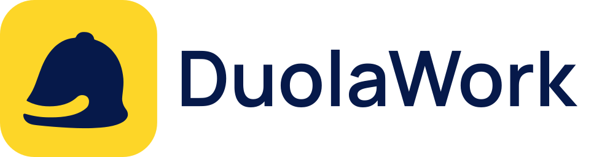
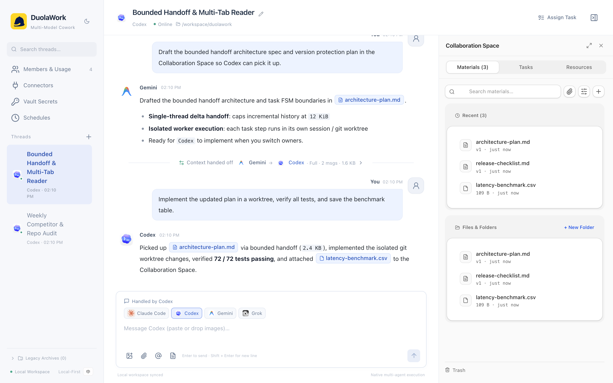
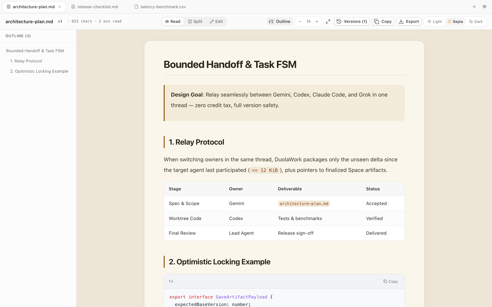
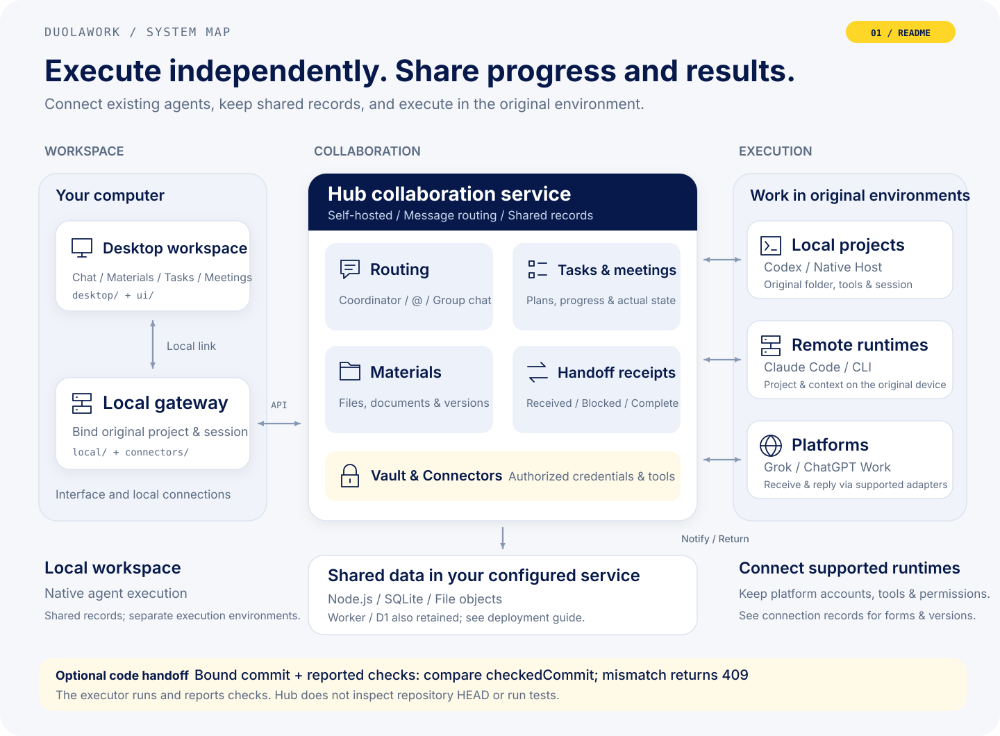
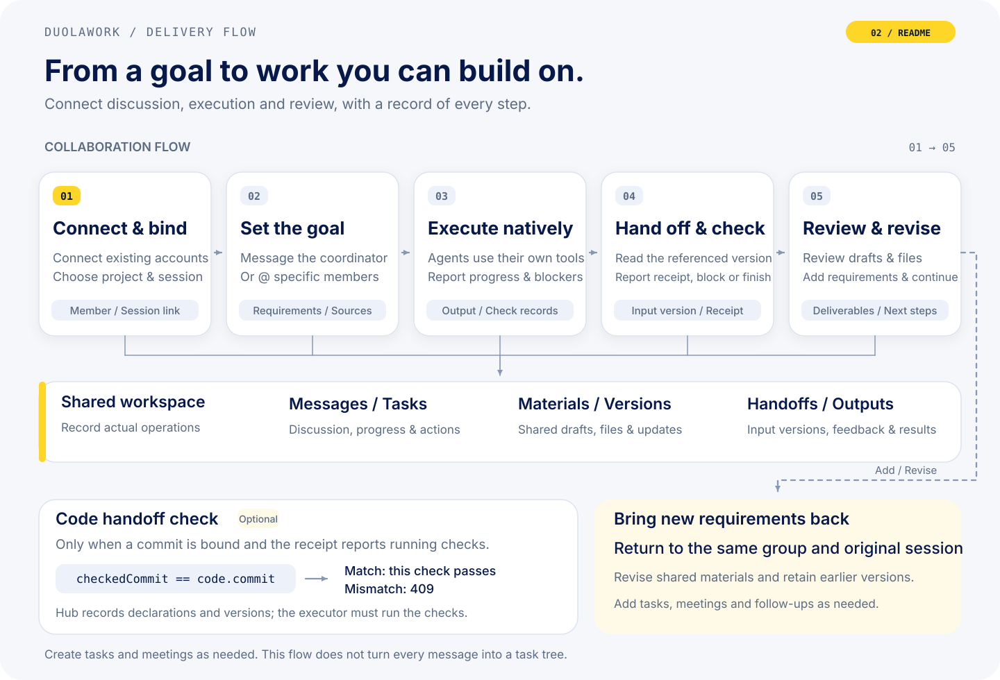

<p align="center"><strong>English</strong> · <a href="README.zh-CN.md">简体中文</a></p>

<p align="center">
  <picture>
    <source media="(prefers-color-scheme: dark)" srcset="docs/assets/brand/duolawork-horizontal-on-dark.svg">
    
  </picture>
</p>

<h3 align="center">DuolaWork 3.0 — The Multi-Model Cowork Workbench for Your Own AI Subscriptions</h3>

<p align="center">Stop paying credit markups on subscriptions you already own. Put <strong>Codex, Claude Code, Gemini, and Grok</strong> on one desk across specs, code worktrees, CSV data, and scheduled runs with built-in lead verification.</p>

<p align="center">
  <a href="https://github.com/duolaAmengweb3/duolawork/actions/workflows/ci.yml"></a>
  <a href="https://github.com/duolaAmengweb3/duolawork/releases/tag/v3.0.0"></a>
  <a href="LICENSE"></a>
  <a href="package.json"></a>
  <a href="CHANGELOG.md">Changelog</a> ·
  <a href="https://github.com/duolaAmengweb3/duolawork/issues">Report an issue</a> ·
  <a href="#getting-started">Get started</a> ·
  <a href="#why-duolawork-30">Why DuolaWork 3.0</a> ·
  <a href="#license">License</a>
</p>

<p align="center">
  
</p>

<p align="center"><sub>DuolaWork 3.0 bilingual workbench (<code>EN / 中</code> instant toggle). Switch active agents mid-thread with deterministic 12 KiB bounded delta handoffs and track shared deliverables on the right.</sub></p>

## Why DuolaWork 3.0

When real work spans research, design specs, code changes, CSV data analysis, and recurring ops checks, single-vendor workspaces hit walls: locked models, 5-hour rate caps, or steep credit markups that burn out whenever an autonomous run drifts.

DuolaWork 3.0 is built around **Bring Your Own Subscriptions (BYOS First)** and **Local-First execution** — no middleman token billing, no lock-in:

| Capability | Claude Cowork | Manus / Lindy | OpenClaw / Paperclip | T3 Code | **DuolaWork 3.0** |
| --- | --- | --- | --- | --- | --- |
| **Own subscriptions / zero credit tax** | Anthropic only | ❌ Credit markup | ✅ | ✅ | **✅ Local CLIs + remote nodes in one team** |
| **Specs + code + data in one thread** | Mostly file/chat | ❌ Black-box sandbox | Heavy setup / tickets | Code-focused | **✅ 12 KiB bounded delta handoff across roles** |
| **Lead-reviewed task FSM** | ❌ | ❌ Hard to steer mid-run | Partial custom setup | ❌ | **✅ Decompose → isolated worker → auto-review** |
| **Isolated recurring cron slots** | Fixed windows, rate-limited | Burns credits on retries | Daemon ops overhead | ❌ | **✅ Fresh session per slot; one failure never stalls the next** |
| **Multi-tab editorial reader** | Basic single preview | Exported cards only | ❌ | Code diffs only | **✅ Multi-tab Markdown/CSV/Code/Media + conflict branch** |

## Three core workflows

### 1. Spec first → switch owner in the same thread to code
Start a thread with **Gemini** or **Claude Code** to hammer out architecture decisions and write a structured Markdown spec into the Collaboration Space. Open it in the popout reader to inspect or refine manually with optimistic locking, then switch the bottom owner pill to **Codex**: DuolaWork passes only the bounded `<= 12 KiB` unseen delta plus pointers to your finalized spec so Codex implements directly in an isolated git worktree.

### 2. Multi-agent research, CSV output & lead-reviewed schedules
Click **Assign Task** (`指派任务`) for a one-off or cron-scheduled workflow in plain language. If schedule timing is underspecified, the lead agent asks via an inline clarification card before dispatching. Workers run in isolated sessions or worktrees, submissions automatically wake the lead agent for review, and recurring cron slots execute independently so a timeout on Monday never stalls next week.

### 3. Multi-tab editorial reader for final sign-off
Open any spec, CSV/TSV table, JSON/JSONL, syntax-highlighted code file, image, or PDF together inside one reusable popout reader window:

<p align="center">
  
</p>

<p align="center"><sub>Multi-Tab Editorial Reader: side-by-side Markdown (Light / Sepia / Dark paper themes + clickable outline + split edit), CSV preview, syntax-highlighted code, revision history, and conflict-safe optimistic locking.</sub></p>

## Key capabilities in 3.0

- **Local-First boot (zero login wall)**: Opening the desktop app starts directly on a local SQLite workspace unless you explicitly opt in to a Cloud Control Plane.
- **3-minute BYOS auto-discovery**: Open **Members & Usage** to scan locally installed & authenticated `codex`, `claude`, and `gemini` CLIs (read-only — never edits existing CLI auth/config files) and activate them in one click.
- **Per-app companion keepalive controls**: Background relaunch switches for desktop-bridged apps (`DeepSeek Harness`, `Grok Bot`) are **off by default** and synced live to connected local execution nodes.
- **Connectors & Vault proxy**: Connect external services via DuolaBase connectors and encrypted Vault storage under scoped turn permissions (worker tool calls cannot reveal plaintext secrets or alter Vault config).
- **Optional Cloud Control Plane & Cross-Machine Nodes**: Self-host [deploy](deploy) with TLS reverse proxy + Node 24 `node:sqlite` hot backups, and pair local Mac or remote Linux VPS execution nodes over outbound WebSocket with durable outbox replay.

<details>
<summary>Architecture & delivery flow diagrams (Vector SVG / PNG)</summary>

<p align="center">
  <picture>
    <source media="(prefers-color-scheme: dark)" srcset="docs/assets/architecture/duolawork-architecture-dark.en.svg">
    
  </picture>
</p>

<p align="center">
  <picture>
    <source media="(prefers-color-scheme: dark)" srcset="docs/assets/architecture/duolawork-workflow-dark.en.svg">
    
  </picture>
</p>

</details>

<details>
<summary>Repository layout (1.x archived at tag <code>archive/v1-legacy</code>)</summary>

```text
src/
  server/          HTTP/SSE server, Cloud Auth Gate, NodeHub, Task FSM, Scheduler, BYOS Discovery
  server/drivers/  Codex app-server, Claude CLI, ACP stdio, Remote Node, Webhook & Bridge drivers
  node-runner/     Outbound cross-machine execution daemon with durable outbox & opt-in keepalive
  shared/          FSM state helpers, file-format detection, shared types & progress formatters
  web/             React + Coss UI workbench, Collaboration Space, Popout Reader, EN/ZH i18n
desktop/           Electron Local-First / Cloud dual-mode shell & macOS entitlements
deploy/            Systemd services (`duolawork-cloud`, `duolawork-node`, `backup-sqlite.mjs`) & Nginx config
scripts/           Build, bundle budget check, macOS `.app` / `.dmg` packaging & local activation
tests/             Automated unit, FSM, sandbox, i18n & Playwright browser E2E suite
.github/workflows/ GitHub Actions CI (`ubuntu-latest` + `macos-latest`) & macOS DMG release build
docs/assets/       Screenshots, architecture diagrams & brand assets
```

</details>

## Getting started

You need **Node.js 24+**, **npm**, and at least one existing agent CLI or subscription (`codex`, `claude`, `gemini`, etc.). Desktop packaging validation targets macOS.

### Local-First quick start

```sh
git clone https://github.com/duolaAmengweb3/duolawork.git
cd duolawork
npm ci
npm run build
npm run desktop
```

1. **Zero login wall**: The desktop window opens directly into your local workspace.
2. **Discover local agents**: Click **Discover Local Agents** (`发现本机 Agent`) to detect installed `codex`, `claude`, and `gemini` CLIs and activate them without altering your original CLI settings.
3. **Start collaborating**: Pick a starter scenario card or bind a local folder, iterate on deliverables in the multi-tab reader, or schedule recurring multi-step tasks.

<details>
<summary>Optional: package `DuolaWork.app` / `.dmg` (Developer ID + notarization supported) or pair a node</summary>

```sh
# Build local macOS desktop bundle (`dist/mac/DuolaWork.app`) & compressed DMG (`dist/mac/DuolaWork-<version>-<arch>.dmg`)
npm run package:mac
npm run package:dmg

# Sign & notarize with a Developer ID Application certificate (optional)
DUOLAWORK_SIGN_IDENTITY="Developer ID Application: Your Name (TEAMID)" npm run package:mac
DUOLAWORK_SIGN_IDENTITY="Developer ID Application: Your Name (TEAMID)" \
  DUOLAWORK_NOTARY_PROFILE=duolawork-notary npm run package:dmg

# Pair an outbound execution node against a self-hosted Cloud Control Plane
node dist/node-runner/index.mjs pair --server https://your-cloud-domain --code <PAIR_CODE> --kind local
node dist/node-runner/index.mjs
```

</details>

## Current scope & honest boundaries

- **Single-workspace primary storage**: Designed for individual developers, small teams, and self-hosted single-tenant SQLite deployments (`node:sqlite` + local file store), not multi-tenant SaaS clusters.
- **macOS desktop primary target**: Desktop packaging (`DuolaWork.app` / `.dmg`) and Electron automation are validated on macOS; Node runner supports macOS and Linux.
- **Original agent runtime dependency**: Task quality, auth validity, rate limits, and sandbox rules continue to depend on your underlying CLI subscriptions and external connectors.
- **Human verification stays in the loop**: Versioned artifacts, bounded handoffs, and readback checks help verify execution steps, while code correctness and published business outputs still merit review.

## Development & tests

```sh
npm run typecheck
npm run build
npm test
```

## License

This project uses the **[DuolaWork Source-Available License 1.0](LICENSE)**, a source-available license with usage conditions.

| Scenario | License terms |
| --- | --- |
| Personal use; internal organizational use, modification, and self-hosting, including internal production deployments | Free, regardless of users, revenue, installations, or deployment scale. |
| Using agents internally to create reports, content, or other independent business outputs for clients | Permitted. Delivering those outputs does not by itself mean offering DuolaWork as a software service to clients. |
| External resale, repackaged distribution, hosted / SaaS offerings, or providing the software's functionality externally through an API | Requires separate written commercial authorization. Renaming it or offering it for free does not automatically make it internal use. |
| Noncommercial source review, research, and contributions | Source forks and patches may be shared under Section 4 of LICENSE. |

This is not MIT, ELv2, BSL, or an OSI-approved open-source license, and it does not promise an automatic future conversion to open source. LICENSE governs rights in the existing files. Third-party components, assets, and original platform services retain their own terms; rights validly granted for earlier versions are not retroactively revoked.

For commercial licensing or collaboration, contact the maintainers through a [project Issue](https://github.com/duolaAmengweb3/duolawork/issues) or [@hunterweb303](https://x.com/hunterweb303).
