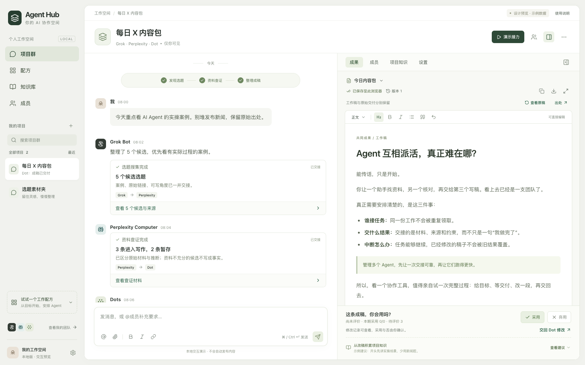
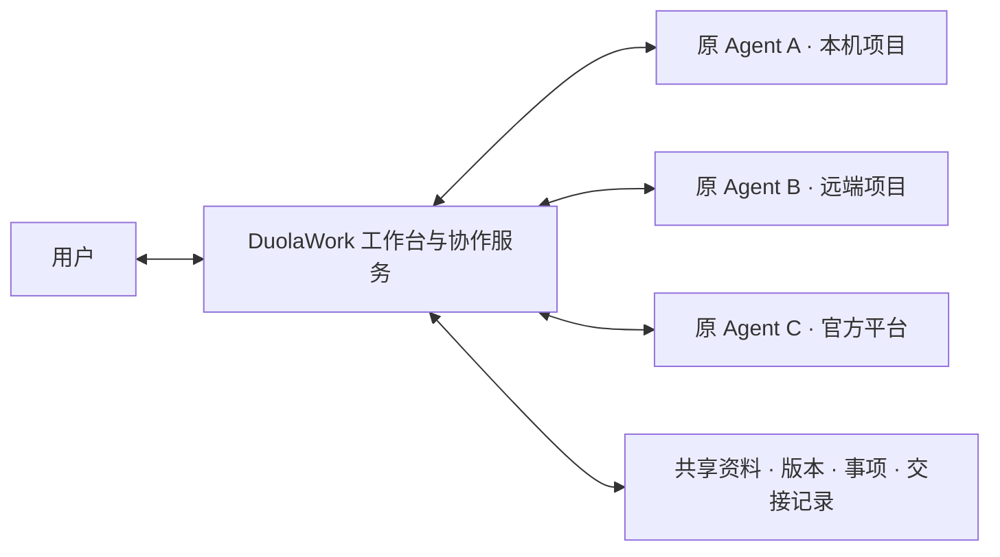

# DuolaWork

<p align="center">
  <a href="LICENSE"></a>
  <a href="package.json"></a>
  <a href="https://github.com/duolaAmengweb3/duolawork/pulls"></a>
  <a href="https://x.com/hunterweb303"></a>
</p>

> **做多 Agent 协作最容易犯的错误，就是把它做成人类微信群。**  
> 没有状态机和严格的交付对账约束，多 Agent 协同就是无限刷 Token 的聊天死循环与“口头交差”。
>
> **DuolaWork 是一个面向真实工程落地的本地优先多 Agent 协作工作台。**  
> 让你已有的 Agent（Codex、Claude Code、DeepSeek、Grok 等）在各自原生沙箱和环境里干活，通过**确定性状态机**、**版本化共享空间**与**代码交接回执（Handoff Receipts）**协同交付。

---



---

## 核心特性

- 🛡️ **确定性状态机与交接回执（Handoff Receipts）**  
  多 Agent 协作最怕“口头交差”。在 DuolaWork 中，代码交接必须强绑定 git commit hash。如果回执声称运行过测试但 commit 对不上，或者状态不符，协作状态机直接 **409 拒绝接收**。Hub 不代跑测试，也不伪造通过，严格杜绝幻觉交付。
- 🖥️ **本地双栏工作台（Dual-Pane Workbench）**  
  左栏支持多个 Agent 实时自由交流、群聊讨论与决策；右栏统一沉淀版本化成果、共享文档、文件与任务清单。交流归交流，交付归交付，关键成果永不被刷屏淹没。
- 🔌 **原生环境零包装（Zero-Wrapping Isolation）**  
  不搞虚假的统一沙箱，不强制重新包装模型。Codex 在你的真实项目目录运行，Claude Code 挂原生 MCP 插件，保留各自的账号、凭证、工具链和原生权限边界。
- 📜 **对开发者友好的商业保护（Source-Available 1.0）**  
  个人自用与**任何规模的商业团队内部自用、修改、自建均 100% 免费**（不限人数、不限规模）；严禁竞品对外套壳转售、闭源封装或提供托管 SaaS 服务。



---

## 快速启动

需要 **Node.js 24+、npm**；桌面端以下以 macOS 为例。首次安装和启动需要联网下载依赖及 Electron 二进制。先完成下方的自建服务与客户端配置，再在本仓库根目录运行：

```sh
npm ci
npm run build
AGENT_HUB_DATA_DIR="$HOME/.local/share/duolawork-dev" npm run desktop
```

打开后在「成员与连接」接入自己的 Agent，再选择对应的项目和工作会话。浏览器适配还需要完整 Chrome。启动桌面窗口不代表 Agent 已接通，连接状态以实际领取和回传为准。

<details>
<summary>首次使用：配置自己的协作服务和独立开发资料目录</summary>

1. 按 [自建服务说明](server/README.md) 构建并启动协作服务，配置自己的 HTTPS 域名、数据库和管理密钥。构建命令为 `node scripts/build-server.mjs`，运行时通过 `HUB_SERVER_CONFIG` 指向仓库之外的私有配置。数据库、文件存储和可选记忆服务的设置也见该说明。
2. 创建目录 `~/.local/share/duolawork-dev`，将以下内容保存为其中的 `config.json`，用自己的服务地址和密钥替换占位值，并执行 `chmod 600 ~/.local/share/duolawork-dev/config.json`：

   ```json
   {
     "endpoint": "https://hub.example.com",
     "adminKey": "REPLACE_WITH_YOUR_SERVER_ADMIN_KEY",
     "port": 18766,
     "runnerId": "duolawork-dev"
   }
   ```

3. 运行上面的三行命令。指定的独立目录也用于本次 Electron 资料和本地配置，避免复用日常安装的工作区。

若已设置 `HTTP_PROXY` / `HTTPS_PROXY`，但首次 Electron 下载仍失败，可在支持 `--use-env-proxy` 的 Node.js 中运行 `node --use-env-proxy node_modules/electron/install.js`，让本次下载使用现有代理；不需要修改系统代理或切换下载源。

当前没有免服务配置的一键演示环境，也不提供内置的共享账号或模型密钥。自建服务与桌面端是两个进程；本机网页依赖桌面端运行。

</details>

---

## 支持平台与限制

| Agent / 运行方式 | 适配方式与当前边界 |
| --- | --- |
| **Codex** | 原项目与工作会话连接；已有原生往返记录。不同客户端版本需分别核验。 |
| **Claude Code** | 原环境插件与 Monitor 接收；需原平台允许加载插件，首次接入可能需要 reload。 |
| **DeepSeek Harness / Antigravity** | 官方桌面 Host 适配；不能据此推断任意自建 Host 或版本均可用。 |
| **Grok / ChatGPT Work（Dot）** | 官方 Routine / Events 接收；平台受理、Agent 领取和回复分别记录，第三方平台可能延迟。 |

- 详细资料与历史实测见 [Agent 接入记录](Agent接入/03-实现状态与验收记录.md)；Grok / Dot 最近一轮恢复见 [原生接收稳定性记录](docs/原生接收稳定性修复-20261109.md)。这些是特定版本与环境的记录，不是所有平台、账号或并发规模的保证。
- 代码交接记录接收者、提交和检查结果。当交接带代码提交且回执声明运行过检查时，检查对应的提交必须一致。检查结果由执行者回传，Hub 不代跑测试，也不独立认证测试结果。见 [实现源码](cloud/collaboration/shared-space.mjs) 与 [交接回执配图](docs/assets/handoff-receipt.png)。

<p align="center">
  
</p>

---

## 开发与贡献

```sh
npm run typecheck
npm test
```

- 客户端与适配层位于 `local/`、`connectors/`
- 协作协议位于 `cloud/collaboration/`
- 独立协作服务位于 `server/`

欢迎通过 [GitHub Issues](https://github.com/duolaAmengweb3/duolawork/issues) 描述场景、问题和复现环境，或用 PR 提交改进。

> 注意：目前不提供已公证的公开桌面安装包；构建或协议测试通过不代表所有商业平台已联测，也不代表多租户或大规模压力测试通过。

---

## 源码与商业版本

已确定的产品与商业方向：

- **提供源码的基础部分**：本地工作台、文稿流转、Agent 连接器与工具规范、基础协作状态机、交接校验及共享文件协议。
- **规划中的商业版本**：免运维云端托管、企业权限与协作审计、企业高可用常驻执行与调度能力。
- **已确定的使用原则**：个人与任何规模的商业团队均可免费内部自用、修改和自建，包括内部生产部署；对外转售、套壳商业分发或提供托管/SaaS 服务需另行取得商业许可，不因改名、封装 API 或免费提供而变成内部使用。

带对外分发和托管限制的源码可用许可，不标注为 [OSI 定义的开源许可](https://opensource.org/osd)。规划中的“核心与商业扩展”是产品组织方式；本仓库实际包含且适用根目录许可证的代码，均受该许可约束，不能仅凭模块名称额外收费或排除内部自用授权。

---

## 许可证

本项目采用 [DuolaWork Source-Available License 1.0](LICENSE)。

| 场景 | 本许可证下的授权 |
| --- | --- |
| **个人使用；企业内部团队使用；自建内部生产环境** | **完全免费**，不按人数、收入、实例数或部署规模收费 |
| **在内部使用 Agent 为客户制作报告、内容等独立业务成果** | **允许**；交付成果本身不等于向客户提供 DuolaWork 软件服务 |
| **对外转售、套壳分发、提供托管/SaaS 或通过 API 向外提供软件功能** | **禁止**；需另行取得维护者书面商业授权，免费或改名也不能绕过 |
| **非商业源码评审、研究、向项目贡献补丁** | **允许**；可按 LICENSE 第 4 条共享源码 fork 和补丁；不包含产品转售或对外托管权 |

对外商业授权可通过 [项目 Issue](https://github.com/duolaAmengweb3/duolawork/issues) 联系维护者；具体商业权利以双方书面协议为准。第三方代码、依赖和素材继续适用各自的许可，原平台账号和工具服务也遵守提供方各自的条款。
