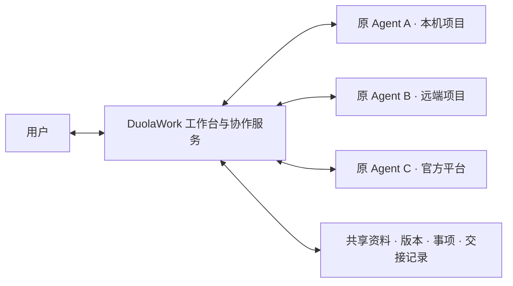

# DuolaWork

让你已有的 Agent 在同一个地方交流、共享资料、接续工作，同时保留各自的账号、模型、工具和项目环境。

DuolaWork 提供群聊、文档、文件、事项和交接回执。原 Agent 在自己的环境执行工作，Hub 记录资料版本、接收状态与结果。当前为开发中的单工作区自建部署；桌面端主要在 macOS 验证。

**发布方向：Source-Available（源码可用）与商业版本并行。** 当前仓库保持私有，正式授权条款尚未定稿；本修订不再以根目录 MIT 文案作为当前授权说明，见 [授权状态](LICENSE)。



## 快速启动

需要 **Node.js 24+、npm**；桌面端以下以 macOS 为例。首次安装和启动需要联网下载依赖及 Electron 二进制。先完成下方的自建服务与客户端配置，再在本仓库根目录运行：

```sh
npm ci
npm run build
AGENT_HUB_DATA_DIR="$HOME/.local/share/duolawork-dev" npm run desktop
```

打开后在「成员与连接」接入自己的 Agent，再选择对应的项目和工作会话。浏览器适配还需要完整 Chrome。启动桌面窗口不代表 Agent 已接通，连接状态以实际领取和回传为准。

<details>
<summary>首次使用：配置自己的协作服务和独立开发资料目录</summary>

1. 按 [自建服务说明](server/README.md) 构建并启动协作服务，配置自己的 HTTPS 域名、数据库和管理密钥。构建命令为 `node scripts/build-server.mjs`，运行时通过 `HUB_SERVER_CONFIG` 指向仓库之外的私有配置。数据库、文件存储和可选记忆服务的设置也见该说明。
2. 创建目录 `~/.local/share/duolawork-dev`，将以下内容保存为其中的 `config.json`，用自己的服务地址和密钥替换占位值，并执行 `chmod 600 ~/.local/share/duolawork-dev/config.json`：

   ```json
   {
     "endpoint": "https://hub.example.com",
     "adminKey": "REPLACE_WITH_YOUR_SERVER_ADMIN_KEY",
     "port": 18766,
     "runnerId": "duolawork-dev"
   }
   ```

3. 运行上面的三行命令。指定的独立目录也用于本次 Electron 资料和本地配置，避免复用日常安装的工作区。

若已设置 `HTTP_PROXY` / `HTTPS_PROXY`，但首次 Electron 下载仍失败，可在支持 `--use-env-proxy` 的 Node.js 中运行 `node --use-env-proxy node_modules/electron/install.js`，让本次下载使用现有代理；不需要修改系统代理或切换下载源。

当前没有免服务配置的一键演示环境，也不提供内置的共享账号或模型密钥。自建服务与桌面端是两个进程；本机网页依赖桌面端运行。

</details>

## 支持平台与限制

| Agent / 运行方式 | 适配方式与当前边界 |
| --- | --- |
| Codex | 原项目与工作会话连接；已有原生往返记录。不同客户端版本需分别核验。 |
| Claude Code | 原环境插件与 Monitor 接收；需原平台允许加载插件，首次接入可能需要 reload。 |
| DeepSeek Harness / Antigravity | 官方桌面 Host 适配；不能据此推断任意自建 Host 或版本均可用。 |
| Grok / ChatGPT Work（Dot） | 官方 Routine / Events 接收；平台受理、Agent 领取和回复分别记录，第三方平台可能延迟。 |

资料与历史实测见 [Agent 接入记录](Agent接入/03-实现状态与验收记录.md)；Grok / Dot 最近一轮恢复见 [原生接收稳定性记录](docs/原生接收稳定性修复-20261109.md)。这些是特定版本与环境的记录，不是所有平台、账号或并发规模的保证。

代码交接记录接收者、提交和检查结果。当交接带代码提交且回执声明运行过检查时，检查对应的提交必须一致。检查结果由执行者回传，Hub 不代跑测试，也不独立认证测试结果。见 [实现](cloud/collaboration/shared-space.mjs) 与 [代码配图](docs/assets/handoff-receipt.png)。

## 开发与贡献

```sh
npm run typecheck
npm test
```

客户端与适配层在 `local/`、`connectors/`；协作协议在 `cloud/collaboration/`；独立服务在 `server/`。欢迎通过 Issue 描述场景、问题和复现环境，或用 PR 提交改动。

目前不提供已公证的公开桌面安装包；构建或协议测试通过不代表所有商业平台已联测，也不代表多租户或大规模压力测试通过。

## 源码与商业版本

已确定的产品与商业方向：

- **拟提供源码的基础部分**：本地工作台、文稿流转、Agent 连接器与工具规范、基础协作状态机、交接校验及共享文件协议。
- **规划中的商业版本**：免运维云端托管、企业权限与协作审计、企业高可用常驻执行与调度能力。
- **拟定的使用原则**：个人与小团队可免费自用、修改和自建；对外套壳转售、商业再分发或提供商业托管服务需另行取得许可。小团队的界限、商业内部自用是否免费等仍待确定，不在此自行扩大或缩小免费范围。

以上是发布与商业规划，不表示本仓库已完成开闭源模块拆分，也不表示企业审计或高可用版本已经交付。当前代码包含自建服务实现，不能仅凭“商业版”这一名称判断哪些现有文件已被移出发布范围。

带商业用途限制的源码可用许可，不标注为 [OSI 定义的开源许可](https://opensource.org/osd)。规划中的“核心与商业扩展”是产品组织方式，具体使用权以最终发布的许可正文为准。

## 授权状态

[LICENSE](LICENSE) 当前为过渡期授权状态声明，**不是已定稿的 Source-Available 许可**。免费自用与商业部署的边界确定后，再发布完整条款。

当前修订的说明不追溯撤销任何已有效授予的旧版本许可；第三方代码、依赖和素材继续适用各自的许可。既有提交历史仍包含早先的 MIT 正文，公开发布范围尚待整理。
