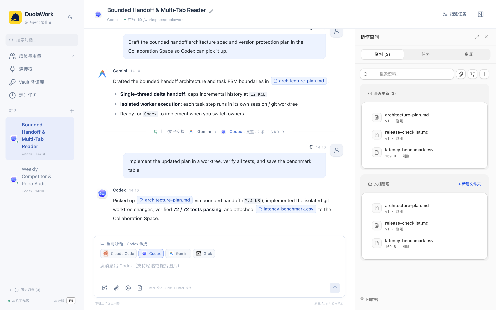
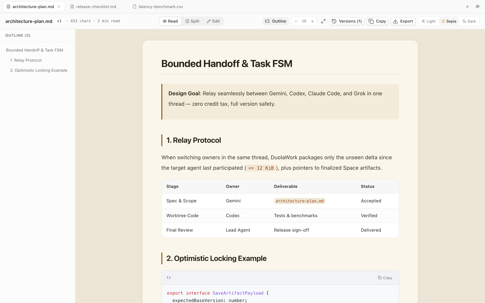
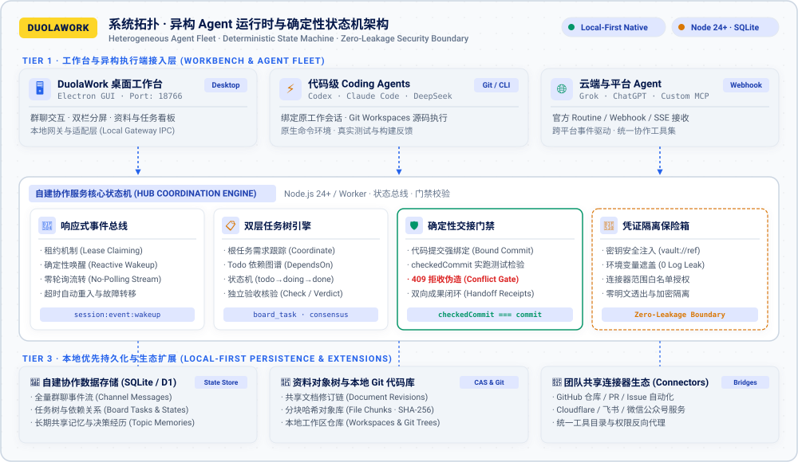
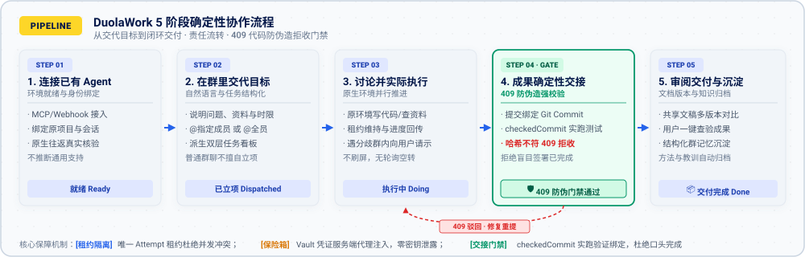

<p align="center"><a href="README.md">English</a> · <strong>简体中文</strong></p>

<p align="center">
  <picture>
    <source media="(prefers-color-scheme: dark)" srcset="docs/assets/brand/duolawork-horizontal-on-dark.svg">
    
  </picture>
</p>

<h3 align="center">DuolaWork 3.0 —— 自带订阅的多 Agent 桌面协作台（Multi-Model Cowork）</h3>

<p align="center">你已经买了 Codex、Claude Code、Gemini 和 Grok，别再为单一工作台交第二份“积分税”。让多个 AI 成员在同一张桌子上讨论方案、切分支写代码、产 CSV 数据表、跑定时验收并在多标签阅读器里精排交付。</p>

<p align="center">
  <a href="https://github.com/duolaAmengweb3/duolawork/releases/tag/v3.0.0"></a>
  <a href="LICENSE"></a>
  <a href="duolawork2.0/package.json"></a>
  <a href="CHANGELOG.md">更新日志</a> ·
  <a href="https://github.com/duolaAmengweb3/duolawork/issues">反馈问题</a> ·
  <a href="#开始使用">开始使用</a> ·
  <a href="#为什么选择-duolawork-30">产品对比</a> ·
  <a href="#许可证">授权说明</a>
</p>

<p align="center">
  
</p>

<p align="center"><sub>DuolaWork 3.0 中英双语工作台（左下角 <code>EN / 中</code> 一键切换并持久化）。左下角切换当前对接成员时自动带入有界增量上下文，右侧沉淀可协同审阅的文稿与数据。</sub></p>

## 为什么选择 DuolaWork 3.0

当真正的工作横跨「调研定方案 → 写代码跑测试 → 分析 CSV/JSON → 周期巡检交付」时，单家产品往往会撞上限流或算力抽成墙。DuolaWork 3.0 坚持 **BYOS First（自带已有官方订阅，零积分抽税）** 与 **Local-First（本机开箱即用）**：

| 能力维度 | Claude Cowork | Manus / Lindy | OpenClaw / Paperclip | T3 Code | **DuolaWork 3.0** |
| --- | --- | --- | --- | --- | --- |
| **自带订阅 / 零积分税** | 仅 Anthropic 生态 | ❌ 黑盒积分与月费抽成 | ✅ | ✅ | **✅ 本机 CLI + 远端节点原生混编** |
| **方案 / 代码 / 数据同桌接力** | 偏桌面文件与对话 | ❌ 黑盒长链难半途接管 | 偏重工单与脚本运维 | 专注写代码 | **✅ 同线程 `<= 12 KiB` 有界增量接力** |
| **负责人自动拆单与验收** | ❌ | ❌ | 需复杂自定义 | ❌ | **✅ 内置确定性任务拆单与打回验收状态机** |
| **定时跨期独立隔离** | 固定时钟，易触限流 | 重试极易烧光积分 | 守护进程配置成本高 | ❌ | **✅ 每期独立会话，单期异常不卡下一期** |
| **多标签精排文档/数据阅读器** | 单文件基础预览 | 仅报告卡片导出 | ❌ | 仅代码 Diff | **✅ 单窗口多标签 Markdown / CSV / 代码 / 冲突分支** |

## 三大核心工作流

### 1. 方案定稿 → 同线程切人开分支写代码
在 `+ 新对话` 里先让 **Gemini** 或 **Claude Code** 梳理想法并在右侧协作空间生成结构化 Markdown 方案；在多标签独立阅读器里审阅或手工改稿保存（乐观锁防覆盖）；随后直接在左下角切换当前负责人为 **Codex** —— 系统静默带入 `<= 12 KiB` 增量上下文与最新定稿指针，Codex 直接在独立 Git Worktree 改代码并跑通测试。

### 2. 跨成员调研 + CSV 产出 + 负责人定时自动验收
点击顶部「指派任务」，用自然语言描述一次性或循环定时任务；若周期未说清，负责人会先通过内置追问卡向你确认再立项。多步骤分别在各自隔离会话执行并由负责人自动核验回传，循环任务按每期独立隔离，单期超时失败绝不堵死后续调度。

### 3. 多格式成果集中审阅（多标签独立阅读器）
协作空间中的任意文档、CSV/TSV 数据表、JSON/JSONL、源码、图片与 PDF 都可集中在同一个可复用独立阅读器窗口并排查看与编辑：

<p align="center">
  
</p>

<p align="center"><sub>多标签独立阅读器：支持浅色 / 护眼 / 深色纸张主题、自动提取目录大纲、分屏/编辑模式、修订版本历史、乐观锁冲突分支与全格式预览。</sub></p>

## 3.0 关键工程能力

- **Local-First 开箱即用（零登录墙）**：安装打开 `DuolaWork.app` 默认启动本机 SQLite 工作台，直接进入协作工作区。
- **3 分钟零配置 BYOS 自动发现**：进入「成员与用量」自动探测本机已安装且已登录的 `codex`、`claude` 与 `gemini`（只读检测，不改动你原有的 CLI 配置），一键接入成员。
- **桌面伴生应用保活可控开关**：针对桌面连接器（`DeepSeek Harness`、`Grok Bot`）的后台自动拉起默认关闭，可在「成员与用量 → 桌面伴生应用自动保活」按应用独立开关并实时同步本机执行节点。
- **连接器与 Vault 凭证代理**：外部工具权限与明文凭证隔离保管在 Vault，执行成员沙盒调用无法反查明文或越权改写。
- **可选云端控制面与跨机执行节点**：提供完整的 [duolawork2.0/deploy](duolawork2.0/deploy) 部署配置（HTTPS 反代 + Node 24 `node:sqlite` WAL 热备份）及本机/VPS 外连 WebSocket 执行节点守护。

<details>
<summary>架构与交付流程图（矢量 SVG / PNG）</summary>

<p align="center">
  <picture>
    <source media="(prefers-color-scheme: dark)" srcset="docs/assets/architecture/duolawork-architecture-dark.svg">
    
  </picture>
</p>

<p align="center">
  <picture>
    <source media="(prefers-color-scheme: dark)" srcset="docs/assets/architecture/duolawork-workflow-dark.svg">
    
  </picture>
</p>

</details>

<details>
<summary>仓库目录结构（3.0 主工程与 1.x 历史归档）</summary>

```text
duolawork2.0/
  src/
    server/          HTTP/SSE 控制面、云端登录鉴权、NodeHub、任务状态机、调度器、BYOS 自动发现
    server/drivers/  Codex app-server、Claude CLI、ACP stdio、Remote Node 与桥接驱动
    node-runner/     跨机外连执行节点（持久化 outbox 重放、可开关桌面伴生保活）
    shared/          进度状态解析、文件格式识别、共享类型定义
    web/             React + Coss UI 三栏工作台、协作空间、多标签阅读器、中英双语 i18n
  desktop/           Electron Local-First / Cloud 双模式桌面壳（DuolaWork.app）
  deploy/            systemd 服务配置（含 Node 24 sqlite WAL 热备）与 Nginx 反代示例
  scripts/           构建、前端体积门禁检查、macOS 打包与本机激活脚本
  tests/             自动化单元测试、状态机审计与 Playwright 浏览器端到端回归
cloud/, local/, ui/  早期 1.x Agent Hub 参考源码保留目录
```

</details>

## 开始使用

需要 **Node.js 24+**、**npm**，以及至少一个你已有的 Agent CLI 或订阅（`codex`、`claude`、`gemini` 等）；桌面打包验证当前以 macOS 为主。

### Local-First 快速启动

```sh
git clone https://github.com/duolaAmengweb3/duolawork.git
cd duolawork/duolawork2.0
npm ci
npm run build
npm run desktop
```

1. **免登录直接进工作台**：桌面端默认启动本机工作区；
2. **发现本机 Agent**：点击引导里的「发现本机 Agent」，扫描并一键启用你已装好的 Codex / Claude Code / Gemini CLI；
3. **开始协作交付**：选择首屏场景卡或绑定本地目录，在多标签阅读器里定稿，或把复杂/周期工作交给负责人拆单验收。

<details>
<summary>可选：打包 `DuolaWork.app` 或配对跨机执行节点</summary>

```sh
# 打包 macOS 桌面应用（产物位于 duolawork2.0/release/DuolaWork.app）
npm run package:mac

# 将本机或 Linux VPS 作为执行节点接入自建云端控制面
node dist/node-runner/index.mjs pair --server https://你的云端域名 --code <配对码> --kind local
node dist/node-runner/index.mjs
```

</details>

## 当前边界

- **部署形态**：面向个人与自建单工作区团队（单节点 `node:sqlite` + 本地文件目录），当前不宣称多租户 SaaS 集群。
- **桌面端**：桌面打包（`DuolaWork.app`）与 Electron 测试主要在 macOS 验证；`node-runner` 支持 macOS 与 Linux。
- **原生运行时依赖**：实际产出质量、登录有效性、速率限制与工具沙盒仍取决于底层各官方 CLI 与连接器账号授权。
- **结果审阅**：版本保护、有界交接与回执核验帮助你核对过程与输入，重要代码和对外内容仍须人工最终把关。

## 开发与回归验证

```sh
cd duolawork2.0
npm run typecheck
npm run build
npm test
```

## 许可证

本项目采用 **[DuolaWork Source-Available License 1.0](LICENSE)**，属于带使用条件的源码可用许可。

| 场景 | 授权方式 |
| --- | --- |
| 个人使用；企业内部自用、修改和自建，包括内部生产部署 | 免费，不按人数、收入、实例数或部署规模收费。 |
| 内部使用 Agent 为客户制作报告、内容或其他独立业务成果 | 允许；交付这些成果本身不等于向客户提供 DuolaWork 软件服务。 |
| 对外转售、套壳分发、提供托管 / SaaS，或通过 API 向外提供软件功能 | 需要另行取得书面商业授权；改名或免费提供不自动成为内部使用。 |
| 非商业源码评审、研究和贡献补丁 | 可按 LICENSE 第 4 条共享源码 fork 和补丁。 |

它不是 MIT、ELv2、BSL 或 OSI 认可的开源许可，也没有约定未来自动转为开源。现有文件的权利以许可证为准；第三方组件、素材和原平台服务继续适用各自条款，已有效授予的旧版本许可不被追溯撤销。

商业授权与合作请通过 [项目 Issue](https://github.com/duolaAmengweb3/duolawork/issues) 或 [@hunterweb303](https://x.com/hunterweb303) 联系维护者。
