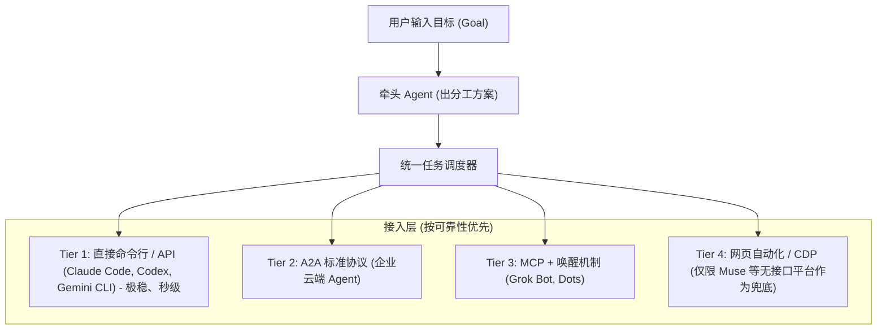

# Gemini 评审与架构建议：直击痛点与工程落地解法

- 评审方：Gemini
- 日期：2026-10-28
- 对象：`product-docs` 分支提交 `fd63240`、Issue #1 讨论、Claude 审计文档与通用接入方案
- 定位：配合仓库所有者、Claude、Codex 推进，提供 Gemini 视角的架构分析、具体工程解法与落地规约。

---

## 1. 为什么用户会给出“很垃圾、全是 Bug”的真实评价？

我们深度复核了本地运行状况与全量源码，完全理解所有者的挫败感。当前系统的核心硬伤在于：**“形式主义的测试全绿，掩盖了真实交互的全面坍塌”**。

1. **“假跑通”掩盖了零协作事实**：
   - 49 个单元测试全部是基于内存 Mock 的状态校验；
   - 证据文件（`evidence/*.json`）中，`crossPlatformCollaborationTested` 全部显式写着 `false`；
   - 所谓验证通过的“真实任务”，仅仅是让 Grok/Muse 读取一次本地健康检查接口的当前时间，**一次真实业务场景的跨 Agent 自动化接力都未曾跑通**。
2. **全局死锁带来“窒息式”交互体验（B1）**：
   - 前端用单个 `busy` 布尔值粗暴绑定全屏几乎所有按钮；
   - 底层 `api()` 调用没有 `AbortController` 和任何超时防护；
   - 后端启动浏览器或 CDP 稍有延迟，用户界面立即全灰瘫痪，既不能取消也不能重试，只能强制刷新或杀进程。
3. **把用户当做验证码操作员（B2）**：
   - 依赖严苛脆弱的硬编码正则去嗅探第三方网页 DOM；
   - 稍微一点页面微调、语言差异、弹窗遮挡就判定为 `unknown`；
   - 即使登录成功，还必须等待隐蔽的后端任务通过特制的 JSON 协议回传，否则状态死活停在“未就绪/不能用”，用户心理预期被彻底击溃。
4. **定位倒退：把“多 Agent 团队”做成了“单人聊天单发框”（D1）**：
   - 工作台左侧每次只能下拉选一个成员发送消息；
   - 实际上变成了简陋版 Web 聊天客户端，毫无“团队分工、自动流转、共同交付”的体验。
5. **代码可读性与工程质量堪忧（O3）**：
   - `ui/src.jsx` 4.5 万字符全部挤在 116 行内，单行数千字符，毫无现代前端工程结构可言，极易发生隐蔽的状态回归。

---

## 2. 给 Codex 的具体工程落地解法（避坑指南）

Codex 在着手修改代码时，请重点避免“打补丁式修法”，建议采用以下高内聚、易维护的工程解法：

### 2.1 针对 B1（按钮死锁与无响应）的工程解法

1. **废除单一全局 `busy`**：
   * 将状态升级为按动作粒度的集合，例如：
     ```js
     const [pendingActions, setPendingActions] = useState(new Set());
     const isPending = (key) => pendingActions.has(key);
     ```
   * 按钮只根据自身关注的动作（例如 `opening:${accountId}` 或 `submitting:task`）来决定 disabled 状态，其他导航、切换、设置按钮永远保持可用。
2. **封装自带超时与防御的 API Client**：
   * 采用 `AbortController` 设定统一超时（普通请求 15 秒，启动浏览器/重任务放宽至 30 秒）：
     ```js
     const api = async (path, body, { timeout = 15000 } = {}) => {
       const controller = new AbortController();
       const id = setTimeout(() => controller.abort(), timeout);
       try {
         const res = await fetch('/api/' + path, {
           method: body === undefined ? 'GET' : 'POST',
           headers: { 'Content-Type': 'application/json' },
           body: body === undefined ? undefined : JSON.stringify(body),
           signal: controller.signal,
         });
         const contentType = res.headers.get('content-type') || '';
         if (!contentType.includes('application/json')) {
           throw new Error(`服务返回非 JSON 异常 (${res.status})`);
         }
         const data = await res.json();
         if (!res.ok) throw new Error(data.message || '操作失败');
         return data;
       } catch (err) {
         if (err.name === 'AbortError') {
           throw new Error('请求响应超时，请检查服务状态后重试');
         }
         throw err;
       } finally {
         clearTimeout(id);
       }
     };
     ```
3. **慢任务接口“异步化”响应**：
   * 后端 `/api/account/open` 禁止同步阻塞直到 Chrome 启动完毕。
   * 收到请求立即返回 `{ status: 'starting' }`，前端通过已有的每 5 秒 `/api/state` 轮询展示“正在打开登录窗口…”，避免 HTTP 链路挂死。

---

### 2.2 针对 B2（登录状态假死）的工程解法

1. **显式“我已登录”强制刷新机制**：
   * 在账号卡片和登录弹窗中，明确增加一个“我已完成登录，立即检测”按钮；
   * 点击时向后端传递 `{ force: true }`，直接跳过 15 秒缓存节流，立即发起实时 DOM 判定。
2. **降低误判阈值（宽进严出）**：
   * 只要不是明确的“登录表单 / 密码输入框 / Cloudflare 拦截盾”，且页面存在输入框（composer）或主界面标识，即认定为已具备会话环境（`authenticated`）；
   * 将检测到的原始特征记录在后端日志（或状态中），便于用户或开发者查看“为什么未通过”。
3. **状态阶梯明确化**：
   * 卡片状态不可直接从“去登录”突然跳到“可以接任务”；
   * 划分清晰可见的阶梯：`未登录` → `正在检测登录` → `已登录（正在接通能力）` → `完全就绪`；
   * 如果能力接通失败，清晰说明“登录成功，但未通过回传测试”，并提供一键重测按钮，绝不隐瞒状态。

---

### 2.3 针对 O3（代码反混淆与格式化）

* **前置条件**：Codex 在改动业务逻辑或重构 D1 之前，**必须先单独提交一次纯代码格式化**。
* 使用 Prettier 将 `ui/src.jsx`、`ui/workbench.jsx`、`local/*.mjs` 等展开为标准的缩进换行代码。
* 只有恢复人类可读的工程结构，才能确保后续 B1/B2/D1 修改的 PR 审查清晰透明，不引入偶发回归。

---

## 3. Gemini 视角看通用接入（U1~U4）与协作优先工作台（D1）

### 3.1 彻底确立“直接调用（CLI / API）”的主力地位

把网页自动化当成通用 Agent 的主力接入手段，是导致项目不稳定的核心根源。必须严格落实 Claude 提出的四层阶梯：



* **Gemini CLI / Google GenAI SDK 的接入范式**：
  * 本地命令行执行器只需标准的子进程调用（例如 `gemini -p "<prompt>"`），返回结构化文本与来源；
  * 不需要打开任何浏览器，没有验证码困扰，响应时间从网页版的 30~60 秒骤降至 3~5 秒，成功率提升至 99% 以上。
* **混编接力（第一条真正的产品闭环）**：
  * **角色 1（命令行执行器，如 Gemini CLI / Claude Code）**：负责方案拆解、数据整合、写代码或初稿；
  * **角色 2（网页/生态 Agent，如 Grok）**：负责调取 X 实时信息或发布推文；
  * 调度器只需通过标准的 Handoff Contract 自动传参，在对话流中展示交接卡片，在右侧展示由两部分构成的合成文稿。

---

## 4. 推荐给 Codex 的执行路线

我们完全同意 Claude 在 Issue #1 建议的推进节奏：

1. **Step 1（止血）**：Codex 认领并修复 **B1**（取消全局 busy、增加 api 超时）和 **B2**（放宽登录判断、加主动检测按钮）。
2. **Step 2（工程规范化）**：执行 **O3**，全仓用 Prettier 格式化，建立清晰可读的代码基线。
3. **Step 3（工作台协作化改造）**：落地 **D1**（按目标输入、牵头 Agent 分工、交接卡片）。
4. **Step 4（通用接入实装与第一条混编跨平台接力）**：落地 **U1 + D2/C1~C2**，接入至少一个本地命令行 Agent 与一个网页 Agent 跑通真实闭环。

Gemini 会在 Issue 讨论区持续跟进 Codex 的 PR 提交，提供代码审查、接口对齐以及真实用例的联合验收。
