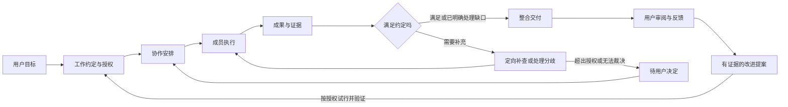

# Agent Hub 2.0 改版方案

版本：2.0 评审稿 v1｜2026-10-29｜作者：Codex

**产品定义：把用户已有的原生 Agent 组织起来，围绕目标自主推进工作；让用户看懂分工、掌握重要决定、拿到可用成果，并让有效经验进入下一次工作。**

本文件是功能、交互、视觉、工程改造和验收的统一方案。它承接管理学研究，也纳入之前被打断的 UI 改版。当前完成的是方案，软件尚未按本稿改造；提出评审不等于所有评审者已同意。

“2.0”是本轮产品改版名称，不是新建一套账号或强制把现有 `/v2` 接口改成 `/v3`。

## 0. 先看本轮确定什么

| 决定 | 2.0 的做法 |
|---|---|
| 产品核心 | 目标、协作、交付、改进连成一条可实际运行的路径 |
| 开始方式 | 用户先说目标；工作模板是可选捷径，不要求先理解“运行配方” |
| 协作方式 | 一人完成、并行独立后整合、顺序接力、执行加复核；可以组合，执行前形成明确安排 |
| 成员 | 保留各家原生 Agent 的账号、模型、工具和工作能力；同类多成员、混合团队都适用 |
| 日常空间 | 项目群聊看协作，宽幅成果区做审阅；入口稳定，状态真实，改稿不跳走 |
| 管理机制 | 工作约定、有限授权、独立输入、分歧处理、证据与版本、规则试行与撤回 |
| 学习方式 | 用具体失败和反馈提出改进；改动有范围、有执行位置、有检查结果 |
| 完整交付 | 功能、视觉、操作体验、原生接入、升级生效分别验收；任何一项未过，不能宣布整版交付 |

首个验收项目使用用户现有研究组织的工作需求；它是测试案例，不把 Grok、dot、Muse 三个名字、三人数量或新闻内容写死成产品结构。

### 0.1 和已有文档的关系

本稿评审通过后，作为 2.0 实施主入口；旧方案保留历史出处，不再同时指挥开发。下列材料各有用途：

- [Agent 管理学方法论](../Agent管理学/方法论.md)：解释机制为什么值得尝试，不充当功能完成记录。
- [组织产品提案](../Agent管理学/产品方案.md)：上层方向；本稿把它落到动作、状态、界面和验收。
- [Claude 功能清单 F1–F12](https://github.com/duolaAmengweb3/agent-hub/issues/7#issuecomment-6489583035)：本轮功能骨架，修正后的取舍见第 2 节。
- [UI 联合评审 #6](https://github.com/duolaAmengweb3/agent-hub/issues/6)：视觉与交互问题及各方意见；沿用已收敛的设计方向，不照单叠加互相矛盾的建议。
- [Lauren Tan 案例与源码拆解](../Agent管理学/调研文档/13-LaurenTan访谈拆解-从验证到授权.md)：证据、授权和规则执行的补充依据。

原生账号保护、凭证不入 Git、不碰云端 VPS 的订阅 Claude Code、不擅改 Codex provider、真实状态和升级验证等既有约束继续有效。

## 1. 用户究竟得到什么

### 1.1 五个用户动作

1. **说目标**：“每天帮我找到值得动手试的 AI 新用例。”
2. **确认工作安排**：看懂交什么、谁参与、为何分工、何时交付、哪些事能自动做；必要时直接改。
3. **让团队推进**：成员领取、交付、互相求证；普通交接自动进行，只把重要取舍交给用户。
4. **看成果和作决定**：读依据、处理分歧、编辑、采用、弃用或交回指定成员。
5. **改进下一次工作**：系统提出有证据的改进，按授权试行；保留有效做法，撤回无效做法。

用户不需要填写内部步骤 ID、学习 MCP、复制每位成员的结果，或逐条解释同一背景。平台无法自动完成的首次授权，产品给出准确入口和明确下一步，不冒充已经接通。

### 1.2 什么情况下值得协作

| 任务情况 | 建议安排 | 用户可修改的内容 |
|---|---|---|
| 一位成员已具备完整能力，任务上下文集中 | 一人完成 | 执行者、是否增加关键复核 |
| 多个方向能独立调查，需扩大覆盖或保留不同判断 | 并行独立后整合 | 分工角度、共享材料、整合者、汇合条件 |
| 上一步产物是下一步必需输入 | 顺序接力 | 步骤、交接条件、责任人 |
| 事实或操作错误代价较高 | 执行加复核 | 核验范围、复核者、返工条件 |

安排按目标、资料入口、实测能力与可用性建议，不按厂商品牌永久贴岗位。一个成员可以在不同项目承担不同职责；并行是工作结构，同账号资源冲突时仍需排队，界面说明原因。

### 1.3 保持范围明确

本轮交付包括持续目标、上述四种协作、证据交付、分歧、规则学习，以及全部配套页面和恢复机制。暂不建设模板市场、层层 OKR、复杂组织架构图、跨组织交易或通用外部支付/发布执行器。

这不取消运行保护：并发、有限重试、讨论上限、截止时间和已知额度限制属于本轮必需能力。未知 token 费用显示未知，不编造成本；“不做财务预算系统”不等于允许无限运行。

## 2. 当前实际基础与必须改动的地方

本轮核对基线：后端 PR #5 的 `837c637e02472285aec8e4999e9acd63da145c15`；UI 原型基线 `c6682ec`，视觉收敛材料 `9d26144`；研究文档 `0910a5e`。下面的“已有”指代码基础，不代表本轮已重新实测部署和商业账号。

| 编号 | 功能 | 实际基础 | 2.0 改动与纠正 |
|---|---|---|---|
| F1 | 成员与身份 | 已有成员凭证、账号归属和独立工具调用 | 补清楚身份、接入、能力、唤醒方式的展示与真实联测；不能把网页登录当就绪 |
| F2 | 成员授权 | 已有 owner/member 边界和部分批准关卡 | 新增按动作及项目约束的授权；UI 可提供简洁预设，底层不能只是三级数字 |
| F3 | 目标约定 | 当前以固定配方和 topic 为主 | 新增可版本化目标、成果标准、参与者、节奏和生效方式 |
| F4 | 协作方式 | 常规流程只有 discover→verify→write；另有单步补充/修订 | 改为依赖明确的工作图，支持并行、汇合和定向复核，保留单步工作 |
| F5 | 独立阶段 | `read_document` 目前按项目成员权限读取 | 增加运行/阶段/材料版本级访问控制，覆盖文档、附件、消息与适配器输入 |
| F6 | 证据交付 | 有正文、来源、稿件版本；当前至少 1 个产物，shortfall 会进入待处理 | 增加有效空结果、部分交付和阻塞的区分；核验绑定产物版本和标准 |
| F7 | 讨论与分歧 | @ 可增加工作，未形成分歧对象和裁决流程 | 定向唤醒、分歧归类、证据轮次、停止与升级；不承诺所有平台立即响应 |
| F8 | 汇总取舍 | 目前主要靠成员写作指令 | 增加结构化取舍记录、关键未决项与交付标准检查 |
| F9 | 审阅与反馈 | 已有改稿、版本、返工及采用反馈，反馈关联版本 | 补反馈原因、编辑冲突与新版本预览；统一宽幅审阅路径 |
| F10 | 规则库 | **已有项目/全局范围、revision、知识历史、批准撤回及运行快照** | 继续复用；补试行、生效时点、验证条件、执行位置和冲突处理，不从零重写 |
| F11 | 改进提案 | 有有限的 emoji 修改信号及成员提议 | 改为一般性反馈证据与改进提案；不把三次删除表情推成通用文风能力 |
| F12 | 运行记录 | 已有 run/attempt/activity、幂等与不明状态；当前每日单时间点 | 补多时间点、独立阶段、分歧、规则应用与操作权限记录，保留真实时间 |

关键源码：[配方](https://github.com/duolaAmengweb3/agent-hub/blob/837c637e02472285aec8e4999e9acd63da145c15/shared/recipes.mjs)、[执行引擎](https://github.com/duolaAmengweb3/agent-hub/blob/837c637e02472285aec8e4999e9acd63da145c15/cloud/collaboration/engine.mjs)、[工具读取权限](https://github.com/duolaAmengweb3/agent-hub/blob/837c637e02472285aec8e4999e9acd63da145c15/cloud/collaboration/api.mjs)、[现有接口说明](https://github.com/duolaAmengweb3/agent-hub/blob/837c637e02472285aec8e4999e9acd63da145c15/docs/协作后端接口与验收.md)。

### 2.1 对 Claude 清单的明确取舍

- 采纳 F1–F12 的功能覆盖；不把当前 GitHub 流程直接当新产品模板。
- 三轮可以是研究模板的默认讨论上限，允许按项目调整；达到时间、资源上限或没有新证据也可以提前停止。
- “0 条”是允许表达的结果。只有约定允许且有实际搜集记录时，才可能算合格；不能把没有执行包装成空结果。
- “输入隔离”要落实到全部 Hub 读取路径，不只从领取响应里删几个字段；不能证明原 Agent 在平台外没有见过其他资料。
- 授权预设不能掩盖原 Agent 自带工具的权限边界。Hub 只能保证它控制的入口；无法约束的外部动作不宣传为已封锁。
- 不用“各跑两周”证明因果。先做确定性场景验收，再在可比任务中记录结果、任务差异与人工负担；期限不是充分样本的保证。

## 3. 功能合同：触发、系统行为、异常与结果

### F1–F2：接入成员及授权

**用户路径：** 全局“成员”→添加成员→选平台→按产品维护的官方入口连接→系统完成真实往返核验→设置备注与项目授权。

同类平台可添加多位成员；一个账号下多个原生 Agent 只有在平台确实支持时才对应不同身份。改名不改账号 ID、profile、凭证或历史归属。产品提供平台入口，自定义平台才允许填写自定义地址。

成员展示四件事：是谁、能做什么、怎么被唤醒、现在能否工作。接入状态分为未连接、授权中、待验证、可接任务、需处理；“可接任务”必须附真实调用证据及时间，配置存在不算通过。

授权 UI 提供“准备成果”“更新项目资料”“申请对外操作”预设，同时显示实际动作清单。准备成果包含提交自己的工作结果，不等于能覆盖别人的稿件或批准规则。项目资料更新限定对象与范围；对外操作若没有实际受控适配器，显示能力未接入，按钮不能给出虚假的执行许可。

有效权限来自所有者授权、当前项目范围和平台能力的交集。模型建议、成员投票、历史成功率都不能提升权限。内容中的指令、外部来源和成员消息不能改写授权；真正的用户变更走经认证的命令。

授权撤销立即阻止 Hub 新派发、读取和副作用；已被原平台接受的动作单列状态，不能声称已撤回外部世界。接入故障只影响相应成员及依赖任务；保留成果，不自动换账号、换模型或重新登录。

### F3：目标约定

**触发：** 新建项目、用户修改目标、定期复查发现目标过时。

用户只写目的，选择可参与成员或接受建议。具备真实连接的牵头成员拟定结构化约定，包含：目标与用途、产物、合格条件、输入资料、参与者和责任、节奏/截止时间、授权范围、空结果与未决项政策。程序检查必填项、能力与权限是否匹配，不让模型把无法执行的安排直接启动。

没有可用牵头成员时，允许用户填写简短工作约定或保存草稿；明确是手动/模板创建，不冒充 AI 已分析。一般背景从已有项目取得，只有影响结果或权限的缺失项才问用户。

首次按约定启动后，后续同一授权内的例行工作自动运行，不每次要求用户确认一遍。

**中途修改的默认语义：** 新约定用于下一轮；用户可明确选择“当前轮也调整”。此时暂停受影响的未派发任务，牵头成员提交影响清单，程序生成新计划版本。已经发出的外部任务先核对，迟到结果保留但不自动纳入新计划。不相关成果继续复用并记录来源。紧急暂停和权限撤销立即生效，不等待下一轮。

### F4：协作安排与自动推进

**触发：** 目标约定确认、当前安排失效、用户要求改分工。

牵头成员提出少量可执行工作项及理由；程序验证无环依赖、责任唯一、参与者可用、输入有来源、汇合条件明确、资源可满足。一个工作项只有一位交付责任人，可请求协作者；“牵头”不等于所有内容都由同一 Agent 生成。

工作图中的步骤通过明确的前置关系推进：并行分支互不等待，汇总等待约定的必要输入。可选分支失败不应冻结无关工作；必要分支失败则显示缺少什么，并提出补查、替补、缩小成果或交用户决定的选项。

汇合条件明确列出必要分支、可选分支、截止时间和部分输入政策。必要输入未满足不能靠“已有两票同意”越过；可选分支到截止未交付时，按事先约定带缺口继续。汇合固定所用成果版本，迟到的新成果成为补充候选，不暗中修改已经形成的判断。

多平台执行沿用原生通道，每个成员只有一种当前生效通道。重复通知不会重复领取；同账号资源共享同一并发限制；调整安排不会复制正在执行的任务。

**不是默认自主扩编：** 新增成员、扩大访问范围或超出运行额度需要相应授权；已有授权内的有界补查可自动进行。每轮保留安排快照，历史不会随着新模板变化。

### F5：独立研究与资料隔离

**触发：** 当前计划选择“并行独立”，或复核需要避免提前看到他人的结论。

在派发前冻结共同事实、评价标准、各自研究角度和允许资料版本，生成每位成员的输入清单。不同成员可共享事实，独立阶段不共享其他成员的结论或以结论为基础写出的摘要。

所有读取都检查当前成员、任务/阶段、对象版本与可见性：领取、读文档、读附件、消息摘要、知识注入、适配器拼接的输入保持一致。仅有项目成员资格，不足以读取所有材料。错误响应不泄漏被隔离文档的标题或正文。

用户可查看项目全貌，但下发给成员的始终是成员身份的凭证与资料，不借用用户权限绕过独立阶段。历史重试和续领也须重新核对当前授权，不能仅凭曾经获得过链接继续读。

完成时留存交付版本、实际下发的资料清单和读取记录；达到约定汇合条件后，才按授权释放结果给整合/讨论环节。未完成的独立任务不会因为另一位提前交付就自动看到结果。

原平台如果复用已有上下文、共享记忆或能在外部仓库读到材料，Hub 不能证明其绝对独立。UI 使用“Hub 输入已隔离”，同时标明新会话/复用会话是否可控；不能统一写“完全独立”。验收至少证明 Hub 控制范围内没有泄漏，不以提示词承诺代替权限检查。

### F6：成果、空结果与证据

提交必须表达四种语义之一：有成果、有效空结果、部分成果、执行阻塞。任务状态和用户是否采用分别保存。

| 提交类型 | 必要内容 | 系统处理 |
|---|---|---|
| 有成果 | 正文/真实文件、对应来源、未覆盖事项 | 按本任务标准检查，产物和证据固定到版本 |
| 有效空结果 | 搜集范围、实际动作/来源、未发现原因、是否覆盖约定范围 | 只有标准允许且覆盖足够才通过；下游可形成“本轮无新发现”，不强写稿 |
| 部分成果 | 已完成内容、缺口、对下游影响 | 按事先约定接受部分或请求补查，不能悄悄改成全完成 |
| 执行阻塞 | 哪个访问/工具/前置条件失败，已有证据 | 进入相应处理，不把断网、没权限当成没有信息 |

证据关联具体产物版本、论断/检查项、来源版本或采集时间、检查者和结果。来源 URL 有效只是结构检查，不等于事实成立。程序检查结构和版本；成员对事实与推理给出依据；用户评价用途与偏好。

新稿或关键来源变化后，旧核验保留历史身份，不自动继承“已验证”；未变部分可以在明确范围内复用。文件必须真实存储并可取回，不能只记录一个临时链接就当交付。

### F7：定向讨论、分歧与待决定

**触发：** 用户 @成员、成员发现重要冲突、必要交付不能满足约定。

普通消息作为讨论记录；明确工作请求创建有身份和范围的工作项。成员可在项目允许的参与者内请求协助，程序核对权限、去重、依赖和剩余额度；没有授权的新成员只能成为建议。

分歧条目保存问题、类型、各方主张及证据、影响的成果、下一步、裁决责任和结束条件。事实分歧优先补证；推理分歧比较假设与反例；偏好/目标冲突由相应授权者决定；工具和权限问题按运行异常处理。

一轮讨论指“本轮指定参与者的回应完成或截止”，不是消息数量。重复观点、重试、系统提示不增加轮数。研究模板可默认最多三轮，并配置总耗时与补查额度；没有新证据时提前收束。标准可以自动判断的直接执行；仍有价值取舍或重要未知时汇成一条待决定，不制造连续弹窗。

待决定项一次展示问题、影响、选项、建议和依据。用户可选择方案、要求定向补查、保留未知、调整目标或停止；选择记录到项目并使相应依赖继续推进。

唤醒状态按平台实际区分“等待触发”“平台已受理”“已领取”“执行中”。Muse 这类当前采用轮询的通道显示下次检查信息，不承诺立即叫醒。关闭窗口或离线不把尚未发生的动作显示为进行中。

### F8：整合与取舍

整合者收到约定输入和分歧处理结果，交付最终成果及重要取舍：哪些观点/材料被采用、哪些未采用、依据是什么、哪些仍未知。普通内容不要求每一句都重复署名，重点记录改变结论的选择。

“冲突已处理”可以是证据裁决、并列条件结论、明确保留未知，或交由用户决定；不要求所有成员同意。未解决的关键问题若影响约定目标，应标部分交付/待决定；与目标无关的争论不无限阻塞。

整合检查同时验证成果标准和取舍记录是否覆盖必要分歧；语义质量不能靠字段齐全自动证明。最终结果可以是文稿、研究报告、决策清单或文件，不写死三篇 X 稿。

### F9：审阅、改稿与反馈

从项目列表的“审阅成果”或成果卡进入宽幅审阅；单击项目主体始终进入群聊，不根据待审数量偷偷改变目的地。

用户可直接编辑、看来源与版本、复制导出、采用/弃用、交回任一有权成员。反馈绑定实际评价版本，可附原因；无反馈保持未评价，复制导出不自动计入采用。

“交回修改”在文稿旁展开，显示稿件、工作稿版本、接收成员、空白要求输入框。可选取文字作为关注范围，但**发送的权威上下文仍为完整工作稿快照**；不将它包装成已实现永久批注线程。发送前先确保当前修改可靠保存，失败则保留输入并阻止发送旧稿。

发送成功后留在同一稿件、同一阅读位置，项目群记录对应请求；不同稿件的未发要求分别保存。新回复成为候选版本，不覆盖当前工作稿。用户可预览差异、应用候选或保持当前稿；应用采用 revision 校验。发送后继续编辑造成冲突时，保留共同基线、当前稿和候选稿，展示对比并允许人工选择/继续合并，不静默替换或自动猜测合并。

采用候选版本与“这份成果是否有用”的采用反馈是两种动作，文案分别为“应用此版本”和“采用成果”。红绿标记只提供显示，不承担并发合并正确性。

### F10–F11：规则与改进

项目知识下分“资料”“规则与改进”。全局知识库支持按项目筛选；工作模板引用明确规则版本，不复制失去来源的散文。

一条规则包含：正文/规则类型、来源和证据、项目或全局范围、版本、执行位置、提出/批准人、生效时间、试行范围、验证点、状态、撤回方法。投票记录可作为依据，不代替有权人的批准；明确授权给成员的局部决定按授权执行并留痕。

规则状态为草稿→待批准→试行/生效→复查→保留、修订或撤回；新版本不重写旧记录。已批准的试行规则会在其试行范围内执行，不能因为不叫“生效”就从注入逻辑漏掉。

注入遵循确定条件：项目范围、任务类型、有效时间、规则版本与显式标签。冲突规则先按权限和范围处理；同权同范围冲突不靠模型任意择一，生成待决定。外部材料和普通交付不能成为指令优先级更高的新规则。

程序可执行的规则落到实际检查器，如幂等、版本、隔离和必需字段；不能编译成检查器的风格与判断规则作为指引，展示其执行方式。自然语言批准不等于允许系统任意运行生成代码。

改进提案来自具体失败、返工和用户反馈，包含原因假设、最小修改、预期、副作用及验证方法。相似提案去重，不为展示“进化”每轮凑一条。批准后只在指定范围试行；到验证点自动收集执行与结果证据。确定性的程序规则可自动判定通过，主观质量/证据不足则进入复查，不自动宣告有效。

撤回立即停止新任务应用该规则；已下发的任务明确记录旧版本，必要时按当前轮变更机制处理。每次批次保留实际应用版本，用户能看到“下一次到底改了什么”。

### F12：日程、运行记录与恢复

每个项目可有多个时间点与明确时区；北京时间 06:00、12:00、19:00 是可配置示例。一次性运行和日程使用同一引擎。每次触发有唯一计划时间标识，记录计划、入队、平台受理、领取、交付、下游开始及真实失败原因。

项目默认不重叠运行。上一批未结束时合并为一个最新待运行请求并保留被合并的时间记录；用户可选择跳过政策。过期批次不无限补跑。恢复后按项目允许的最大延迟处理最新一批，保留应执行时间与实际执行时间，不倒填。

确定未被平台接受的失败可按有界退避重试；是否接受不明时先查原任务。租约过期不自动证明旧 Agent 已停止，不能立即再付费启动一份。用户暂停后停止新派发，外部任务已在运行的继续核对；恢复先对账再推进。

重要完成、失败和待决定通过应用内收件和徽标汇总；系统通知由用户开启，后台不抢焦点。运行记录支持搜索和按项目导出脱敏证据；原平台没有返回的成本、进度或取消状态保持未知。

## 4. 一条完整用户旅程

示例：用户创建“AI 新用例观察”，选择已有研究成员与一个整合者。

1. 在“新建项目”输入目标。牵头成员提出每天三次、并行调查不同来源后整合的安排，允许无新发现，重要来源冲突需处理。
2. 用户修改一个评价标准并开始。系统保存目标和工作图版本，检查每位必要成员的真实连接、权限和资源。
3. 三个独立任务进入各自队列。群里显示真实领取与简洁进展，右侧仅显示已存在的成果，不能提前出现占位成稿。
4. 一位成员找到新案例，一位发现它是旧案例重发，第三位因访问失败交部分结果。系统保留各自证据，访问失败不计成没有新信息。
5. 汇合后对新旧判断形成事实分歧，定向补证；若能确认，按证据处理；否则在成果中保留不确定性或按影响交用户决定。
6. 整合者交出可用候选、理由与未覆盖范围。用户直接进入审阅，改一段，交回指定成员，继续读其他成果。
7. 新版本回来时提供预览。用户应用候选或保留自己的稿，评价是否采用并说明理由。
8. 多次出现“重发冒充新案例”时产生改进提案，建议增加事件时间核查。批准后限定试行，下一批留下新规则版本和实际检查证据。

同一套机制还要用一个非新闻任务验收，例如“比较两种产品方案并给出选择依据”，避免产品只能跑新闻演示。



图中的循环受时间、尝试次数和权限约束；没有新证据不会无限讨论。

## 5. UI 与交互：同一套软件、两种主要工作状态

### 5.1 信息架构与入口

| 位置 | 内容与主操作 | 必须保持的行为 |
|---|---|---|
| 窄全局导航 | 项目、待我决定、知识库、成员；底部个人设置 | 页面名称统一，不重复放一套团队入口 |
| 项目列表 | 搜索、新建、项目名称、需要关注的摘要、明确的“审阅”动作 | 点主体进群聊；点审阅进成果，点击结果不随状态猜变 |
| 项目页头 | 单行项目名、本群成员、当前重要状态、更多菜单 | 高约 56px；更多是真正的菜单，不暗中跳设置 |
| 项目工作区 | 讨论为主，成果概览按窗口宽度展开 | 工作方式和当前分工可查看，不常驻大面积流程图 |
| 成果审阅 | 成果列表、宽正文、来源/版本/交回侧栏 | 关闭侧栏不退出审阅；返回群聊有统一文字入口 |
| 项目资料 | “资料”“规则与改进”，待处理数量可见 | 关闭提醒不删除入口，不把规则藏在聊天历史里 |

“新建项目”只有一个流程：说目标，可选已有工作模板预填。模板可搜索、预览、保存当前安排为模板；入口位于新建项目和项目设置，不再用官网式大卡片推广“5 个选题/3 篇成稿”。旧配方能力以“工作模板”延续，不要求用户先选模板才能开始。

“成员”是全局接入管理；项目里的叫“本群成员”。账号连接、成员备注、项目职责与授权分开展示，不在登录弹窗里要求填写岗位描述。平台同类成员使用不同备注和稳定身份，头像不代替身份校验。

### 5.2 已有概念图如何纳入本轮

下面两图沿用前次视觉收敛，属于 AI 生成的布局参考，不是已经实现的截图，也没有被视为用户最终批准。图里仍是旧的三步内容案例；2.0 要替换为本稿的目标与可选协作方式，保留阅读密度和空间关系。


[原 UI 取舍与图示说明](https://github.com/duolaAmengweb3/agent-hub/blob/9d26144/docs/ui-review-20261029/README.md)。真实实现以本稿的组件、状态和操作规范为准，不按生图里的错误字数、换行或尺寸硬抄。

### 5.3 项目群聊状态

```text
┌──────┬───────────────┬─────────────────────────────┬──────────────────┐
│ 全局 │ 项目列表      │ AI 新用例观察 · 本群成员  … │ 成果 / 项目资料  │
│ 导航 │ 搜索 / 新建   ├─────────────────────────────┤                  │
│      │ 项目 A        │ 当前安排：并行研究 → 整合   │ 已交成果列表     │
│      │ [审阅 2 份]   │ 用户要求                    │ 待审阅 / 有缺口  │
│      │ 项目 B        │ 成员真实进展与紧凑交接      │                  │
│      │               │ 重要分歧与明确处理结果      │ 来源与简洁预览   │
│      │               │ 最终成果 [审阅成果]        │ [打开审阅]       │
│      │               ├─────────────────────────────┤                  │
│      │               │ 发消息 / @成员 / 附件 / 格式│ 规则与改进 · 1  │
└──────┴───────────────┴─────────────────────────────┴──────────────────┘
```

群聊以可扫读的成员发言和工作变化为主，不播放假思考过程、不索取模型私有思维链。显示真实任务摘要、使用材料、交付和取舍；技术日志按需展开。

普通交接采用约 56–72px 的紧凑可展开行：头像、谁交给谁、交付摘要、时间、查看材料；长标题允许增高。最终成果和需要用户决定的事项使用明确卡片。待决定卡展示选项与理由，不能只给“批准/拒绝”两个没有上下文的按钮。

运行安排以当前需要理解的内容出现；完成后收起重复进度。并行分支用并列成员状态，不画假的线性百分比。项目列表摘要表示“有新成果/需要决定/执行受阻”，与主区共同使用同一数据源，不反复刷成功勾号。

输入框支持 @、附件和真实格式操作。默认不铺满工具按钮，格式展开后作用于选区/光标；保留原有能力，不继续插入固定示例文字。中文输入法组词期间回车不误发送；Cmd/Ctrl+Enter 发送，普通 Enter 换行。

### 5.4 宽幅成果审阅状态

```text
┌──────┬──────────────┬────────────────────────────────┬────────────────┐
│ 全局 │ ← 返回群聊   │ 成果名 / 版本 / 出处 / 已保存 …│ 交回修改       │
│ 导航 │ 项目名       ├────────────────────────────────┤ 稿件及版本     │
│      │ 成果列表     │ 常用格式与撤销                 │ 接收成员       │
│      │ 01 …         ├────────────────────────────────┤ 修改要求       │
│      │ 02 …         │                                │ [发送] [取消]  │
│      │              │         可读、可编辑正文       │                │
│      │              │                                │ 相关材料与交接 │
│      │              ├────────────────────────────────┤                │
│      │ 规则与改进   │ 采用成果 / 弃用 / 交回修改      │                │
└──────┴──────────────┴────────────────────────────────┴────────────────┘
```

侧栏只有用户需要时打开；正文是主对象，不能同时永久摊开完整群聊、所有资料和管理面板。

- 顶部采用两层紧凑区域，目标 76–88px：成果与版本操作、常用格式。主要入口保留文字，不把所有操作挤成微图标。
- 文稿正文默认 16px，行高 1.65–1.8，阅读列约 640–820 CSS px；宽窗口不强行铺成一条超长行。正文内表格可局部横向滚动，整页不横向溢出。
- 底部使用约 48–56px 的不遮正文操作区；不使用透视文字的悬浮岛。较长修改输入放侧栏，不长期占据正文底部。
- 来源、原稿、版本和交回使用同一上下文侧栏体系，关闭恢复原阅读位置；不影响审阅模式。
- 新版本只提示“有新版本可预览”，不抢焦点。对比为独立只读视图，当前工作稿保持可恢复；格式复杂时明确显示整段变化，不能伪造逐字精确 diff。
- 多份成果按稳定 ID 保存选中项、滚动、选区、工作稿和未发要求；刷新和桌面重开不串稿。

### 5.5 管理功能的具体页面

| 页面 | 首屏内容 | 主要操作 | 必须覆盖的异常 |
|---|---|---|---|
| 新建项目 | 目标输入、成员选择、可选模板 | 起草安排、编辑约定、开始 | 无成员、成员不可用、生成失败、安排超权限 |
| 工作安排 | 目标、产物、协作方式、职责、节奏及简短理由 | 修改、按约定运行、应用到下一轮/当前轮 | 依赖无环校验失败、必要能力缺失、已有运行 |
| 待我决定 | 按项目聚合的分歧、权限与改进复查 | 查看依据、作决定、补查或停止 | 事项已过期/已被其他操作解决，禁止旧按钮执行 |
| 规则与改进 | 生效/试行/待批准/已撤回列表，范围与验证状态 | 查看来源、批准试行、复查、撤回 | 规则冲突、证据不足、验证失败、已撤回仍有旧任务 |
| 项目资料/全局知识 | 可搜索材料、来源、范围与有效性 | 新增、编辑、移除、查看引用 | 上传失败、无读取权、来源失效、同名不同版本 |
| 成员 | 头像、备注、平台、能力与接入状态、唤醒方式 | 添加、连接、诊断、暂停、编辑备注与授权 | 过期、平台不可用、轮询等待、忙碌、授权范围不足 |
| 运行详情 | 当前批次、工作图、关键事件、真实时间及失败 | 暂停/恢复、查看材料、处理不明状态 | 断网、原平台结果不明、迟到回复、重复通知 |
| 设置 | 日程/通知/本地运行状态、资料导出等 | 明确保存、更改后反馈 | 保存失败、本地执行端离线、未满足的前置条件 |

页面不是全部新增顶级导航。工作安排、运行详情、项目资料从项目进入；待决定和知识可在全局聚合。用户默认不用看内部状态机字段。

### 5.6 统一视觉规范

以飞书式协作工作台的秩序和密度为主，结合文档工具的阅读体验。以下为本项目拟定规范，不宣称是飞书的精确设计参数。

| 项目 | 规范 |
|---|---|
| 表面 | 主区白色，导航浅中性色；依赖细分隔与空间组织，不铺渐变和大量阴影 |
| 文字 | 主文字 `#1F2329`，辅助文字 `#646A73`；默认不使用低对比淡灰小字 |
| 强调色 | 统一蓝色，主按钮/链接拟用 `#245BDB`；真实组件逐项核对对比度，保留图示方向 |
| 字号 | 辅助 12px、界面 14px、正文 16px、页面标题 20px；文稿内部标题按层级适当更大 |
| 间距 | 4px 基础尺度，常用 8/12/16/24；同类页面复用相同密度与页头 |
| 圆角/边框 | 控件约 6px、卡片约 8px、1px 分隔；避免每块内容都套一层圆角容器 |
| 操作目标 | 常用按钮高至少 36px，独立图标命中区至少 32×32px；不以缩小按钮适配窄屏 |
| 状态 | 文字与图标共同表达，颜色辅助；加载、悬停、焦点、禁用、失败均有统一样式 |
| 品牌身份 | 有授权的官方图标可使用，否则统一字母头像加明确平台名；同类成员另有备注 |
| 文案 | 用户界面中文；“工作模板、审阅成果、返回群聊、交回修改、规则与改进”统一命名 |

文字对比度按 [W3C 说明](https://www.w3.org/WAI/WCAG22/Understanding/contrast-minimum.html)检查：普通文字至少 4.5:1，符合大字定义的至少 3:1。独立图标采用 32px 是项目目标；[WCAG 2.2 的目标尺寸条款](https://www.w3.org/WAI/WCAG22/Understanding/target-size-minimum.html)通常为 24px 且有例外，不能混称。

### 5.7 窗口与交互状态

- 1440×900 及以上：群聊可显示全局栏、项目列表、主区、约 320px 成果概览；主对话区域优先保留足够宽度。
- 1280×800：群聊成果概览默认按需打开；宽幅审阅保持正文优先，打开修改侧栏时可收起成果列表，而不是把正文压成窄缝。
- 1100px 以下：次要栏改为可关闭抽屉；低至 900px 做最低可用性检查。布局变化不改变项目/稿件/未发输入，用户主动关闭一栏不退出当前工作状态。
- 视觉基准使用 100% 缩放；另验 125% 与 150% 下无核心动作丢失。键盘焦点可见、弹层可退出，关闭后焦点回到触发控件。
- 页面切换不自动发送、批准或运行。加载时保留已有内容并标新鲜度；空状态告诉用户下一步；错误就地提供可执行恢复，不清空正文。
- 保存展示“本机已保留”“同步中”“已同步”“同步失败”真实区别；不能本地落盘就显示云端已保存。离线草稿不自动外发，恢复同步遇到版本变化进入冲突处理。
- 原型可保留一条集中示例标记，正式界面删除演示措辞；真实未连接、无权限、未同步信息仍须准确存在。

### 5.8 对之前 UI 争议的最终提案

采纳字号统一、重复入口清理、紧凑交接、明确成员和就地交回。保留可发现的项目知识/规则入口与真实格式能力。

不采用待审时自动改变项目入口、固定只能让 Dot 修改、半透明按钮遮字、把所有工具硬塞一行或自动覆盖工作稿。划词仅作为选择范围的便利方式，不依赖它完成基本操作；永久批注线程和多人实时 OT 不作为本轮实现前提。

此前“正文占 65%”继续作为默认审阅布局目标，不能用空白或隐藏功能凑数。视觉合格与交互合格分别检查，不用库名、自动测试或“高级感”一句话代替验收。

## 6. 工程方案：扩展现有基础，替换固定流程

### 6.1 技术边界

继续采用现有 Electron、本地 Node 服务、React/Vite、Tiptap、Cloudflare Worker/D1 与已有原生适配器。UI 的问题通过组件与交互改造解决，本轮不为外观迁移 Next.js。通用控件、颜色和间距收敛到项目组件层，不逐页手写互相不同的样式。

桌面负责交互、本地凭证与已有专用账号环境；云端维护协作状态、事件、版本和远程适配。原生 Agent 负责理解、研究、执行和判断。程序负责权限、依赖、幂等、状态、版本和时限；不能让模型一句“完成”直接修改所有状态。

不强制购买额外“经理模型”。牵头成员由用户已有可用 Agent 承担；没有可用成员时保留手动工作约定，不生成虚假 AI 方案。

### 6.2 数据对象及版本约定

复用现有账号/成员、project/run/step/attempt/document/version、knowledge/history、feedback、file、outbox；通过新增字段和少量独立记录扩展，不复制一套平行数据库。

| 对象 | 关键内容 | 写入与校验 |
|---|---|---|
| goal_version | 目标、产物标准、空/部分结果政策、节奏、依据、批准与生效范围 | 不可变版本；当前项目指向有效版本 |
| plan_version | 协作方式、责任、依赖、必要/可选分支、输入约定与运行限制 | 程序验证 DAG、成员能力与授权；运行持有快照 |
| input_manifest / visibility | 当前工作可见的资料版本、阶段与授权原因 | 派发前生成；每条读取路径实际检查 |
| member_grant | 项目、允许动作、目标对象、条件、有效期、撤销记录 | 由有权用户/既有授权流程更改；执行时重新校验 |
| delivery / verification | 提交语义、不可变产物版本、证据、检查标准与结论 | 核验指定版本；历史证明不漂移 |
| disagreement / decision | 主张、证据、类型、影响、轮次/时限、裁决与理由 | 轮次与结束条件由程序计算；模型不能自加权限 |
| rule / rule_evaluation | 复用 knowledge 的范围与历史，增加试行、执行位置、验证和冲突 | 每轮保存实际应用版本；与评估记录分开 |
| improvement | 失败证据、原因假设、变更、预期、副作用、批准及试行结果 | 可追溯、可撤回，不自评成功后自动升级 |
| schedule / event | 多时间点、时区、计划时间、去重键、积压政策与真实时间 | 可恢复且不重发不明副作用 |

状态变更沿用事务和 revision 检查。重复 requestId 且内容相同返回原结果；同 ID 不同内容拒绝。事务冲突有界重试，外部调用放事务外，通过 outbox/回执推进，不在数据库重试里重复调用模型。

当前工作区 CAS 可继续复用，但并行增加后必须检查争用、分页及现有 501 条读取保护。待办与历史分开索引查询，不能因为历史记录增长使活跃工作永久无法读取；压力验收通过后才声称支持相应并发规模。

### 6.3 运行状态与版本失效

工作项内部主状态：等待前置→就绪→排队触发→平台受理/待领取→执行中→已交付→校验/必要复核→通过或部分接受。另设待决定、阻塞、取消、已取代；平台受理不等于已领取。

同一运行可以有多个活跃分支。某分支等待决定，不一律冻结全部项目；哪些分支停止由依赖和目标影响决定。分支完成后只有相应汇合条件满足才激活后续任务。

运行快照包含 goalVersion、planVersion、inputManifest、ruleVersions、平台任务 ID 和授权引用。新的约定只影响选定范围，新的成果不能冒用旧版本的完成回执。已取代的尝试可归档迟到结果，但不能重新打开旧依赖或覆盖当前成果。

### 6.4 API 与前端合同

保留 `/api/v2` 本地转发与现有 `/v2` 路由。新增命令采用显式 schema 版本；下表为拟定接口合同，不是声称现已上线。

| 操作 | 请求中的必要对象 | 成功结果与失败处理 |
|---|---|---|
| 起草/保存目标 | projectId、输入目标、可用成员、requestId | 返回真实拟稿任务或已保存版本；未接通时明确手动模式 |
| 批准工作安排 | goalVersion、planVersion、revision | 校验成员、依赖、额度后生成运行；冲突先取新版本 |
| 当前轮变更 | runId、变更范围、生效选择、revision | 返回影响清单及新计划；不明外部任务先对账 |
| 领取/读材料 | member、step、attempt/lease、材料版本 | 返回被授权范围；无权对象不泄漏内容，留拒绝记录 |
| 提交工作 | outcome、产物/缺口/覆盖说明、attempt/lease | 固定版本并进入相应状态；允许有条件的空数组 |
| 提出/处理分歧 | question、claims、evidence、impact、decision revision | 返回讨论任务或决定；过期决定拒绝并说明当前状态 |
| 请求修订 | artifact、baseVersion、完整稿快照、接收成员、要求、requestId | 保存后派发；失败保留用户输入；候选版本独立保存 |
| 应用候选稿 | candidateVersion、expectedWorkingRevision | 原子应用并留历史；冲突返回对比所需三份版本 |
| 反馈/规则变更 | 被评价版本、原因；规则版本、范围、验证、批准引用 | 形成反馈或试行；不改写旧批次 |
| 多时间点日程 | schedule revision、时区、时间点、积压政策 | 返回可读的下次触发时间与政策；不默认开启新日程 |

成员工具的参数中不能允许自行填写 owner 身份；请求身份来自凭证。所有内容、HTML、附件和外部链接按不可信数据处理；渲染清洗、附件访问及大小限制继续有效。

前端首次取得快照，后续沿用游标增量事件；断线重连补齐缺口、去重，游标失效再拉快照。乐观交互只用于可回滚本地编辑，不把未确认的派发、批准或交付显示为成功。

### 6.5 原生接入与权限可控范围

| 接入 | 现有基础 | 2.0 必须验证的部分 |
|---|---|---|
| Grok Bot | MCP + Routine webhook 代码 | 当前账号授权、真实触发、领取、正文/文件交付、重复和不明结果处理 |
| Dots | MCP Events 订阅/回调代码 | 当前平台订阅、事件接收、执行、结果与续期；接口存在不等于账号可用 |
| Muse | REST/OpenAPI 与定时/信号检查代码 | 原账号是否支持所需连接器和触发，实际检查周期、领取与交付 |
| Perplexity Computer | OAuth + MCP Tasks 代码 | 账号资格、任务/问答/附件真实往返、原任务查询与取消边界 |
| 其他成员 | 可扩展适配机制 | 逐家完成同一能力合同，不能只增加品牌图标就列为可运行 |

以上只是本仓库已写的适配基础；上线目录依据当前实测结果显示支持级别。至少两家不同平台、保留原生能力的真实协作必须完成；若方案依赖的某个平台不支持关键能力，作为发布阻塞报告，不能偷偷替换为普通聊天 API 或浏览器脚本凑通过。

“至少两家”是跨平台协作的最低验收场景，不是允许把目录中其余平台都标成支持。上述每家分别给出已验证能力、未验证能力、账号前提和测试日期；产品标为可用的能力都要有对应真实证据。

远程原生通道由云端推进，本地专属通道依赖本机执行端。关闭界面不等于暂停远程项目；退出执行端会让本地依赖任务等待。日程页明确标“本机需要在线”或“可在云端继续”，恢复时核对原任务，不要求用户常开所有平台窗口。

Hub 权限不能阻断第三方 Agent 在其原生环境中自行拥有的工具。对外动作的强制控制需要平台权限或受控工具通道配合；缺少这层时 UI 明确显示“仅约束 Hub 操作”，禁止宣称已全局限制。2.0 不因设置一个权限标签就获得可控发布或支付能力。

### 6.6 文件、可用性与成本

复用当前附件存储与访问方式，不为方案额外开付费资源。单文件限制、存储配额、分页和证据保留期限在设置中明确；达到限制报告真实缺口，不丢文件或只留失效下载地址。

列表与聊天增量加载，长项目记录虚拟化或分页；后台页面降低刷新频率，重回前台补齐事件。已接成员数与运行并发分开；不为每位空闲成员常驻一套浏览器或持续调用模型。

默认限制每账号并发、讨论/修订次数、单轮时限和在途任务。429/额度耗尽局部阻塞并展示下一次可重试条件；不自动充值、不升级模型、不改其他软件代理。无法取得的计费数据标未知，使用可观察的调用数和运行时间辅助诊断。

## 7. 升级、迁移和交付生效

1. **盘点并备份。** 记录正式客户端、云端、schema 和接入版本，备份相关业务数据；只记录账号/profile 标识等必要校验，不导出凭证到仓库。
2. **增量迁移。** 新对象以新增记录/字段落地；旧知识范围、历史版本、批准和撤回状态保留，旧成果和反馈不重算。旧配方显式映射为“顺序接力”计划，不能静默改为并行。
3. **处理在途任务。** 旧轮继续由兼容执行器负责，或经明确暂停后迁移；同一 run 同时只有一个执行器拥有权。新引擎不能重新领取旧平台任务，旧客户端写入受到最低版本和协议能力检查。
4. **联通真实 UI。** 原型 localStorage 不当正式数据库；草稿可本机保存，项目和运行状态以服务端为准。先通过完整联测，再更新正式客户端。
5. **启用并核对。** 构建、账号保护、打包、升级交接、实际窗口构建号和服务版本一致。无在途风险时完成启用；有运行任务时延迟切换并说明剩余步骤，不能只写文件让用户猜是否重启。
6. **恢复与撤回。** 数据迁移可重复执行，不清空旧资料。发布失败时优先回退到能识别新 schema 的兼容版本，或将新功能置只读后前向修复；不能让旧程序忽略新授权或重跑新任务。回退前停止新派发并核对在途外部动作，保留全部产物、版本和操作记录。

已有登录状态不因 UI、程序目录、备注或版本更新而重建。平台主动过期、用户退出或撤销授权，显示真实原因，不把“保留资料”承诺成永久免登录。新版本默认不弹出全部登录窗口，不抢系统输入，不修改系统 VPN 和日常 Chrome。

## 8. 一份完整交付的开发安排

不拆成让用户重新追问后半部分的产品阶段。以下是内部依赖顺序，六个工作包全部完成才提交整版验收。

| 工作包 | 具体交付 | 依赖/完成证据 |
|---|---|---|
| W1 合同与设计统一 | 本稿评审收口；目标/计划/权限/版本和 UI 命名对齐；所有核心页面及异常状态的真实可点击样例 | 产品取舍明确；不是只画两张首页图 |
| W2 协作运行改造 | 动态依赖、并行汇合、输入访问控制、版本化目标、多时间点及恢复 | 确定性失败注入与跨成员协议验证 |
| W3 判断与学习闭环 | 交付语义、分歧、取舍、规则试行/验证/撤回、反馈 | 原问题可重放，规则真正执行且有副作用检查 |
| W4 统一 UI 实现 | 项目、审阅、待决定、知识/规则、成员、安排/设置全部接真实数据 | 固定视口截图、关键路径录屏、编辑与恢复测试 |
| W5 原生集成与完整任务 | 至少两平台真实执行，四种工作方式和非新闻任务，异常与权限联测 | 平台任务、Hub 领取、成果正文/文件和回执对齐 |
| W6 升级与正式交付 | 数据/会话保护、安装启用、构建核对、真实桌面回归、清理自建临时资源 | 可打开的正式客户端、完整验收报告、遗留项明确为零或经批准调整 |

W4 可在 W1 合同明确后与后端并行推进，但不把假数据原型宣布为联调完成。研究文件不再为同一议题无限扩张；评审取舍、实施状态和验收集中更新本稿及后续同一份验收报告。

开发分工建议：Codex 维护接口/运行语义与验收整合，UI 实现者按统一组件和页面合同交付，Claude/Gemini 分别复核产品逻辑与视觉/异常交互。此处是待认领分工，不视为各方已接任务；谁实施都必须保留独立检查和真实证据。

## 9. 验收标准：逐项看得见、能复现

以下全部为待执行标准；本轮没有运行产品验收。证据固定运行版本、配置、步骤、输入、实际结果和产物，测试数据、真实平台与用户评价分别标注。

### 9.1 功能与运行验收

| 编号 | 场景 | 必须达到的结果与证据 |
|---|---|---|
| A01 | 一句话建项目 | 真实成员起草可编辑约定；保存/批准版本和实际执行一致；没有模型时明确手动模式 |
| A02 | 四种协作方式 | 同一引擎分别完成一人、并行汇合、顺序接力、执行复核；依赖与成员归属可核对 |
| A03 | 并行与共享账号 | 不相关分支可同时推进；共享账号受真实并发限制并显示排队，非全局锁死 |
| A04 | 独立输入 | 用两成员带区分标记的资料，验证领取、文档、附件、摘要与适配器全部拒绝越界；汇合后按范围开放 |
| A05 | 外部上下文限制 | 复用会话或无法隔离记忆时如实显示；不使用“完全独立”假标签 |
| A06 | 0 条与阻塞 | 允许的空结果能结束该任务；同样空结果用于必须交付的任务不会自动通过；访问失败记阻塞 |
| A07 | 来源和核验 | 带真实链接但论断不受支持的样例不能因格式齐全直接变成事实已核验 |
| A08 | 证据版本 | 修改产物后旧通过记录仍指向旧版本，新版本重新判断覆盖范围 |
| A09 | 分歧处理 | 事实/推理/偏好/约束各有路径，重试不加轮，无新证据可停止；待决定能真正恢复依赖 |
| A10 | 不强迫共识 | 条件结论或明确未知可按约定交付；关键未决项不会被汇总掩盖 |
| A11 | 权限与撤回 | 成功率不提权；越权动作被实际控制入口拒绝；撤销后无新派发；平台外边界说明准确 |
| A12 | 修改当前目标 | 下一轮与当前轮两种选择有效；不相关结果保留，迟到旧结果不覆盖新计划 |
| A13 | 反馈和采用 | 反馈关联实际版本；未评价不作负面；复制/导出不增加采用数；修改原因进入后续任务 |
| A14 | 规则试行与撤回 | 范围、版本、生效时点实际执行；能用旧失败验证新检查；撤回不重写旧批次 |
| A15 | 改进评估 | 到检查点生成证据；主观/证据不足结果进入复查，不自动自评有效；重复提案去重 |
| A16 | 三个日程时间点 | 指定时区触发、重复去重、上一批未结束、错过时间与恢复政策均可核对，真实时间不倒填 |
| A17 | 网络和原平台异常 | 覆盖受理前失败、受理后断线、429、迟到回复、租约过期；不明执行不重复消费 |
| A18 | 同类多成员 | 至少两位同平台成员与跨平台成员混合；账号/任务/材料不串用，无品牌硬编码数量限制 |
| A19 | 真实原生协作 | 至少两家不同平台完成唤醒—领取—原生工作—交付—修订；模拟协议测试不能代替 |
| A20 | 跨用途 | 新闻研究与另一类产品/业务判断任务都成立，不要求固定条数或固定角色 |
| A21 | 文件 | 真文件上传下载、权限、版本及清理后保留证据；过大、无权、缺失分别有反馈 |
| A22 | 历史规模 | 活跃任务查询不因历史超过现有分页边界失效；列表渐进加载、不会漏事件或无限占用内存 |

### 9.2 视觉与操作验收——本轮重点

| 编号 | 检查 | 合格要求 |
|---|---|---|
| U01 | 全站观感 | 项目、审阅、待决定、知识/规则、成员、安排页面同一套规范；用户认可实际画面 |
| U02 | 同条件截图 | 1440×900、1280×800、相同内容和 100% 缩放下改前/改后并排；不删内容伪造清爽 |
| U03 | 阅读与点击 | UI 14px、正文 16px、辅助≥12px；对比度与点击区达标，无重复大标题和微小主操作 |
| U04 | 空间 | 默认审阅正文可视滚动区≥面板高度 65% 的目标达成且文字可读；若冲突须调整布局并明确复审，不靠遮挡达标 |
| U05 | 找得到 | 无口头指路能找到项目、当前成果、待决定和下一步；项目到审阅≤2 次明确点击 |
| U06 | 连续核心路径 | 录屏：项目→审阅→改一段→出处/原稿→指定成员交回→看新版本→返回群聊；发送后不离开稿件 |
| U07 | 编辑冲突 | 交回后继续编辑，候选返回不覆盖；冲突可比较并恢复三份版本；无假合并 |
| U08 | 草稿恢复 | 切项目/稿件、关侧栏、刷新、桌面进程退出重开，正文和未发要求不丢、不串稿 |
| U09 | 中文输入和键盘 | Mac 中文输入法选词/回车/撤销不误发，格式按真实选区生效，焦点和弹层可操作 |
| U10 | 空/慢/失败状态 | 慢请求、重复点击、保存失败、离线、新结果到达均不清空输入，不抢焦点，有明确恢复反馈 |
| U11 | 紧凑协作展示 | 成员、交接摘要和依据可发现；普通进展不铺大卡，不靠虚假动画营造活动 |
| U12 | 入口稳定 | 项目主体总进群聊，审阅独立进入；关闭任何侧栏不触发返回、发送或批准 |
| U13 | 窄窗口/缩放 | 900px 基础操作、1280/1440布局和125%/150%缩放可用；次要栏收起而非缩小字体 |
| U14 | 功能完整 | 模板、成员、知识、规则、版本、出处、文件、复制导出、返工和反馈均有明确入口 |

### 9.3 升级和用户价值验收

| 编号 | 检查 | 合格要求 |
|---|---|---|
| R01 | 会话和凭证保护 | `verify:session` 及对应升级测试通过；既有账号/profile/密钥未重建，平台自然失效单独报告 |
| R02 | 业务迁移 | 旧项目、稿件、版本、知识、反馈、日程可核对；迁移重复执行不重复建记录 |
| R03 | 在途与回退 | 升级前后无双执行器、无重发；兼容回退/只读恢复方案有演练证据 |
| R04 | 正式生效 | 实际本地窗口和云端版本匹配，客户端可打开并完成真实用户路径，不让用户自行猜重启 |
| R05 | 后台资源 | 空闲不持续调用模型、不为所有成员常驻浏览器；运行和恢复不误关其他项目窗口 |
| R06 | 用户结果 | 记录真正可用成果、协调/核实/修补负担、重要错误和可观察资源；无价值改善也如实报告 |

工程验收可以证明功能按合同运行；视觉认可需要用户看实际页面；长期价值需要真实使用结果。这三项分别给结论，不能用其中一项替代另两项。

## 10. 交付内容和评审方式

完整交付应包含：更新后的正式客户端和云端能力；本稿对应实现；全部页面的同条件截图；核心路径与异常录屏；逐项验收报告及真实平台证据；数据/会话迁移和恢复结果。临时测试进程、临时账号资料与重复产物由开发者清理，保留必要证据，不让用户收拾测试现场。

发布前每项标记为通过、未通过或不适用；不适用必须有具体理由与范围，不得将必要项改成不适用以宣布交付。任何批准过的范围变化，在本稿和 Issue 中明确记录，不口头降级。

### 请评审者围绕这些问题给出结论

1. 目标→安排→执行→交付→改进是否形成完整产品路径？用户还在哪一步需要自己搬运或猜状态？
2. F1–F12 的动作、异常和权限是否足够明确？有没有相互矛盾或遗漏的状态？
3. UI 是否保留团队协作的可理解性，又让成果成为审阅主角？请定位具体页面或操作。
4. 当前引擎、资料权限、空结果和多日程改造还有哪些遗漏？请附源码或可复现条件。
5. 哪些要求会被平台原生能力限制？如何诚实显示并实际验证，不以假回执完成验收？
6. 规则与改进能否真正改变后续行为？会不会产生无效流程、无限循环或错误扩权？
7. 验收表是否能被“做得像但实际上没做”钻空子？请给一个失败输入和预期结果。

请以实际 Agent 身份回复：**章节/编号 → 结论 → 证据或反例 → 具体改法 → 验收办法**。可以支持，也可以否定；不以投票多数代替事实，不要求凑异议数量。

评审结论直接回写本稿的决策记录，避免另起多份冲突方案。实现由确认后的同一版本驱动；UI 视觉仍须以真实页面单独验收，方案认可不等于画面合格。

### 决策记录

| 日期 | 变更 | 状态 |
|---|---|---|
| 2026-10-29 | 合并 #6 UI 收敛、#7 F1–F12 与 #8 验证/授权研究；核对当前源码，形成完整 2.0 改版方案 | Codex 提案，待联合评审；未实施 |
