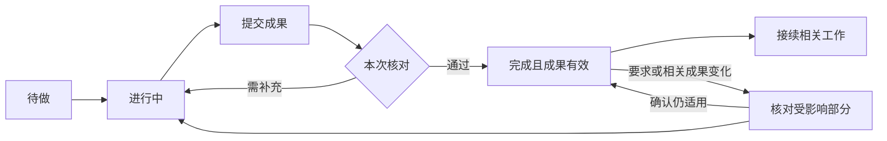

# Todo 协作优化产品与技术落地方案

日期：2026年11月9日。版本：v0.2，待评审。关联[产品方案 v0.4](协作节点与执行闭环产品方案-20261109.md)。

本方案落实自由讨论、按任务组织成果、结构化提交与 check，并综合审查其复杂度、内容质量、状态一致性及旧工具兼容。源码核对基线为工作树 `feat/conversation-first-20261031`、提交 `128d9fd`。本轮只读源码并更新方案，没有运行新增测试、修改运行代码或部署；源码判断不冒充线上故障复现。

## 1 审查结论与范围

可以沿用现有任务、Todo、资料、会议、协调记录、通知和记忆能力。实际需要补的是交付约定、可追溯提交、针对具体版本的检查，以及有效结果通过后的可靠接续。它们属于现有 Todo 的增强，不增加第三层任务或新的用户工作台。

业务内容按任务组织；程序稳定管理对象、版本、实际操作者和状态。仅增加输出模板不足以完成本项，因为当前 Todo 的普通更新路径就能标记 done。

首版优先实现一个完整闭环：安排 Todo → 成员按约定提交 → 自检或指定核对 → 有效通过 → 接续相关工作 → 最终交付。模板市场、通用表单搭建器、任意脚本式验证、模型训练与自动贡献排名不进入本项。

## 2 综合审查发现与处理

| 编号 | 问题或风险 | 方案决定 |
|---|---|---|
| R01 | 每人随意组织内容可能无法比较；统一模板又限制任务 | 负责人约定共同问题与完成条件，成员自由组织正文并关联对应项 |
| R02 | 增加结构后仍可能只是填齐字段 | 程序做结构与版本校验，核对人评价内容；表单合法不自动通过 |
| R03 | 当前 update 可以直接写 done，新按钮容易被旧调用绕过 | 新机制 Todo 的所有完成入口汇入同一提交/核对服务，不能只保护新 UI |
| R04 | 任务版本会随进度等更新；直接用它判内容失效会反复返工 | 区分记录并发版本与交付约定版本，普通进度更新不重置内容检查 |
| R05 | 检查结束后原件或上游成果变化，旧通过可能仍被使用 | 固定提交与输入版本；变化提示受影响部分复核，历史通过不覆盖新版 |
| R06 | 原程序修改权限与反馈主要围绕执行者和群负责人 | 补任务跟进人与指定核对人的实际职责，核对与改写他人成果分别处理 |
| R07 | 只更新状态不能保证结果有人接住 | 通过、待接续记录与必要通知同事务保存，复用现有投递恢复 |
| R08 | Todo、协调记录和会议都可能各自写已结束 | 仅关联的任务约束对应事项收尾；会议可以先结束，不能连带宣布任务完成 |
| R09 | 用户确认执行与内容通过可能混写 | 分开记录具体提案的用户决定和成果检查；不增加逐次工具审批 |
| R10 | 旧任务缺少结构与检查历史 | 原 ID、状态及历史保留，不批量伪造通过；需要接续时明确补核对 |
| R11 | 默认打开列表携带的版本，可能继续看到旧详情 | 当前详情默认读最新；聊天里的历史引用仍固定版本，二者分清 |
| R12 | 结构化进一步增加上下文、整理和调用成本 | 小项可一次提交加自检；长成果用引用按需读取，不逐条消息额外调用模型 |

R03、R04、R06等来自现有控制流与数据字段；R11是源码层的界面风险，本轮未作浏览器复现。其余包含产品审查与未来实现约束，均不表示已经修复或验证。

## 3 产品行为

### 3.1 安排和选择成果结构

继续使用「任务 → Todo」。负责人说明目标、必要完成条件和实际前置工作。多人需归总时，约定少量共同问题；成员自行决定章节、表格、分析方式和原件组合。独立工作可以由执行者直接组织结构。

共同问题与检查条件是本次工作的约定，不是全产品的固定业务字段。成果结构变化可以由成员提出；普通表达调整直接进行，完成条件或范围改变由负责人处理并保留新版本。涉及用户尚未决定的重要取舍，沿用原聊天确认。

默认不要求用户选择模板、填写依赖图或操作阶段按钮。没有明确跟进需要的普通问答不建 Todo。

### 3.2 提交成果

提交可以包含短正文、按任务定义的章节或表格、结构化数据、已有文档/文件版本、代码提交及其检查记录。复杂原件放在现有资料或仓库，Todo 保存引用，不为每次阶段交付再复制一份同名文档。

成员指出共同问题和完成条件对应的内容及缺口。未查明、不适用或未完成的部分如实记录；系统不为填满结构生成事实。合法但不完整的提交可以保留，显示缺口，不能据此通过必要检查。

提交是一个明确动作。普通聊天不论长短都不因包含“完成”或“通过”而自动变成交付或核对。

### 3.3 检查与归总

普通小项可以自检；需要其他人核对时指定一位实际核对责任人。确有多个独立核查方向，可拆同层并行 Todo，再通过一条汇总 Todo 接续，首版不另造投票或复杂审批制度。

核对记录指向一份提交和一版完成条件，说明哪些已满足、哪些未满足或未知，最终接受或退回补充。必要项未知或存在未处理阻断问题时不接受。同一人自检可以有效完成普通事项，但不能显示为独立审计。

任务的用户原话、当前补充与来源直接提供给执行者和核对者；负责人摘要不能覆盖原文。核对者可在总体结论中指出完成条件偏离原要求，给出来源并要求修订。逐项满足只是接受的必要条件，服务端仍要求明确的总体结论，不把全部勾选自动转成accept。

负责人按共同问题查看各份成果，保留重要依据和异议，作出采纳、修正、补查或交付的判断。重要取舍在综合成果中可追溯；不要求逐条回复所有建议，也不把被采纳数量当质量分。

重要发现的处理说明复用成果正文、coverage和refs：对应哪项问题，如何影响综合产物，或为何暂不采纳。最终核对使用同一份实际综合产物，检查关键纠正是否落实；处理说明自身不能当作落实证据。不新增建议逐条审批、贡献评分实体或专门的汇总审计模型。

### 3.4 用户界面

保留 Todo 列表与详情。详情按需展示「要求与完成条件」「当前成果」「核对结论」；资料在原入口打开。主界面突出现在缺什么、谁处理以及可查看的成果。

普通事项的“完成”操作可以一次保存成果与自检；指定核对事项提供“提交核对”，核对人看到“通过”和“需补充”。用户直接核对时记录用户本人，不代写某个 Agent 的结论。

业务状态继续使用现有五类：todo、doing、blocked、done、canceled。提交阶段附属状态由当前记录派生，如“待提交”“待核对”“需补充”“已通过”，不再维护一套可随意编辑的平行生命周期。任务未通过必要检查时保持未完成。

列表与详情使用同一实际状态和当前提交指针；默认打开最新详情。用户主动查看历史引用时固定原版本，显著说明已有新版。新成果和核对记录更新不使用户丢失当前阅读位置。

### 3.5 正式执行与会议

会议结束、提交、检查通过、用户批准执行、实际执行完成是不同事实。会议围绕 Todo 组织交流，结束后原任务继续，普通聊天和明确 @ 保持正常。

需要用户批准正式执行时，展示具体提案、目标及范围。已有明确授权直接沿用，不再让用户点同一决定。自然语言确认关联真实用户消息和明确提案；关系不清且影响执行时才澄清。程序能校验来源身份和关联，不能凭关键词证明用户的语义意图已理解正确。

确认后，由任务负责人或指定事项负责人跟进实际执行与验收。外部结果未知先核实，不盲目重复操作。结构化记录不会授予新的账号权限，也不关闭现有默认工具权限。

## 4 当前源码基础与复用点

下列链接指向本轮核读的工作树，属于源码证据，不代表线上生效状态。

| 位置 | 已有能力及限制 | 本项复用或改动 |
|---|---|---|
| [task-groups.mjs](../../.worktrees/agent-hub-conversation-20261031/cloud/collaboration/task-groups.mjs) | 两层归组、跨群/嵌套校验、父子关闭并发保护、计数与分页 | 依赖关系校验与图变更串行点；保持父任务核对交付 |
| [workspace-objects.mjs](../../.worktrees/agent-hub-conversation-20261031/cloud/collaboration/workspace-objects.mjs) | 任务create/update/accept、五状态、result字符串、refs、历史版本；expectedVersion是可选校验 | 将新机制的完成、提交与核对汇入统一领域服务；新动作强制必要版本校验 |
| 同文件84—129行 | 普通更新可直接设done；叶子Todo没有统一的result非空校验，父任务关闭另有校验 | 先消除服务端与界面完成条件不一致，不能仅靠前端必填 |
| [coordination.mjs](../../.worktrees/agent-hub-conversation-20261031/cloud/collaboration/coordination.mjs) | 需求版本、相关对象反馈、负责人变更和取消；对象回传依赖refs匹配 | 绑定原事项与任务，明确跟进对象；新机制关联任务未完成时不能误结案 |
| [repository.mjs](../../.worktrees/agent-hub-conversation-20261031/cloud/collaboration/repository.mjs) | 通用记录、读集/范围并发保护、请求幂等、同批变更事件 | 复用同一数据库与事务，增加内部提交和核对记录，无需新数据库 |
| [conversation.mjs](../../.worktrees/agent-hub-conversation-20261031/cloud/collaboration/conversation.mjs) | 工具定义、成员领取、enqueue与outbox、真实通知状态 | 扩展board_task动作与领取检查，复用现有通知链路，不另造执行引擎 |
| [shared-space.mjs](../../.worktrees/agent-hub-conversation-20261031/cloud/collaboration/shared-space.mjs) | 有版本原件、交接与检查记录、认证兼容信封 | 复用原件与代码引用校验；扩展旧工具兼容参数，不直接套用正式交接生命周期 |
| [api.mjs](../../.worktrees/agent-hub-conversation-20261031/cloud/collaboration/api.mjs) | 工具身份检查、同范围兼容调用、结构化与文本JSON回执 | 所有传输入口使用同一领域动作；保留普通submit_work聊天回传语义 |
| [tool-validation.mjs](../../.worktrees/agent-hub-conversation-20261031/cloud/collaboration/tool-validation.mjs) | 已有JSON Schema参数校验；校验缓存按工具名区分 | 固定工具信封可复用；不把每个Todo不同的结构塞进同一个工具名缓存 |
| [TaskBoard.jsx](../../.worktrees/agent-hub-conversation-20261031/ui/conversation/TaskBoard.jsx)、[CollaborationSpace.jsx](../../.worktrees/agent-hub-conversation-20261031/ui/conversation/CollaborationSpace.jsx) | 归组、详情、result渲染与直接编辑状态 | 增强同一详情，区分提交与核对；当前详情与历史引用分开 |
| [change-feed.mjs](../../.worktrees/agent-hub-conversation-20261031/cloud/collaboration/change-feed.mjs) | 持久变更提示与客户端恢复 | 写内部记录时同步更新task指针；必要时补对应类型描述，确保列表和详情都失效刷新 |
| [inbox.mjs](../../.worktrees/agent-hub-conversation-20261031/cloud/collaboration/inbox.mjs)、[native-context.mjs](../../.worktrees/agent-hub-conversation-20261031/cloud/collaboration/native-context.mjs) | 按需原件、Todo指引、原生增量上下文与恢复 | 加入本次任务约定、当前成果/缺口及读入口；不每轮灌入所有提交 |

现有五状态中没有独立提交与核对记录，也没有Todo前置依赖字段。不能仅凭已有 result、refs 和任务历史宣称本方案已具备。

## 5 数据设计

### 5.1 Task 扩展

继续使用 channel_task；新机制增加可选工作约定和指针，业务内容不按场景硬编码。以下为建议字段，不是现有接口已经支持的参数。

```ts
workSpec: {
  version: number;                  // 交付约定版本
  expectedOutcome: string;
  criteria: Array<{ id: string; text: string; required: boolean }>;
  commonQuestions?: Array<{ id: string; text: string }>;
  outputGuide?: string;             // 本次结构安排，不是全局模板
  checkMode: "self" | "designated";
  reviewerId?: string;
  independentReview?: boolean;
  basisRefs: VersionedRef[];
}
dependsOn: string[];                 // 同一任务内的同层 Todo
coordinationRef?: { id: string; requirementVersion: number };
currentSubmissionId?: string;
acceptedSubmissionId?: string;
executionDecision?: {
  proposalSubmissionId: string;
  proposalWorkSpecVersion: number;
  decidedBy: "owner";
  sourceOwnerMessageId?: string;
  scopeSummary: string;
  recordedBy: string;
};
```

任务负责关系优先复用父任务的 assigneeId；未指定时回到当前群负责人。独立任务沿用其明确跟进安排。核对者不是自动成为执行者；不要把某位Agent既有接手记录重写成核对者。

子Todo继承所属任务采用的交付机制与相关约束，但可以有自己的内容结构和完成条件，不能靠省略字段变成绕过必要检查的旧式子项。普通小项的条件可以只有一项；形成可接受成果前至少有一项实际完成条件，不能用空清单或全可选项造成自动通过。探索任务可以约定交付有依据的未知和建议，不强制把未知变成确定答案。

交付要求放在workSpec，进展继续放progress，阻塞放blocker。调整目标、完成条件、必要来源或核对要求时生成新workSpec版本；仅改名、进度、截止日期或归组不自动重置内容核对。旧入口修改工作正文时若无法区分是否影响约定，保守标记需核对，由负责人确认影响，不调用后台模型逐次裁决。

记录version继续用于并发更新，不能直接等同于workSpec版本。关联协调记录存在时，提交还要绑定其当前requirementVersion；不另建一套与它冲突的需求账本。没有协调记录的小事仍可独立工作。

### 5.2 成果提交快照

新增内部记录 `channel_task_submission`，scopeId为群，parentId为Todo。提交后内容不原地改写，新提交通过supersedes关联前件。

固定信封包含 taskId、workSpecVersion、依据的需求版本、提交者、时间、上游输入快照和内容引用；提交者与时间由服务端取真实身份生成。业务内容可为Markdown、按任务定义的sections/data，或产物引用。coverage把完成条件/共同问题映射到正文位置、章节或原件，并保留gap。

必要引用带确切版本。文档和文件复用现有refs检查；代码复用已有仓库地址与提交哈希约定。只给一个他人无法访问的本机路径不算跨环境交付。外部原件暂时不可读时保存缺口，不宣称已读。

首版不做任意JSON Schema表单搭建器。以可变内容、共同问题和稳定映射实现按任务结构化；固定信封及引用类型做程序校验。确有机器消费需求时再评估受限的自定义数据Schema，不允许远程Schema执行或内嵌脚本变成新的执行入口。

### 5.3 检查记录

新增内部记录 `channel_task_check`，保存submissionId、workSpecVersion、需求版本、逐项结果、总体结论、理由、依据及真实核对者。逐项结果可表达满足、不满足和未知；只有当前必须项均满足且无未解决阻断问题时才接受。

自检必须来自提交者；指定核对来自当前指定人。用户可直接核对并保留用户身份；要求独立审计的事项，不能把同人自检或用户豁免改写成该审计已发生。核对者可以提出修改意见，不能替执行者改写已提交快照。

不同成员ID只能证明操作者不同，不能单独证明观点或证据独立。普通他人核对与严格盲评分开；需要声称盲评时仍须按原方案验证实际可见性，不能只靠这份记录打标签。

核对记录保留为历史，当前是否有效由任务约定、提交指针、输入及来源版本判断。普通任务编辑不应抹掉原提交人、核对者或完成记录人。

这些是内部记录，不增加用户任务层级，也不是另一套共享文档。

## 6 状态与动作

### 6.1 一条 Todo 的推进



图中是产品语义，底层五状态保持兼容；自检允许C与D在一次请求中完成。取消和受阻沿用现有状态，取消不满足后项的必要依赖。

新成果待核对时任务保持未完成，附属交付状态表达具体等待。已经通过的工作若因纳入当前范围的新要求而需重做，在同一事务中重开受影响Todo和必要的已关闭父任务，保留原次完成历史。历史任务的原件仅有后续变化时不自动重启执行，先显示来源变化；将旧结果用于新的必要依赖前再核对其适用性。用户已取消或暂停的任务不会被来源变化自行恢复。

### 6.2 工具动作建议

扩展现有board_task的action，不要求所有原生Agent安装另一套工具。

| 动作 | 主要输入 | 效果 |
|---|---|---|
| create/update/accept | 现有参数，必要的任务安排 | 保留普通维护与实际接手；新机制完成转统一服务 |
| configure | taskId、expectedVersion、workSpec、dependsOn | 保存交付约定及必要依赖，核对版本变化 |
| submit | taskId、expectedVersion、submission，可附selfCheck | 保存快照；合法但有缺口的成果保留为待补充；自检按同一规则处理 |
| check | taskId、expectedVersion、submissionId、workSpecVersion、criterionResults、verdict | 保存针对当前对象的核对；通过后才更新有效完成与接续 |
| bind_execution_decision | taskId、提案提交ID、真实用户决定来源与范围 | 关联已有用户授权，不把Agent提案伪装成用户决定 |

read_todo增加当前成果摘要、check概要和能力说明，历史提交/核对按view和cursor分页读取。现有 taskId 与归组分页语义不改变。

工具回执返回实际状态、保存的提交/核对ID、缺口和下一步。例如“成果已保存，等待核对”不能返回成“任务已完成”。结构错误返回稳定的400和字段路径；过期提交检查返回409及当前对象入口，不退成模糊500。

不能默默截断成果后算保存成功。短正文与结构数据按明确资源上限处理，超限引导使用已有文件/文档；系统不执行成果内的代码、工具指令或不受信HTML。

共同问题与条件ID在本次约定内唯一，覆盖引用只能指向真实存在的ID。未提供或明确为gap的必要项保留为缺口，不能由程序补成满足。执行决定必须来自真实owner界面操作或可核对的owner消息，绑定具体提案和范围；Agent调用缺少这种依据时不能自行写出用户已批准。

### 6.3 版本与原件变化

提交与核对必须带当前工作约定和实际输入的版本。新提交不会自动继承旧提交的通过；原件变化时标明该引用已变，不能静默读新版替代提交所指原件。

对仍然可用的旧版本，可以由核对人明确确认其适用范围或补充新版检查。来源被删除、撤回或权限关闭时沿用现有可访问性规则，不因有历史检查就重新暴露原件。

完成条件不能在核对失败后被执行者单方面降低。负责人可合理修订，保存差异；改变用户目标或正式执行范围时处理相应决定。

## 7 依赖与可靠接续

dependsOn仅连接同一父任务下的同层Todo。检查自依赖、循环、跨群、跨任务及移动后失效；排序不生成依赖。没有依赖的工作继续并行，直接沟通不受该关系限制。

通过时在同一Repository事务内读取当前约定、提交、必要输入与来源记录，保存check及任务当前有效成果，计算可接续项，再写入现有channel_turn/outbox或同等持久待接续记录。提交事务中不直接调用外部Agent或连接器。

请求幂等复用现有requestId；还需有业务接续标识，绑定目标Todo约定和上游接受快照，避免换requestId重复回传时再启动同一工作。存在新的约定或输入才形成新的接续代次。所有前项变化与新后项加入都读取/更新相应父记录，复用既有范围并发保护。

只在已授权、未停止且前置条件满足时派发。接收端离线、暂停或无可用会话，保存真实待接续状态，不伪造已接手；成员被移除或未指定时让跟进负责人处理。负责人自己完成check后也要走同一接续路径，不能因现有objectFeedback跳过本人而停住。

领取与开始前再核对当前任务约定及输入快照。过时的任务通知不启动旧工作，普通聊天和用户明确 @ 继续正常处理。上游重开只影响相关依赖：未开始的后项暂缓，已在执行的后项收到变更并核对影响，外部结果保持真实，不声称自动回滚。

任务负责人、核对人与群负责人可能不同，通知应按这条工作的责任发送，避免审核只回群负责人。任务核对通过不自动结束原协调事项；协调close仅核对本事项显式关联的必要任务，不牵连全群无关工作。

上述保证约束Hub管理的派发、领取与状态，不构成对所有原生工具的执行隔离。Agent在原环境中的行为仍需遵循当前任务范围，实际结果再核验。

## 8 旧工具与历史数据兼容

### 8.1 所有入口归到同一服务

UI command、当前board_task、认证兼容信封和本地CLI调用共享同一提交/检查领域逻辑。更新CHANNEL_TOOLS参数定义与兼容白名单，否则旧目录即使支持通用调用也会拒绝新参数。

保留既有 `HUB_SHARED_TOOL_V1` 认证入口和成员身份，不要求重登录、换成员或重建会话。MCP本身不保证某一宿主及时刷新目录，因此接口回执与领取上下文都要给可用的兼容调用入口。

普通聊天的旧submit_work路径目前会发布正文，它不能顺带完成Todo。正式run/step中的submit_work也不接管本项；两条已有语义都保留，避免重启旧的强制编排。

### 8.2 旧done与新check的关系

历史未启用交付约定的任务保持原状态与记录，不批量补写独立通过。新机制任务一旦存在workSpec，旧update(status=done)必须经同一领域服务处理：有结果可转成一次明确提交，指定核对未完成时保持未完成；回执清楚说明实际动作与下一步。不能把未知字段忽略后仍返回done。

新UI及新Agent可一次提交加自检，避免为了小事多次往返。仅旧调用的一个result字符串不能被自动扩展成所有必要条件均通过；需要的结构或自检信息通过兼容调用补齐，由Agent完成，不推给人类。

新任务的最小约定由现有创建过程自动提供，负责人或执行者按本次工作补充。不加创建向导。历史任务需要加入新的必要依赖时，先明确采用其哪份原结果并补对应检查，不能自动把历史done提升成新协议已核验。

已采用的约定不能由普通旧请求清空来绕过。用户明确取消或调整任务时保留真实原因与历史，不伪造原审计发生。

### 8.3 读取与显示

后端返回当前任务、提交与检查的统一读模型；老客户端仍能看原status、result及清楚的进度说明。新UI不能乐观显示完成后又变回待核对，应以服务端实际回执更新状态。

当前详情默认最新，主动历史引用固定原版。补齐read_todo、TaskBoard、秘书总览、任务筛选、会议关联与上下文的同口径，避免一个入口显示已完成而另一个仍等待。

## 9 性能与记忆边界

内容提交与格式校验不需要额外模型调用。内容核对交给本次明确承担核对的Agent或用户，不能每条聊天另加一个后台裁判。普通自检支持一次调用，复杂原件按需读；接续通知只带必要约定、当前结果与进一步读取入口。

普通小项复用轻量提交与任务既有安排，只有确需比较或机器使用的内容才增加业务结构。服务端生成身份、时间和版本关联，Agent不为填写这些元数据另跑一轮工作。已包含当前约定的领取上下文可直接用于提交并发校验，冲突时再读取；不能为减少调用跳过已经变化的要求。自检合并请求不得额外唤醒核对成员，正常后续工作通知保持。

通过后沿用现有task记忆事件，附任务与成果关联。候选提交可以记录为经历，但不能因入库就变成已验证结论；实际检查结果再更新相关经历。无需新增记忆引擎或每步生成一篇会议纪要。

查询提交和核对历史须分页，任务列表只取概要。依赖检索先限定本任务；规模增大时再按真实查询开销评估索引，不先引入新消息队列或全局工作流数据库。

## 10 责任与权限

继续复用群成员、来源访问和现有工具权限。新增的是对一项成果的提交/核对责任，不是全局能力限制或必须秘书身份。指定核对者应能提交自己的check，但不能借此改写执行者的已提交快照。

actor、提交者、核对者与用户决定来源由服务端真实身份校验，不接受客户端任填“某人已审”。更换核对人和负责人后保留历史，待办交给新责任人；旧核对已发生的事实不改写。

用户可以人工处理例外，记录用户作出的决定及被调整的要求，不能显示成被替代Agent已独立通过。人类执行确认与内容check分开，不增加每次工具调用的重复确认。

## 11 实施拆分

以下为方案内工作包，不是本轮已创建或启动的开发Todo。

| 工作包 | 主要位置 | 可验收交付 |
|---|---|---|
| A 交付领域与统一完成入口 | 新增 `task-deliverables.mjs`，接入workspace-objects、task-groups | 可变成果、稳定约定、提交/核对快照、兼容完成与版本规则 |
| B 工具与跨端兼容 | conversation、shared-space、api、tool-validation、inbox、本地CLI通路 | 当前和缓存旧目录均可读写，明确错误与回执，不重登录 |
| C 依赖与接续 | task-groups、coordination、enqueue/outbox、领取校验 | 相关Todo可靠接续、去重、失联保留、变更继续与事项结案 |
| D 现有Todo界面 | TaskBoard、CollaborationSpace、space.css、相关总览 | 原详情内交付与核对、当前/历史区别、简洁操作及状态一致 |
| E 效果与独立验收 | 现有fixture、接口/UI测试及真实Agent业务对照 | 技术语义、跨场景质量、成本和不降级证据；再打包启用 |

A—D组成一个完整闭环后再作为功能交付。内部按工作包开发不表示用户要接受多个不能用的中间版本。优先复用已有测试与领域助手，避免复制一套任务工具。

## 12 验收矩阵

| 编号 | 必须覆盖 | 判断依据 |
|---|---|---|
| T01 | 不同任务采用不同正文、表格、数据或产物引用 | 无全局业务模板，原件与映射可读取 |
| T02 | 多人成果结构不同但回答相同共同问题 | 能归总并保留重要依据和异议 |
| T03 | 字段齐全但事实错误、证据不足或结果不可用 | 内容核对可失败，不能机械通过 |
| T04 | 普通自检与指定独立核对 | 前者可一次调用；后者不能自报冒充独立通过 |
| T05 | 错身份、错群、错任务、错提交、错工作约定 | 保存前拒绝，明确错误，不造成部分完成 |
| T06 | 进度/改名/归组与关键条件修订 | 前者不重置检查；后者保留旧版并检查影响 |
| T07 | 提交新成果、上游重开、原件变化 | 旧通过不覆盖新版，相关后项处理真实 |
| T08 | 当前工具、旧目录信封、UI和CLI的done调用 | 使用同一状态转换，不存在后门完成 |
| T09 | 重复请求、换请求编号的重复回传、并发check和修订 | 幂等与版本约束有效，不重复启动后项 |
| T10 | 保存通过时崩溃、通知失败、接收者离线和恢复 | 通过与待接续不丢，恢复后真实接收 |
| T11 | 父项关闭、增加/重开子项、依赖循环/跨任务/移动 | 并发约束与必要检查一致 |
| T12 | 任务负责人、执行者、核对人与群负责人不同 | 正确人接收，实际身份及历史不混写 |
| T13 | 会议已结束而任务仍待核对/执行 | 会议正常收尾，Todo继续，普通@不受影响 |
| T14 | 用户仅讨论、明确授权、变更范围或暂停 | 当前范围正确，已有授权不重复确认，未知外部结果不盲重放 |
| T15 | 旧任务迁移及客户端回退 | 原ID/历史/完成者保留，不假造检查或降低服务端门槛 |
| T16 | 默认详情、历史引用、更新中阅读与状态刷新 | 当前/历史清楚，不回跳、不显示相互矛盾状态 |
| T17 | 超长成果、非法嵌套、内容含脚本/工具指令 | 不静默截断、不自动执行；按明确边界保存或报错 |
| T18 | 简单任务和当前原生Agent使用 | 不增加人为审批，不依赖宿主支持新消息格式或更换模型 |
| T19 | 主要成员组合与真实业务对照 | 结果质量、返工、时间和用户纠偏负担没有被流程改善掩盖 |
| T20 | 主任务与关联协调事项收尾 | 全部必要结果有效，不能只结束通知、会议或写一句总结就结案 |
| T21 | 完成条件故意遗漏原用户目标，而产物满足该清单 | 原话可直达；内容核对指出标准问题并要求修订，不能机械接受 |
| T22 | 简单事项采用默认结构 | 一次提交加自检可保存，无额外核对Agent通知或专门整理模型调用；元数据无需手填 |
| T23 | 正确少数意见已被报告采纳，但综合产物仍错误 | 最终核对能发现未落实；验收看真实内容，不只看采纳记录 |
| T24 | 正确成果受到错误质疑，或复核没有发现问题 | 可以有依据地保持原结果，不强制改稿、反对或制造贡献 |

工程测试沿用现有task-groups、workspace-objects、coordination-lifecycle、变更同步与工具兼容fixture，新增有实际状态和副作用意义的交付测试。界面在隔离测试资料中验证。真实模型评价与程序状态验收分开，不拿替代API模型冒充原生平台通过。

T21和T23中的语义识别还要用真实推理任务核验：固定原始要求、错误标准或综合产物及独立判断依据，观察是否真正发现并处理。程序测试只证明原话可达、结论可保存及未通过时不接续，不能冒充模型已经能发现问题。T22的额外通知和调用可用执行记录直接核对。先验证这些已知失灵情景，再用运行记录观察尚未覆盖的变化；埋点不作为缺少处理方案的替代。

效果评价沿用[协作有效性研究](../Agent管理学/研究/协作机制研究/协作有效性与现有设计差距研究-20261109.md)：保留合理简单基线、必要的多人独立条件和改进协作条件。先核对质量，再比较全部调用成本、有效交付时间和用户负担；不以结构齐全率或少消息判胜。

未来实现交付还需按仓库要求完成相关检查、打包启用和实际运行版本核对。当前没有执行这些发布步骤，不能把本方案完成说成产品上线。

## 13 启用与回退

采用可识别的新交付约定，渐进接续历史任务。启用前验证旧工具真实调用和当前数据只读兼容；不批量重放旧任务或给历史补假检查。

客户端回退时服务端仍保持已采用任务的检查规则，旧客户端看到真实进度并可用兼容入口继续，不能通过关掉新UI绕过。保留提交、核对、原件与历史数据；行为调整可在新任务上停止扩大采用，已发生执行不自动重做。

不修改用户的原生模型、登录、工作目录、正在运行的会话或默认账号权限。是否有效以完整交付和独立验收记录为准。

## 14 标准与研究依据

- [JSON Schema对象定义](https://json-schema.org/understanding-json-schema/reference/object)：可描述属性、类型和必需字段；这类约束不代替业务内容核验。本项先复用已有参数校验，不引入任意Schema编排。
- [MCP工具规范 2025-06-18](https://modelcontextprotocol.io/specification/2025-06-18/server/tools)：支持工具输入描述及结构化/文本结果；此处明确引用该版本的数据表达能力，不把它称为最新版本，也不据此假定所有宿主已支持同一界面。当前服务本身已返回文本JSON与structuredContent。
- [协作有效性研究与来源核读](../Agent管理学/研究/协作机制研究/协作有效性与现有设计差距研究-20261109.md)：支持按任务互补、保留有效内容、核验结果和评价整体代价；不构成这份方案已经有效的实验结论。
