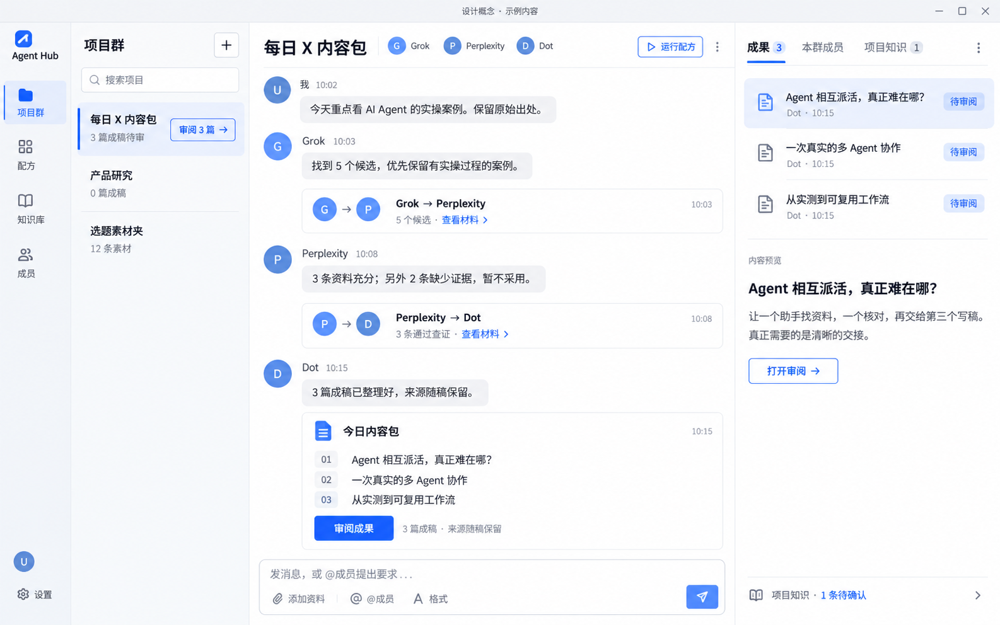
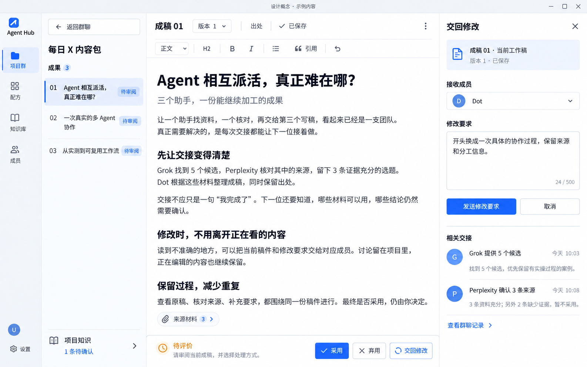

# UI 评审收敛与验收

> **2026-10-29 实施更新：** 两张效果图已落为可操作的 2.0 React 界面，见[预览、实际截图与 23 项检查](../prototype/agent-feishu-v2/README.md)。以下保留原设计收敛记录；正式后端与原生 Agent 尚未联调。

日期：2026-10-29 · 作者：Codex · 状态：**设计建议与 AI 效果图待对齐，尚未实施本轮 UI 改版**

本轮功能不变，重点是视觉效果和操作体验。基线为 `c6682ec`。本文件与两张效果图组成一份交付，不另建重复方案。

## 我理解的评审结论

已完整阅读 [Claude 的评审](https://github.com/duolaAmengweb3/agent-hub/issues/6#issuecomment-6485335886) 和 [Gemini 的评审](https://github.com/duolaAmengweb3/agent-hub/issues/6#issuecomment-6485409497)，并核对原型代码。

Claude 主要指出：字小、标题与状态重复、侧栏拥挤、入口叫法混乱、交回操作让人离开稿件。Gemini 主要指出：精简时仍要看见成员与交接，同一个项目入口不能根据状态跳不同页面，改稿不能固定只给 Dot，不能靠隐藏控件或遮挡正文制造空间。

两者不是整包二选一，也不能把评审中的所有工程推断当成已验证事实。

| 议题 | 本轮决定 | 原因 |
|---|---|---|
| 字号、配色、重复标题 | 采纳 Claude：白/浅灰/深色字/蓝色强调；清理重复标题与介绍卡 | 先统一全站视觉语言；不再轮流换皮肤 |
| 原型说明 | 集中为一条“设计概念 · 示例内容”标记；实现时真实保存位置、连接和失败状态仍准确显示 | 去掉评审说明的干扰，不能伪装已接通或云端已保存 |
| 侧栏 | 窄全局导航 + 项目列表；审阅时同一区域换成稿件列表 | 区分全局、项目与稿件，避免在一列堆七类入口。窄窗口收起次要栏，不缩字 |
| 交接展示 | 采纳 Gemini 的紧凑可展开卡：保留头像、交给谁、交付摘要 | 普通交接不是 150px 大卡，也不退成难扫读的小字日志；约 56–72px 为目标，长内容允许增高 |
| 项目入口 | 点项目主体稳定进入群聊；“审阅 3 篇”是单独明确的动作 | 不采纳“有待审就自动换目的地”；到达新稿也不抢当前焦点 |
| 修改要求 | 在稿件旁打开“交回修改”，明确稿件、接收成员、要求；发送后留在当前文稿，并同步到群记录 | 复用现有交回/消息能力，不写死 Dot。正式映射时核实已有任意成员任务与稿件快照如何一起提交 |
| 划词批注 | 不作为这轮第一张图的前提 | 全文交回已存在；永久段落锚点、批注线程属于需要额外定义的能力，不偷偷算作“只是换 UI” |
| 工具栏 | 两层紧凑顶部：稿件/版本/出处；常用格式条。底部是不遮正文的操作栏 | 不硬塞一行；不依赖划词浮层；不采纳透视文字的半透明浮岛 |
| 知识建议 | “项目知识”入口和待确认数量持续可见；临时提醒关闭不影响入口 | 保留现有闭环，避免提示一关就找不到 |
| 格式控件 | 保留已有能力，移入“格式”展开区，按选区/光标生效 | 不再插入固定示例文字，也不因精简删除功能 |
| 版本与编辑安全 | 保持原稿/工作稿分离；新回复作为独立版本，不能自动替换正在编辑的工作稿 | 红绿 Mark 只能表示痕迹，不等于解决并发覆盖。本轮不承诺自动合并 |
| 输入法风险 | 列入实际 Mac 中文输入验收 | BubbleMenu 并非必然有问题，也不能仅靠库名宣称没有问题 |

能力判断：现有 React/Tiptap 能实现这套布局和已有功能的交互整理。无需为了视觉迁移 Next.js。视觉是否合格由实际画面与用户判断，操作是否合格靠真实路径测试，不能靠工程测试替代。

## 两张效果图：同一个设计，两个工作状态

### 1. 项目群聊



优先看清“谁做了什么、交给谁、有哪些成果”。右侧先看成果目录与预览，完整阅读进入审阅。运行按钮是次操作，成果审阅是当前主操作。多个入口可以服务不同上下文，但名称和结果一致，不设置隐含副作用。

### 2. 宽幅审阅（已打开交回修改侧栏）



正文成为主区域；修改要求在旁边，接收成员可以选择。关闭修改侧栏后正文恢复更宽。发送修改要求后仍留在原文，群里保留一条对应记录。

两张均使用内置 imagegen 生成，第二张引用第一张保持风格一致。**它们是观感与布局参照，不是运行截图或逐像素规格。** 生图里的字数计数、头像、文案换行不作为程序约束；修改输入框实现时初始为空，图中有文字只用于展示用户已填写状态。示例内容不证明真实 Agent 已完成任务。

## 实施路径

先让用户及评审者围绕这两张图确认布局、密度、配色和阅读体验，再做一套真实可点击的原型。确认的是具体画面，不是“高级感”这样的形容词。

真实原型覆盖所有现有页面及加载、空、错误、待处理、完成状态；使用同一套组件规范。最后以同内容截图和录屏验收，而非继续换一轮配色。当前两图只覆盖最关键的群聊和审阅，其余页面不能因为主界面通过而自动算合格。

## 验收标准

以下是交付门槛，当前均待实现/验证；不把效果图当作已经通过。

| 项目 | 标准 | 验收方法 |
|---|---|---|
| 用户观感 | 群聊、审阅、配方、知识、成员的字体、色彩、间距、图标一致；最终页面符合已确认设计，不自行换风格 | 固定同内容的改前/改后截图并排；用户明确认可观感。若不认可，不以“测试全过”关闭本轮 |
| 阅读 | 普通界面字 14px、稿件 16px、辅助信息不小于 12px；无截断关键名称、重叠或淡到难读 | 浏览器字号统计、实际阅读；普通文字对比度至少 4.5:1，符合大字定义的至少 3:1 |
| 空间 | 1440×900、1280×800 下主要内容可读；审阅正文可视滚动区 ≥65% 为布局目标；无工具栏遮字、横向整页溢出或挤小点击区 | DOM 尺寸 + 截图。不能靠扩大空白、遮住内容、减少样本来达标；体验冲突时重新排版 |
| 点击 | 主要操作按钮高至少 36px，独立图标命中区至少 32×32px；选中、悬停、禁用、焦点清楚 | 尺寸检查及鼠标/键盘实际操作。这是项目目标，不冒充 WCAG 的原文尺寸 |
| 找得到 | 首次看到页面约 5 秒内能指出当前项目、成果位置、下一步；“审阅成果”“返回群聊”“交回修改”名称一致 | 给用户看真实原型，不提前指位置；观察是否需要口头解释。5 秒是可用性目标，不是科研结论 |
| 核心路径 | 从项目列表到审阅不超过 2 次明确点击；在当前稿件发修改要求，不跨页面重找稿件；返回群聊仅一个主要入口 | 连续录屏：找成果 → 审阅 → 改一段 → 看出处/原稿 → 交回 → 返回群聊。输入文字不计成点击步数 |
| 切换安全 | 01/02 稿切换、关侧栏、返回群聊、刷新后，稿件正文与未发要求不串稿不丢失；新成果到达不强行跳页 | 用不同稿件内容/不同未发要求做恢复检查；键入中触发消息到达，确认光标不被抢 |
| 修改结果 | 发出后明确已提交/失败；取消无副作用；重复点击不重复提交；新版本到达不覆盖本地稿 | 控制成功、失败、慢响应、重复点击和“提交后继续编辑”场景；对照版本与群记录 |
| 中文输入 | Mac 拼音连续选词、回车确认候选、换行、撤销都正常；组词期间不误发消息、不闪动抢焦点 | 实际中文输入法测试，不能只用自动化键入英文代替 |
| 能力保留 | 原有配方、成员、知识、稿件、原稿/版本、来源、复制导出、返工、采用/弃用均可找到并按原定义使用 | 功能入口清单逐项验证。知识建议关闭提醒后仍可从项目知识进入 |
| 反馈诚实 | 真实保存、执行、连接和错误状态准确；AI 效果图与示例原型有集中标识 | 代码与界面对照，不把示例反馈展示成真实平台执行成功 |

视觉规范依据：[W3C 对比度](https://www.w3.org/WAI/WCAG22/Understanding/contrast-minimum.html)、[W3C 目标尺寸](https://www.w3.org/WAI/WCAG22/Understanding/target-size-minimum.html)。后者标准通常为 24×24 CSS px，并有例外；本项目对独立图标采用更大的 32px 目标。

## 本轮交付范围

- 已完成：读完双方评审、核对关键源码、收敛取舍、两张 AI 效果图、验收清单。
- 未宣称完成：前端改版、交互验收、真实 Agent 联测或正式桌面更新。
- 现有程序、后端、账号及登录资料本轮未改动。

<details>
<summary>生图方式与完整提示词（供复现）</summary>

内置 imagegen；无透明背景。第二张以第一张为视觉参考。源文件仍保留，项目使用以下两张副本。

### 群聊图

```text
Use case: ui-mockup.
Create ONE high fidelity product UI concept screenshot, landscape 1600 by 1000 composition, crisp desktop application interface. This is concept 1 of 2 of the SAME Agent Hub application, PROJECT GROUP CONVERSATION state. All visible interface language Simplified Chinese except Agent Hub and agent names. At very top one slim unobtrusive strip says "设计概念 · 示例内容". This is a flat straight-on actual-looking software screen, NOT a poster, no laptop frame, no marketing banners, no decorative gradient blobs, no 3D. Follow the polished restrained hierarchy and information density of Feishu desktop collaboration software, with original branding. White content, cool pale-gray navigation, near-black readable text, blue #3370FF accent, subtle 1px separators, restrained 6–8px radii. No sage green or beige. Legible Chinese, interface text about14px, secondary12px, heading20px, no miniature text.

Layout, full desktop canvas: 72px narrow global icon+short-label navigation rail; 236px project list; a roomy primary conversation column approximately 860px; a right 400px compact results overview pane (NOT a full narrow document editor). Exact dimensions may adapt proportionally to fit width. Common navigation: logo at top; "项目群" active, "配方", "知识库", "成员"; bottom avatar and settings. No duplicate brand slogans or secondary navigation promotions.
Project list title "项目群", search field "搜索项目", + button. Selected project "每日 X 内容包", summary "3 篇成稿待审", a distinct BLUE outlined action "审阅 3 篇 →". Two other plain project rows "产品研究" and "选题素材夹". Project body and review action look like distinct hit areas.
Single 56px main header "每日 X 内容包", avatars labelled Grok / Perplexity / Dot, small button "运行配方", trailing more menu. No duplicate breadcrumb or giant title tile.

Conversation should show a complete short collaboration story in one viewport, readable and professionally spaced:
user avatar and message "今天重点看 AI Agent 的实操案例。保留原始出处。"
Grok message "找到 5 个候选，优先保留有实操过程的案例。"
ONE compact 56px handoff row with two small avatars and text "Grok → Perplexity" + "5 个候选 · 查看材料 ›", not a nested giant card and not tiny log text.
Perplexity message "3 条资料充分；另外 2 条缺少证据，暂不采用。"
ONE compact handoff row "Perplexity → Dot" + "3 条通过查证 · 查看材料 ›".
Dot message "3 篇成稿已整理好，来源随稿保留。"
One clear final delivery card, modest rounded border, title "今日内容包", rows "01  Agent 相互派活，真正难在哪？", "02  一次真实的多 Agent 协作", "03  从实测到可复用工作流". Blue primary button "审阅成果" and subtle time. This is the only prominent card.
Bottom compose box: placeholder "发消息，或 @成员提出要求…", small "添加资料", "@成员", "格式" secondary actions and blue send button. No technical disclaimers in message area.

Right results pane title "成果 3", adjacent quiet tabs "本群成员", "项目知识" with a small count badge "1" and more menu. Three compact document rows with status "待审阅", readable title, author Dot. First document selected. Below minimal content preview only: "Agent 相互派活，真正难在哪？" and two short lines "让一个助手找资料，一个核对，再交给第三个写稿。真正需要的是清晰的交接。" Then a button "打开审阅 →". Show quiet persistent "项目知识 · 1 条待确认" link near bottom. Do NOT place editing toolbars or adoption controls in this overview.
Prioritize alignment, readable size, generous yet efficient spacing, clear primary action, same design tokens everywhere. Restrained platform avatar initials G/P/D instead of invented logos. No extra features, charts, KPI dashboards, fake online ticks or performance claims. Deliver exactly one clean UI screenshot.
```

### 审阅图

```text
Use case: ui-mockup.
Create ONE high fidelity desktop application UI screenshot, landscape 1600 by 1000 composition. Use the attached Agent Hub mockup ONLY as a style and navigation reference. This is the SAME application's DOCUMENT REVIEW state, not an alternative visual style. Preserve its crisp white/light cool-gray surfaces, subtle borders, near-black Chinese typography and blue #3370FF accent, blue circular initial avatars G/P/D, global rail icon+label appearance. All Chinese text crisp and legible. This is a flat straight-on software screenshot, no marketing poster or device frame. Topmost slim strip "设计概念 · 示例内容". No tiny unreadable text.

Composition: same narrow global navigation rail on left, then a narrower document selector column roughly200px, then a dominant wide document editor (~820px) and a 300px contextual modification request pane at right. Do not show the entire group conversation alongside. The primary object is the article. Reading text about16px, UI14px, secondary12px, generous lines, headline26px. Do not add gradients, oversized rounded cards, decorative shadows or translucent dock over the article.

Global rail same "项目群", "配方", "知识库", "成员", profile/settings. Document selector: top visible text button "← 返回群聊"; quiet project title "每日 X 内容包"; heading "成果 3"; three rows: "01 Agent 相互派活，真正难在哪？" selected, "02 一次真实的多 Agent 协作", "03 从实测到可复用工作流". Small "待审阅" status. At lower left persistent clear "项目知识" with "1 条待确认" badge. No repeated navigation advertisements.

Document column top has compact TWO rows: row1 (44px) "成稿 01" then discreet "版本 1 ▾", "出处", "已保存", and trailing more action; row2 (36px) persistent format bar "正文 ▾  H2  B  I  •  引用  ↶" with comfortable click targets. Do not cram everything into tiny icons. The format bar is always available, not selection-only. Center white article with comfortable horizontal padding and max readable width:
title "Agent 相互派活，真正难在哪？"
subtitle "三个助手，一份能继续加工的成果"
paragraph "让一个助手找资料，一个核对，再交给第三个写稿，看起来已经是一支团队。真正需要解决的，是每次交接都能让下一位接着做。"
section "先让交接变得清楚"
paragraph "Grok 找到 5 个候选，Perplexity 核对其中的来源，留下 3 条证据充分的选题。Dot 根据这些材料整理成稿，同时保留出处。"
paragraph "交接不应只是一句“我完成了”。下一位还要知道，哪些材料可以用，哪些结论仍然需要确认。"
section "修改时，不用离开正在看的内容"
paragraph "读到不准确的地方，可以把当前稿件和修改要求交给对应成员。讨论留在项目里，正在编辑的内容也继续保留。"
section "保留过程，减少重复"
paragraph "查看原稿、核对来源、补充要求，都围绕同一份稿件进行。最终是否采用，仍由你决定。"
No invented citation URLs. A small source indicator "来源材料 3" under article.
Bottom document action bar is an opaque compact 48px region OUTSIDE the text scroll area, not overlapping text, with "待评价" at left and at right blue primary "采用", neutral "弃用", quiet "交回修改" active.

Right contextual pane open, heading "交回修改", close X.
Show meaningful scope "成稿 01 · 当前工作稿" in subtle pale box, then labelled dropdown "接收成员" with "D  Dot ▾". Underneath a large request textarea with real example input "开头换成一次具体的协作过程，保留来源和分工信息。"
Blue action button "发送修改要求"; neutral "取消" secondary.
Below divider, calm compact "相关交接" with two chronological lines "Grok 提供 5 个候选" and "Perplexity 确认 3 条来源", with small G/P avatars and a text link "查看群聊记录". No giant card, no technical terms or fake live indicators.
Show empty space where appropriate; don't squeeze or create repeated strips. Preserve selected document scope visibly in the right pane. The image demonstrates reviewing and requesting revision without leaving the document. This is UI appearance only, don't pretend updated agent results already arrived, no fake diff highlights or automatic overwrite messages. Exact one screenshot.
```

</details>
