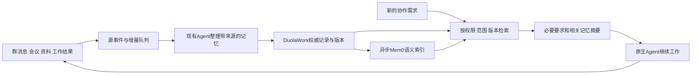

# DuolaWork：侧栏与共享记忆系统完整方案

> 2026-11-05 实施更新：侧栏现按「资料 / Todo / 记忆 / 会议」落地。原方案中“进展”对外名称改为 Todo，沿用同一协作对象。下文记忆引擎及自动整理是完整目标，不代表已经上线；本轮交付边界和证据见 [侧栏实施与验收-20261105.md](./侧栏实施与验收-20261105.md)。

日期：2026-11-05。状态：产品与工程设计稿，包含官方资料及部分源码调研；本轮未安装记忆服务、未修改运行版，尚未完成真实 Agent 记忆验收。本文替代本文件上一版“资料 / 进展 / 约定”的建议，不另开并行方案。

## 1. 结论与本轮确定的方向

**聊天承载自由沟通，侧栏保存需要持续使用的协作内容：资料、进展、记忆、会议。** 人和 Agent 都能使用这些工具，不要求人先建立任务、选择会议方法或维护管理表。

“约定”属于记忆的一种。共享记忆还应保留项目背景、需求偏好、采用或放弃方案的原因、经过验证的经验，以及尚未解决的分歧。它帮助下一轮协作、换成员、换原生会话后继续工作，减少重复解释和重复踩坑。

**推荐技术组合：DuolaWork 负责记忆的来源、范围、版本和纠错；复用 Mem0 OSS 做记忆索引与语义检索，现有 SQLite 保管权威记录与关键词检索。** 不另造一个替代所有成员的总控 Agent，不要求用户给每个成员单独安装记忆插件，不接管各平台原生私人记忆。

**会议采用用户本轮明确的交互：发起会议 → 输入需求并发到群聊 → 负责人在群里多轮细化 → 用户确认后开会 → 侧栏卡片持续更新 → 点击查看记录与总结。完整过程一直在群聊中。** 每场会议有独立记录，不埋进资料，也不另开与群聊割裂的筹备对话。

### 产品边界

- DuolaWork 管共享信息和协作，各 Agent 保留原生账号、模型、工具、项目和运行环境。本机与 VPS 不被伪装成同一个文件夹。
- 账号接入与某个群选用哪个原生项目/会话仍是两件事。本轮不重建账号、不改登录、不搬迁私人会话。
- 群负责人由用户指定、可更换。负责人帮助组织，不垄断发言，也不是使用工具的唯一入口。
- 普通问答、相互讨论和求助照常进行；记忆整理、会议或工作状态不能锁住聊天输入框。
- 本文描述完整目标，不把开源项目已有功能、我们的方案或接口保存成功说成产品已经交付。

## 2. 现有实现：保留什么，缺什么

核对当前开发工作树的 `ui/conversation/App.jsx`、`SharedSpace.jsx`、`cloud/collaboration/conversation.mjs`、`inbox.mjs`、`server/sqlite.mjs`，并参考已完成的运行界面只读检查。

| 当前能力 | 已有价值 | 要补的问题 |
|---|---|---|
| 共享文件与在线文档 | 文件版本、文档修订、授权读取 | 界面按内部结构分栏目；缺统一查找、引用到输入框、回到来源讨论 |
| 事项 | 标题、执行成员、todo/doing/done | 当前 `channel.task` 保存分支没有实际派发通知；缺来源、接手回执、阻塞与成果关联 |
| 会议 | 筹备、执行、记录等基础 | 需求、筹备沟通和结果入口割裂；交互统一回群聊，独立会议记录保留 |
| 成员 | 连接、原生会话、群成员 | 不必占内容标签；需要更清楚地区分账号连接、本群参与者与工作环境 |
| 群知识 | `channel.remember` 写入 pending，用户 review 为 approved/rejected；Agent 读取 approved | 当前近似待确认便签，缺来源、修订替代、冲突、按任务检索及失效机制 |
| 接收上下文 | `withConversationContext` 已携带群知识 | 传递知识集合不等于按当前问题召回记忆 |
| SQLite 与共享授权 | 事务、WAL、对象身份、群范围 | 继续作权威数据层；不能把向量过滤当作全部权限控制 |

旧版另有 `knowledge` / `knowledge_applicability`，迁移时与当前 `channel_memory` 分开识别，不把旧全局记录自动公开到所有群。

## 3. 侧栏结构与共同交互

| 入口 | 用户要解决的问题 | Agent 怎样使用 |
|---|---|---|
| **资料** | 原材料、文件、成果在哪里，如何继续讨论这一份？ | 读取准确版本、发布结果、引用或交接 |
| **进展** | 答应做的事做到哪了，卡在哪，结果在哪里？ | 记录持续工作、更新进展、请求协助、交接结果 |
| **记忆** | 哪些背景、要求、决定和经验以后还需要记得？ | 查询相关记忆、补充来源、依据新证据纠正 |
| **会议** | 哪些会在筹备或进行，每场最后得到了什么？ | 组织讨论、更新议题、形成总结与后续工作 |

群头保留“开会”和成员头像。点头像打开成员面板：加人、移出、换负责人、私聊，选择本群对应的 Coding 项目/会话。账号连接与解除连接放全局成员页；移出群不等于注销账号。

侧栏用紧凑列表、清楚标题，避免满屏大卡片。会议采用小型摘要卡。点击条目在同一侧栏展开详情，可返回、扩宽、全屏阅读；窄屏切成可返回的整页详情。保留群聊草稿、滚动位置、各标签阅读位置。

对象共同动作：**打开、引用到输入框、查看来源讨论**。编辑、下载、版本、删除按类型提供。引用变成可移除标签，用户补一句话即可发送，不搬运 ID、路径或整段全文。

打开面板、切标签、预览、查列表不唤醒 Agent。发消息、明确交接、分配工作以及影响当前执行的变更，才通知相关成员。加载中、确实为空、网络失败分别显示。

## 4. 资料：一套目录，多种内容

### 4.1 文件与文档的关系

它们都是资料。在线文档能直接编辑；PDF、CSV、图片保留格式；链接保留外部来源。统一列表，按类型、来源和最近更新筛选，不再拆成“共享文件 / 共享文档 / 团队知识”三个架子。

同一报告可在聊天、会议、工作中引用，但只有一个对象及版本历史。“成果”是资料的用途，不复制一份新文件。上传文件不会自动变成可共编文档；明确转换时保留原件与派生关系。相同标题不自动合并。

### 4.2 使用方式

1. 文件拖进输入框并发送：消息带附件，资料区同时可找。
2. 只在资料区上传：用于收纳，不自动让全员开工；可继续点“发到群聊”。
3. 点“引用到输入框”或拖入输入框，再写“检查这一版预算”；接收者拿到实际可读的引用。
4. 列表打开最新版；已发消息、历史会议、交接固定当时版本。出现新版提示，不改变历史依据。
5. 修改影响当前工作时，只通知正在依赖它的相关成员；改名和普通整理不广播全群。

参考全文留在资料，需要时读取。记忆保存有来源的关键理解，不把每个上传文件都自动转为长期规则。

## 5. 进展：跟住承诺，不把聊天变成工单

重做现有事项，界面叫“进展”。只有值得跨轮次跟进的工作进入这里，简单问答不建事项。默认显示：**做什么、谁接手、一句当前情况、结果入口**；点开看来源消息、说明、参与者、可选期限、依赖和变更。列表优先，按需切换看板。

- 用户可把消息转成工作，也可自然地说“记下来，明天继续”；Agent 在实际需要时用同一工具记录。
- 分工来自本次沟通，不固定岗位。执行者可换，其他成员可加入帮助。
- 指定人后真实通知；待接手、实际接手、执行者报告完成区分。保存一个名字不能显示已开工。
- 阻塞由执行者写具体原因，如“等 PR 提交后检查”；系统不猜原 IDE 全部活动。
- 完成关联实际文件、文档、提交或明确文字结论，标明谁报告完成；这不等于平台保证内容正确，也不强制每件事人工验收。
- “在群里继续”把工作引用到输入框，可以补充、纠正、取消或重新安排。工作结束不结束群聊。
- GitHub Issue/PR 可关联，不另造与仓库冲突的状态源。既有交接成为工作事件，也仍能独立交接，不强制先建事项。

缺少真实接手与结果衔接，只把 todo/doing/done 改名，不算完成。

## 6. 会议：在群里开，每场有独立记录

本节采用用户 2026-11-05 最新要求，替代另开筹备聊天、让用户填写完整配置的路径。

### 6.1 发起与筹备

1. 点群头“开会”，轻量输入框只问“想讨论什么？”，可附资料；也能在群里让任意 Agent 发起。
2. 发送后，需求以带会议标记的消息进入原群，侧栏“会议”立即生成筹备卡片。输入界面关闭，接下来在群里沟通。
3. 默认群参与者、群负责人、十分钟时长。缺负责人时就地选择一次，不重新配一组人。Agent 发起走同一套对象与规则。
4. 负责人结合材料和上下文先给出理解，再问真正影响方向的问题。可以多轮；信息够了直接给议题和预期交付，不为讨论而追问。
5. 群中简短筹备摘要：讨论什么、要得到什么、需要解决哪些问题、预计多久。成员和时长可展开改，不是必填问卷。负责人选择合适组织方式，用户无需理解“德尔菲、双盲、对抗式”等术语。
6. 用户点“开始会议”，或明确回复“就按这个开始”，才进入正式会议。自然语言确认转成同一开始动作，不重复弹确认。用户明确授权 Agent 直接组织并开始时，保留授权来源。

筹备更新同一份会议安排，不每次刷一个大表格。十分钟从正式开始计时，筹备不占讨论时长。时间是可调整的预期，不是让用户先设计会议。

### 6.2 正式讨论与随时介入

Agent 在原群里回答、交流，消息带轻量会议标记。普通群消息照常发送。侧栏卡片显示主题、阶段、已用时间、最近一句进展，点击打开该场会议。

负责人推进议题、补遗漏，按需要组织独立检查、反例验证等；这些是工具，不是每场必走的流水线。问题或材料变化时可以调整，并说明原因。

汇总保留主张的依据、不同意见和未解决问题，不能因为多数赞同就写成已证实，也不为展示协作强造反对意见。需要首轮独立判断时，仅在该轮暂不提供其他成员尚未提交的答案；提交后回群公开，不借此砍掉自由沟通。

用户可随时补充、改变方向、要求总结、结束或延长。相关成员收到变化，不能继续沿用已撤回目标。与会议无关的工作继续执行。

### 6.3 什么时候结束

默认**十分钟到时停止扩展讨论，由负责人收尾**；提前达到预期也可由负责人交付并结束。用户可以直接说“结束这场会，给我总结”或点击结束，不必等负责人同意。存在多场会议且指向不清时才就地澄清。

- 到时停止新增会议讨论唤醒，负责人用已有内容汇总，不自动延长。
- 结束讨论与总结完成分开记录；没总结时显示“讨论已结束，总结整理中”，不宣称已交付。
- 收尾设有限超时和幂等重试；失败显示“总结暂未完成，记录已保存”，可由原负责人重试或用户换人。具体超时值根据真实连接耗时验收确定，不虚构几秒必达。
- 用户说“立即停止，不用总结”，停止本场后续工作，保留已有过程。停会不暂停群聊、不停止其他任务、不重建登录。
- 用户可调整时长、选择到时直接结束或负责人交付后收尾；负责人收尾仍有截止控制，不无限讨论。

### 6.4 会议侧栏与详情

会议独立列表按时间排列，可筛进行中和历史。每场一张紧凑卡片：**可辨识主题、筹备/讨论/收尾/结束状态、时间、负责人、一句交付摘要**。工具调用次数不当成果。

打开详情：

1. 正在开会先看当前议题、预期结果、进展，以及回群讨论/结束入口。
2. 已结束先给用户能懂的答案，再看依据、未解决问题、需要用户决定的事和后续行动；有内容才显示，不硬凑模板。
3. 完整记录按时间排列，区分会前筹备与正式讨论，每条可跳回群中原消息。总结有修订历史。

**群聊和侧栏会议过程使用同一份消息数据，通过 meetingId 关联，不维护两份独立文字。** 普通消息不因恰在会议时间段就全部收入记录；明确归属或补录，补录保留来源。多场会议的回复保留关联，不靠时间区间猜归属。

原消息删除或权限变化，记录跟随处理，不用快照绕过删除。正式总结是有版本的成果，标明引用和来源状态。

总结可引用回群、关联工作、导出、保存为资料，仍指向同一成果对象。**会议记录不等于记忆**：完整过程留会议，长期有用的决定/经验提炼入记忆并链接原会议。失败或未达共识的会议同样有记录，不强行写“双方达成一致”。

工程上，会议对象保存 `meetingId / channelId / 需求消息 / 负责人 / 参与者 / 议题与预期交付版本 / 确认来源 / 开始时间 / 截止时间 / 总结引用`。筹备、正式发言和收尾通过同一个 `meetingId` 区分阶段。开始、结束、提交总结都是幂等动作，重复点击或接收重试不创建第二场会议；负责人更换后仍继续同一场记录。会议状态仅影响本场组织行为，不映射为群聊的暂停或归档。

## 7. 记忆的产品设计

### 7.1 分清四种信息

| 信息 | 放在哪里 | 例子 |
|---|---|---|
| 原始证据和过程 | 消息、资料、会议 | 截图、测试记录、完整讨论 |
| 当前工作状态 | 进展 | 等 Codex 的 PR，今天要复核 |
| 跨轮次有用的理解 | 记忆 | 为什么选此方案、稳定要求、问题在什么条件下怎样解决 |
| 成员私人上下文 | 原生环境 | 未共享代码、别的客户项目、私人对话 |

不把“正在等 PR”存成永久事实；它由工作对象提供。记忆可引用结果，不维护第二份实时进度。

### 7.2 记什么

- **背景**：在解决什么问题、对象和术语；会变，不永远当真。
- **要求与偏好**：用户明确约定、范围、交付方式；限定当前群/项目，主动推广后才成为团队范围。
- **决定及原因**：为什么选 A、不做 B；条件变化可重议，历史取舍不自动成为永久禁令。
- **经验**：问题、环境、操作、证据、实际结果、适用条件。没验证就标“待验证经验”。
- **分歧与待确认事实**：保留不同主张与依据，相关时可查，不当已确定规则自动执行。

不保存模型思维链，不收集未共享的本地/VPS文件，不把密钥、登录凭证放记忆。新成员得到授权的协作信息，不是其他成员私人记忆的复制品。

### 7.3 怎么形成，用户要做什么

**正常聊天即可，不要求先建知识库，也不逐条审批。** 想明确留下时，说“记住这个”或点消息菜单“记为经验/要求”。

系统保存源事件、权限、版本、队列和去重；**Agent 理解内容、归纳和提出修正**。关键词规则不假装理解用户。

| 来源 | 默认处理 |
|---|---|
| 用户主动添加或明确“以后按这个” | 带源消息保存为本范围要求，可撤销，不再第二次点同意 |
| 已发生事实、已交付结果 | Agent 带依据整理，注明成员报告/附验证记录，不逐条人工批准 |
| Agent 推断的偏好、事实、规则 | 标为待证实理解，不冒充用户授权或已采用决定 |
| 人或获授权负责人明确决定 | 保存决定人、来源和适用范围；负责人建议不自动等于用户决定 |
| 多个 Agent 重复结论 | 合并重复叙述，保留来源；复述次数不提高可信程度 |
| 原资料中的命令性文字 | 作为材料处理，不升级成系统规则或权限 |

真实冲突需要人决定时在群里自然提出，不另造积压审批中心。已经表达的要求按原范围落实，扩大共享范围需有明确意图。

### 7.4 侧栏怎么用

可搜索的短条目列表，默认当前有效内容；按背景、要求、决定、经验筛选，这是查找方式，不是用户必填分类。显示一句内容、范围、来源和更新时间，不显示向量 ID 或相似度。

详情：正文、为何留下、谁写的、原始依据、修改历史，以及“引用到群聊 / 修改 / 不再使用”。争议并列保留，不捏造共识。旧版默认折叠，可查历史。可导出自己的记忆，关闭某群自动整理。

纠错可直接改，也可在群里说“刚才那条理解错了，实际是……”。新版本替代旧版，相关成员后续获取新内容，不让用户逐个重新解释。

“不再使用”退出正常召回、保留历史；“彻底删除”清理正文及派生索引缓存。来源和备份的处理见第9节，不能只隐藏界面。

### 7.5 与原生记忆的关系

DuolaWork 提供共享协作记忆，各 Agent 原生记忆仍由其平台管理。接入不自动读全部原生历史，不向每个工程写同一份 MEMORY.md，不改全局指令。

在群内工作，经现有 Hub 上下文/MCP 提供相关记忆；撤权后停止后续读写。已经读入原 Agent 的上下文无法保证抹除，不能承诺撤权等于远端失忆。新上下文携带当前版本，过时结果不能重新覆盖现状。

## 8. 开源方案调研与选型

查阅于2026-11-05。以下是官方资料和源码核对，不是模型效果实测；未用供应商榜单证明我们的效果。

| 方案 | 查到的机制与条件 | 对本产品的判断 |
|---|---|---|
| **Mem0 OSS** | 增改查删、元数据过滤、可配置模型/向量存储，Python/TS SDK；TS 源码确认 infer:false 直接保存已整理内容，仍做 embedding。Apache-2.0。[M1][M2] | **首选复用引擎**，能接在现有后端后，不替换原生 Agent；群权限和生效规则仍由我们负责 |
| **Graphiti** | 时序关系图、语义/关键词/图检索，需要图数据库、LLM和embedding。Apache-2.0。[M3] | 变化与历史关系值得借鉴，目前不把图数据库变成全部记忆的依赖 |
| **Hindsight** | retain/recall/reflect，事实与经验，支持MCP、主要使用PostgreSQL。官方 full API 最低约1.5GB RAM，slim API约512MB，PostgreSQL另约512MB；slim外置embedding/重排。MIT。[M4][M5] | 经验反思有价值，整套更重，不直接塞进现有1GB中转机 |
| **Letta / MemFS** | Git管理的Agent记忆文件系统，分层加载与共享上下文；Letta仓库Apache-2.0。[M6] | 借鉴可查看、可修订、摘要/详情分层；不等于所有原生Agent装上便统一共享 |
| **OpenViking** | 资源/记忆/技能统一目录，L0/L1/L2分层读取，自托管需模型和embedding/VLM；快照主项目AGPLv3。[M7] | 目录和按需读取有参考意义，覆盖面更大，不整包引入；未来采用按具体分发方式核对许可 |
| **MCP官方memory参考服务** | JSONL实体/关系/观察，源码搜索为字符串包含匹配；已有原子保存和多进程文件锁。[M8] | 适合工具形态参考，不是已完成跨群授权、语义召回、版本纠错的产品 |

### 8.1 推荐组合

**Mem0 OSS TypeScript SDK + 持久化 Qdrant + 现有 SQLite。** 不部署 Mem0 全套管理后台，不把 Node SDK 的内存存储当生产持久化。

- SQLite：权威记忆、来源、版本、范围、处理队列，关键词和标题检索。
- Mem0/Qdrant：索引当前可检索内容，通过不同说法找到相关经验；可重建的派生层，不作最终权限裁判。
- 原生 Agent：理解公开协作并归纳，默认用 infer:false 避免对同一内容再做一次 LLM 抽取；含义是已整理内容直接存，不是免费或免embedding。
- Hub API/MCP：成员统一入口，不需要知道 Mem0，不另建一套用户配对。

TS 与现有 Node 后端一致；本轮核对过 TS 实现，不把 Python 参数直接套过来。当前 Mem0 官方配置文档明确 graph memory 不属于 OSS，本方案不依赖它。[M1][M2]

不是安装一个包就交付。引擎解决索引、存取和检索；谁说的、谁能看、哪条有效、怎样回到原会议/消息，属于我们的协作产品，必须接到现有对象和权限体系。

## 9. 记忆工程方案

### 9.1 数据流

只处理已共享到 Hub 的内容，原环境经验需明确分享，不扫描整台电脑或VPS。文档是材料，不拥有修改权限或用户意图的地位。

### 9.2 自动整理与写入

1. 源消息/成果落库时写待整理事件；聊天发送不等模型抽取。
2. 正在处理工作的 Agent 随结果提交记忆增量；积压按群合批交给可用且获授权的成员整理，不重复读全量聊天。
3. 无可用成员时保留队列和游标，显示尚未整理；恢复后续做，不伪造“已学习”。
4. 提交包含内容、类型、范围、来源对象及版本；修正还带已有ID和预期版本。服务端校验权限与来源存在性；语义是否受证据支持由 Agent 判断并在验收中核对，不能宣称程序证明所有语义。
5. 源事件与提取版本作幂等键，同群整理作业有租约。整理自身事件不再次触发整理，防循环。
6. 权威记录、修订和索引outbox同事务写入；索引异步重试。已保存但未索引要区分。

按新增内容、工作结果、明确纠正触发，不每分钟唤醒全群。后台整理不抢占原IDE任务、不切换原生会话。模型用量计入实际额度，复用订阅不等于没有成本。

### 9.3 权威记录与共享范围

| 字段组 | 必需内容 |
|---|---|
| 身份/范围 | memoryId、workspaceId、channelId或明确共享项目、可见范围；原生sessionId不充当永久项目身份 |
| 内容/来源 | 标题、短摘要、正文、类型、源消息/会议/资料/工作及版本、提交者 |
| 状态/证据 | 有效、待核实、冲突、已替代、不再使用；用户明确要求/成员报告/附验证记录等来源类型 |
| 时间/修订 | version、observedAt、effectiveFrom/To、supersedes、修改者、修订原因 |
| 运行关联 | 幂等键、索引版本、embedding模型/维度、整理游标 |

默认群内共享，单聊属于单聊，团队通用记忆需明确推广。服务端从身份和当前授权产生查询范围，不能凭 Agent 自报任意groupId读其他群。查询前过滤，取回后再核对权威记录和源资料权限，防旧索引、缓存、猜ID越权。

退群立即影响后续读写；换负责人不扩大权限。同账号的不同项目会话不因账号相同自动互通私人上下文。记忆可见范围不超出来源许可；跨群分享需产生明确获准的分享内容和来源关系。

### 9.4 纠错、冲突和时间

- 明确替代：用户“用A”改成“用B”，A保留历史，当前取B，不把两条都当有效要求。
- 条件不同：Mac经验与VPS经验并列，不互相覆盖。
- 事实争议：保留各自依据，不能最后写入者或多数票自动胜出；新证据才能解决。
- 并发修改：携带预期版本，冲突返回当前内容，合并后重试，不无声覆盖。
- 时效：价格、接口能力等记录观察时间和条件；频繁使用不等于重新验证。在线状态由连接系统提供，不塞成永久记忆。
- 经验：保存问题、条件、操作、真实结果；一次成功是后续线索，新任务仍要核对环境，不推导“以后永不出错”。

需独立判断的会议轮次只提供共同事实、必要要求，暂不提供其他人尚未公开的本轮结论；轮次结束后回正常共享。记忆不能成为不断强化旧错误共识的渠道。

### 9.5 检索与上下文

每次开始相关工作、收到新需求或恢复原生会话：

1. 带当前适用明确要求、被撤回的关键要求提示及少量项目背景，不只靠向量相似度碰运气。
2. 按当前需求、明确引用、项目条件，合并SQLite关键词与Mem0语义结果，按权限、相关性、时效、来源筛选去重。
3. 返回短摘要、ID/版本、来源、展开入口；正文按需读取，不反复塞全部群历史。
4. 区分“内容提供了”“Agent实际读了依据”“正确使用了”，分别验收。

普通自动记忆包初始预算建议约1,500 tokens、最多8条相关记录，属于待测参数；必要要求单独计算，超预算提供分页并要求继续读取，不能静默截断后声称完整。检索有独立超时，不无限阻塞唤醒；失败返回必要要求与关键词结果，标明语义检索暂不可用，异步补齐。

中文检索不能假设英文分词有效。FTS5 trigram短于3个字符的全文匹配有限制，短词和别名要补标题/别名查找。语义部分需真实中文改写验收。[M9]

Embedding provider可配置，需用中英混合词汇做选型测试；本轮未测试模型，不宣称哪款最好。记录模型、维度、版本，换模型建新索引验收后切换，不混用不同模型空间。

### 9.6 更新、遗忘与缓存

先更新权威版本，旧向量即使尚未清理也要被最终读取校验挡住。相关执行成员收到变化提示，下一次取上下文取新版；历史回答保留当时依据。

“不再使用”退出当前召回，历史可查。“彻底删除”清理正文、敏感修订内容、向量、全文索引、缓存，保留不含正文的删除标记防恢复后重建。备份按公开周期清除，恢复时应用删除标记，不能承诺按钮立即抹掉所有离线备份。

“忘掉这条”还需阻止同一来源被自动整理再次生成。原聊天是否删除是另一项明确操作；来源删除后，依赖记忆失效或根据剩余来源重新核对，不能遗留无来源的已证实结论。

### 9.7 工具与适配

成员只接触少量工具，暂定 search_memory、read_memory、remember、revise_memory；最终名称遵循既有MCP规范。不再使用、推广范围等由同一业务权限处理。

GUI与工具写同一对象。扩展现有接收上下文携带摘要、版本、读取入口；有MCP的原生Agent按需查询。只能拿唤醒包、暂不能调用新工具的适配器明确标能力，不因登录正常就算完整支持记忆。

记忆与外部资料分区标注，不伪装为平台system权限。新工具通过现有连接发布，不要求重登录；缓存旧工具目录的客户端沿用既有兼容路径，真实往返后才标完成。原VPS Claude仍由用户自行操作，本轮不连接、探测或修改。

## 10. 部署、资源与费用

**无需为写方案购买服务器；现有1GB中转机也不能认定能承载商用记忆系统。** 协作主服务继续保留，记忆worker和Qdrant按可独立部署设计；开发联调可本机运行，生产是否同机由负载测试决定。

边界：协作API/SQLite → 内部记忆worker → 私有Qdrant，Agent统一访问Hub，不能直连向量数据库。Embedding用可配置服务，不在1GB机器上常驻大模型、embedding或重排模型。

资源规划可按独立2核4GB记忆服务预留，这是规划值，不是证明过的最低配置或容量承诺。检索与批量建索引不阻塞聊天主事件循环。大文件解析属资料服务，记忆以短条目为主，不每轮重新向量化全部聊天。

费用包含：原Agent整理的模型额度、embedding、索引服务器与存储、备份运维。infer:false减少重复抽取，不消除embedding费用。外部provider会接收待索引文本，部署设置需明确披露，可配置自托管；普通用户不必给每个成员单独填API Key。

记录实际新增/更新条数、token、查询次数、provider计费、检索/写入耗时、磁盘和RSS。例：1万条1536维float32向量本体约61.4MB，不含索引、元数据、历史和进程内存，不能据此推算1GB的承载人数。

规模变大时权威数据与检索分别扩容。商业多租户还需工作区隔离、配额、备份恢复和容量验收；现有私有工作区不能直接称SaaS。关键词降级只用于故障期间，不能替代语义能力完成正式验收。

## 11. 工程清单与迁移

| 模块 | 复用 | 要补 |
|---|---|---|
| 侧栏 | 群聊与详情组件 | 四入口、面板返回/扩宽、窄屏、草稿阅读位置 |
| 资料 | 文件/文档/版本/授权 | 统一列表、链接资料、类型化引用、来源跳转 |
| 进展 | 事项/通知/交接 | 来源、真实接手、阻塞、结果、变更 |
| 会议 | 会议引擎/消息/总结 | 需求即进群、同群筹备、确认开始、同源卡片记录、收尾 |
| 记忆业务 | channel_memory/源对象/SQLite | 来源、版本、范围、冲突、删除、增量整理和outbox |
| 检索引擎 | Mem0 OSS TS | 锁版本、持久化、关键词合并、过滤、重建、超时指标 |
| 原生适配 | 现有上下文和MCP | 记忆包、按需读取、更新提示，不改登录和环境 |

统一引用至少包含对象类型、ID、范围、版本和展示标题。发送时固定版本并重新校验接收者权限；文档、文件、会议总结、工作与记忆都通过这套引用回到聊天。展示标题不充当对象身份，也不把本地路径当成跨环境可读取地址。

旧approved保留ID，标历史已采用；来源不详明确“历史导入，缺少原始依据”，不编造。Pending保持待核实，Rejected不召回；不能批量把历史便签变现行指令。

历史会议保留ID和消息引用，缺可信归属的旧记录不按时间段乱补聊天。只整理新内容及明确选择的历史范围，回填可断点恢复。旧接口保持兼容，换索引不重新配对。

## 12. 验收：真实使用与数据质量一起看

以下是实现后的目标，**本轮未宣称通过**。四个标签、保存JSON、构建通过、接口200均不代表完成。

### 12.1 场景验收

| 场景 | 必须得到的结果 |
|---|---|
| 引用资料给成员处理 | 原Agent能读对版本，回复回到同一资料 |
| 改版后回看旧讨论 | 历史引用不变，明确提示新版 |
| 两位成员交接 | 接手、来源版本、阻塞、结果连得起来，不复制私人文件 |
| 模糊需求发起会议 | 需求进群、负责人同群细化，不先填完整配置或学术语 |
| 开始、讨论、结束、收尾 | 确认后计时，用户可介入；无总结不称交付，停会不锁群 |
| 看历史会议 | 独立卡片可找，先看答案，过程可逐条跳原消息 |
| 新成员/新会话 | 获授权的相关背景和记忆能用，不让用户从头复述 |
| 用户纠正决定 | 后续取新版，旧版仅作历史，相关Agent不继续使用旧要求 |
| 冲突与重复附和 | 不按多数票认定事实；外部资料不能变用户规则 |
| 单聊/跨群/退群 | 猜ID、旧索引、缓存均不能越权 |
| 删除记忆及来源 | 不偷偷重建，源依赖与索引失败状态清楚 |
| 超时/断网/重启 | 聊天继续，明确未完成；恢复幂等补齐、不丢权威记录 |
| 窄屏/长文/返回 | 无横向溢出，草稿与位置保留，加载不伪装为空 |

### 12.2 记忆质量与性能

建立120题固定集，覆盖中文改写、项目别名、版本变化、并发冲突、跨群权限、无答案、删除、经验条件；至少40题来自脱敏真实协作，人工标注应命中来源及禁出现内容，留一部分不参与调参。

- 明确要求/版本规则、权限/删除用例必须全部通过。
- 语义问题正确来源 Recall@8 初始门槛90%；无答案不得伪造依据。这是我们的验收目标，不是Mem0保证。
- 核对记忆是否受来源支持、范围和条件是否准确；检索命中不代表回答正确。
- 相同原生Agent、固定需求做有/无共享记忆对照，检查重复解释是否减少、纠正是否继承、错误经验是否拒绝，不用第三方榜单代替。
- 普通自动记忆读取不调用生成式LLM；预热新增耗时p95目标≤1秒，单列embedding网络耗时。超时不能无限拖慢唤醒，冷启动与回填另计。
- 初始压力档：1万条记忆、5路并发检索加后台写入，记录RSS、磁盘、主事件循环和错误；不达标调整容量，不宣称1GB已够。
- 原生往返覆盖Personal Agent、本机Coding Agent及获授权远端测试成员；不动用户原VPS Claude。

完整交付应附：实际安装包会议全过程、资料往返、记忆纠正后新会话使用的证据、权限删除用例、固定集结果、性能与恢复记录。未验证客户端/容量单列，不用“接入正常”概括全部能力。

## 13. 官方来源与本轮证据边界

### 13.1 记忆方案

- **[M1] Mem0配置与默认组件**：[配置](https://docs.mem0.ai/open-source/configuration)、[概览](https://github.com/mem0ai/mem0/blob/ed1f10fc87080f0b67f99be370817504888462ab/docs/open-source/overview.mdx)。核对可配置LLM/embedder/vector store、TS接入和OSS范围；本方案不照抄默认provider。
- **[M2] Mem0源码快照**：[TS Memory](https://github.com/mem0ai/mem0/blob/ed1f10fc87080f0b67f99be370817504888462ab/mem0-ts/src/oss/src/memory/index.ts)、[Qdrant adapter](https://github.com/mem0ai/mem0/blob/ed1f10fc87080f0b67f99be370817504888462ab/mem0-ts/src/oss/src/vector_stores/qdrant.ts)、[LICENSE](https://github.com/mem0ai/mem0/blob/ed1f10fc87080f0b67f99be370817504888462ab/LICENSE)。重点核对infer:false、embedding、search、update/delete。源码可行不等于本产品集成已通过。
- **[M3] Graphiti**：[固定README](https://github.com/getzep/graphiti/blob/fb60e59d4a208c99e7d0186ee6335d2a257f17f2/README.md)。核对时序、依赖与自行承担服务权限的边界。
- **[M4] Hindsight**：[固定README](https://github.com/vectorize-io/hindsight/blob/1a37e009cbe9b8cd76b2c5d5b6c5745374e19507/README.md)。核对retain/recall/reflect、数据库、MCP。
- **[M5] Hindsight资源要求**：[Installation 0.10](https://hindsight.vectorize.io/0.10/developer/installation)。内存数是官方组件建议，不是本机测试。
- **[M6] Letta/MemFS**：[官方概念文档](https://github.com/letta-ai/letta-docs-md/blob/main/concepts/memfs/index.md)、[Letta仓库快照](https://github.com/letta-ai/letta/tree/8816d3a8516893bfdc0fa14bfb1235226012e295)。借鉴可查看、可修订、分层读取，不托管替换原生Agent。
- **[M7] OpenViking**：[固定README](https://github.com/volcengine/OpenViking/blob/3e0c9dcc47cffec3de07e82e238d11a6c21e8915/README.md)、[LICENSE](https://github.com/volcengine/OpenViking/blob/3e0c9dcc47cffec3de07e82e238d11a6c21e8915/LICENSE)。核对分层、运行模型与许可，不把其性能宣传作为本产品证据。
- **[M8] MCP官方memory**：[README](https://github.com/modelcontextprotocol/servers/blob/36380287ed3b15d115b55f546617d723072b1296/src/memory/README.md)、[源码](https://github.com/modelcontextprotocol/servers/blob/36380287ed3b15d115b55f546617d723072b1296/src/memory/index.ts)。核对持久化与字符串搜索；仓库LICENSE有许可迁移说明，不简单标成统一MIT。
- **[M9] SQLite FTS5**：[官方文档](https://www.sqlite.org/fts5.html)。尤其注意trigram短词限制；它不是语义记忆引擎。

### 13.2 交互参考

- [飞书创建任务](https://www.feishu.cn/hc/zh-CN/articles/360741352378-创建任务)：消息与工作双向关联。
- [飞书会话标签](https://open.feishu.cn/document/group/chat-tab/chat-tab-overview)：合并文件、文档、URL资源入口。
- [Slack会话标签](https://slack.com/help/articles/32562841868307-Add-and-manage-tabs-in-channels-and-direct-messages)：以沟通为基础按需组织内容。
- [Slack Lists](https://slack.com/help/articles/27452748828179-Use-Lists-in-Slack)：消息建立工作、保留讨论；我们还需真实Agent接手。
- [Slack分屏](https://slack.com/help/articles/47144721728275-Use-split-view-in-Slack)：资料和对话并排，保留上下文。
- [Basecamp Docs & Files](https://5.basecamp-help.com/article/1079-docs-and-files)：统一组织文档、文件、链接，打开方式仍各有区别。

会议新流程直接依据本轮用户要求，不声称上述产品提供完全相同功能。项目已有《多Agent协作大团圆病与自进化实证研究》作为问题背景，本轮未复核其全部论文和数字，不作为此次选型的量化证据。

**本轮完成：调研、源码核对和此设计稿。尚未完成：记忆部署、侧栏改版、会议新交互及原生Agent端到端验收。**
