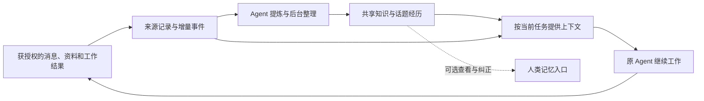

# DuolaWork：Agent 优先的共享记忆与群记忆

2026-11-07｜v1.0｜本轮实现定稿。发布状态和独立验收以今日工作记录为准。

## 1. 用户应该得到什么

用户继续在群里提需求、补充、纠正和看结果。Agent 应能记得相关的旧要求、理解为什么改过方向、知道哪些事情尚未解决，并在新会话里继续工作。用户无需先整理资料、给讨论分类或批准每条记忆。

「记忆」首先是一项协作能力。页面可以暂时不打开，甚至在验证时完全关闭可视化，能力仍应成立。可视化的价值是查看依据、理解误解从何而来和纠正，而非让用户替系统维护知识库。

成功不以记忆条目数、摘要长度、页面访问率衡量。重点是少漏要求、少重复解释、接手正确、更新及时，并且总成本值得。

## 2. 两种记忆，同一套来源

| 内容 | 主要回答 | 典型用途 |
|---|---|---|
| 共享记忆 | 做相关工作时，哪些知识、约束和经验值得参考，适用于什么条件？ | 避免重复踩坑、沿用有效要求、识别旧经验已不适用。 |
| 群记忆 | 这件事为什么开始，经历了哪些变化，现在到哪一步，为什么得到这个结果？ | 换负责人、换会话、旧话题重开、追问决定原因。 |

共享记忆不必是碎片：有关联的条目可以组织成主题知识。群记忆也不是全群的一篇长总结：以可演变的话题组织关键经历，既能读当前理解，也能回到过去的关键节点。

两者互相链接。例如一段讨论经历可以产生一条有适用条件的经验；以后经验被推翻，能回到对应经历说明为什么修正。不会把同一条事实在两个模块各维护一份互不关联的版本。

聊天原消息、文档版本和真实工具回执仍是依据。记忆属于派生内容；原件按既有授权与保存政策管理，不承诺无限期保存。

## 3. 群记忆具体记什么

主要保留会影响后续工作理解的变化：

- 最初需求和交付期待，哪些问题尚未想清楚。
- 后续补充、更改和范围澄清；新要求是替换旧要求，还是附加条件。
- 改变判断的证据、重要方案、反例和分歧。
- 阶段决定及其作出者、理由和适用范围。
- 实际结果及其证据；失败、中止、仍未解决的事项也要保留。

不要求每条记录填满以上字段。刚开始可以只有模糊目标和未决问题；不能为了格式完整编出结果。仅记录公开表达的理由和可核查行动，不采集模型隐藏思考。

话题身份独立于群名、标题、日期、会议和原生会话。A/B/A 交错推进时要能接回 A；相同标题也可能是不同事情。Agent 可建议拆分、合并和关联，系统保留旧标识映射及来源；分类不确定就暂留不确定，不阻止聊天。

群的生命线由这些经历形成。群概况只是按需生成的阅读摘要，不是另一套权威事实。

## 4. 形成、整理与纠正

### 4.1 不增加发送等待

用户消息沿原链路保存和投递，同时可靠记录一个待整理事件。消息发送、聊天切换和普通回复不等待额外记忆模型；重要的用户纠正随本次工作直接送达，不能先等摘要更新。

负责人在已形成阶段理解时，可顺带写入简短记录。普通寒暄或重复赞同可以不生成记忆，事件仍应标记为已检查而非永久积压。

后台整理从已保存的增量恢复，依据变化量、问题重要性、已有未整理范围和资源预算安排。不能默认每条消息都额外调用一个模型，也不把固定“每十条总结一次”当通用规律。

### 4.2 自动记录，不自动把一切变成真理

可存、可检索、是否有充分证据、是否具有指令效力是不同属性。一般观察、暂定推断和未决争议都可以自动记下，并带准确身份；不需要先等人批准才存在。

只有真实的用户指示、实际授权决定或相应证据支持的状态，才按其原本效力使用。Agent 的提案不能因写入记忆自动成为用户要求。引用用户一句话也不等于可以脱离语境扩大授权。

提问、建议、用户要求和已验证结果分开记录。比较性问题不能升级为架构决定；“是否已实现”没有对应证据时保持为未决问题。发现误记后追加纠正经历，明确关联被纠正的旧条目；旧原文和来源保留并标明“已被纠正”，不再作为当前约束。纠正必须核对当前版本，避免用旧认识覆盖较新的修订。

不采用无条件“最后一句覆盖一切”。先核对是否同一对象、同一范围、同一时间条件；用户明确改口更新当前要求，历史保留变化原因。成员判断相互冲突则并列保留，必要时在工作对话中澄清。

### 4.3 维护职责

| 角色 | 责任 | 边界 |
|---|---|---|
| 群负责人 | 维护当前理解和关键过程，处理遗漏和实质性矛盾，交接未决事项 | 不能独占事实来源、删除异议或代用户作未授权决定。 |
| 群成员 | 提交带依据的观察、经验、补充与纠正 | 不要求人人每轮重复写总结；不能跨群扩大来源权限。 |
| 系统 | 保存事件、授权、版本、幂等、并发控制、失败重试和覆盖信息 | 不凭关键词或消息数量决定谁说得对。 |
| 获授权的整理执行者 | 在负责人忙碌或积压时做后台归纳，保留来源与待核实项 | 不接管日常 IDE、不抢占活跃原生会话，不自行获得新账号权限。 |
| 人类 | 可直接在聊天纠正、询问依据、删除或设置记忆范围 | 不承担日常审核和补录义务。 |

首期复用已配置、可执行此工作的 Agent 能力；后台执行者沿用工作区的明确配置与成本预算。负责人是维护责任人，不一定每次亲自运行整理。没有可用执行者时，系统保留增量并按需返回原消息；不能伪称整理完成。

换负责人时，话题、来源、当前理解和未整理范围仍属于群。成员离开不会抹去合法保留的历史贡献，也不会因此向新成员开放原本无权查看的材料。

### 4.4 并发与恢复

写入带来源 ID/版本、操作幂等键和目标期望版本。并发更新先保留各方内容，再按当前来源合并，不能让后一次大摘要覆盖先前反例。失败的整理任务有可重试的范围，不能因 Agent 说了一句“已记录”就推进完成游标。

覆盖记录必须能表达缺口。例如已检查事件 1–50 和 55–60，不能声称“全部整理至 60”。时间戳仅供阅读，内部以事件版本和覆盖范围核对；乱序到达或后补历史仍可重新整理。

涉及当前问题的关键来源已变化时，立即使相关旧结论不再作为当前指令自动注入；保留历史解释。背景索引随后更新，召回仍回查当前权威版本。

## 5. Agent 怎样读和使用

### 5.1 默认只带当前工作需要的内容

领取工作时提供当前消息、相关的最新约束、必要的话题进展、直接关联的资料或待办，以及可进一步查询的入口。不是把全群历史或全部“决定”每轮塞进上下文。

具体数量与长度由所选模型、任务与评测确定。上下文预算不等于只允许保存若干记忆；超出的内容保持可查。若相关约束超出单次预算，要分步读取，不静默丢掉它们。

新会话可先取短概况与相关话题入口。已有会话只需要新增与修订信息，但不能只靠“服务曾发送过”推断模型仍记得：原生压缩、会话切换、恢复或状态未知时，重新提供当前必要依据。

缓存键需包含群/授权范围、任务相关话题、来源版本和记忆版本。用户纠正与来源撤回使相关缓存失效。优化减少重复传输，不能保留失效结论换取速度。

### 5.2 按问题展开

| 当前工作 | 优先读取 |
|---|---|
| 接着处理刚提出的问题 | 当前消息、该话题现状、新增纠正。 |
| “为什么当时选这个？” | 当时的备选、依据、分歧、决定者及后来修正。 |
| “现在是否完成？” | Todo、交付物和验证等实时原对象；记忆只解释背景。 |
| 新成员或新负责人接手 | 相关目标、约束、话题状态、未决问题和来源入口。 |
| 精确条款、数字、承诺 | 当前原始版本；摘要只负责定位。 |
| 需要独立评估 | 共同事实、原始需求和反例；避免只给负责人的最终答案。 |
| 没找到充分信息 | 扩展搜索授权原记录，或说明未知；不能编造群里“早已确定”。 |

记忆还可以记录“哪份资料、哪个成员曾提供过相关依据”。这有助于定向查证，但不能直接推断那位成员现在有空、永远最擅长或必须被唤醒。减少盲目 @全员的效果是待验证收益，不在本次偷偷修改群路由。

### 5.3 工具能力建议

以下能力已沿用现有成员授权和共享工具实现；旧工具目录通过既有认证兼容入口调用，不重新安装另一套工具：

| 能力 | 输入重点 | 返回重点 |
|---|---|---|
| 查询相关记忆 | 当前成员、群、问题、可选话题与时间 | 相关知识/经历、条件、来源、缺口和进一步读取入口。 |
| 读取话题经历 | 话题身份、当前或历史时点 | 目标变化、关键节点、分歧、结果与当前版本。 |
| 贡献或纠正 | 内容、来源版本、适用范围、理由、期望版本 | 已保存版本；合并冲突或明确待核实处。 |
| 读取原始依据 | 消息/文档/结果的确切引用 | 获授权的真实内容，来源不可用则明确返回。 |
| 遗忘或停止使用 | 对象/内容范围，明确的保留或删除意图 | 停用或删除的覆盖范围，残留边界及完成状态。 |

成员看不到内部索引管理员密钥。对只支持文本工具的连接器，返回文本加稳定引用即可；不以某一家支持结构化工具、MCP 或托管记忆作为通用前提。

## 6. 与其他模块的边界

| 模块 | 作为依据的内容 | 记忆不得替代的职责 |
|---|---|---|
| 聊天 | 发言、需求、修改、明确决定 | 原消息与真实发送状态。 |
| 资料 | 文档/文件及其版本 | 正文与完整交付物，不复制成另一套文档。 |
| Todo | 承诺、进度、阻塞与交付 | 不因总结写“做完了”就自动标完成。 |
| 会议 | 特定会议的讨论和总结 | 不驱动开始/结束状态；无正式会议也可沉淀群记忆。 |
| 连接与原生会话 | 成员实际工作环境 | 不扫描未分享的 IDE 历史、私人文件或原生记忆。 |
| 负责人协作 | 澄清、组织、判断和推进 | 有记忆不等于自动解决调度、回复责任或协作质量。 |

Codex、Claude、Gemini、DeepSeek 或 Personal Agent 都通过同一协作语义取用群记忆。它们仍在各自环境干活，原生模型、工具和项目保持原样。DuolaWork 不变成另一个 IDE，也不保证能够清除已经进入原生上下文的旧内容。

共享存储延续已有 VPS 方向。群记忆不要求大家共享同一个磁盘目录；读取经过群权限控制的协作服务。图索引、向量服务、整理执行者是否需要拆分部署，要按真实资源测量，不能承诺当前小型 VPS 能无限承载。

## 7. 可视化只作为轻量入口

侧栏仍是「资料 / Todo / 记忆 / 会议」。记忆内保留两个可切换视图「群记忆」「共享记忆」，共用搜索，不增加一个独立知识管理工作台。

群记忆默认只显示短概况和话题列表。点开某话题才读关键变化、当前结论/未决事项及来源。没有必要默认展示一条巨大的时间轴，更不要求用户维护节点。

共享记忆按相关主题组织，用户可以搜索、纠正、停用或删除。内部置信度、索引分数和处理队列不占用主界面。重要更新通过工作中的正确响应体现，不逐条弹通知。

用户可直接说“这条只适用于这个项目”“这不是我们最终决定”“忘掉那条偏好”。系统定位相关范围并处理；只有对象含糊到会导致误删时才澄清。删除采用现有可撤销机制及明确的永久删除行为，不另设日常审批链。

## 8. 失败时如何继续工作

| 情况 | 行为 |
|---|---|
| 后台整理落后 | 返回当前任务相关的新原始消息，并标注覆盖缺口；不等整理才回复。 |
| 记忆服务暂不可用 | 使用当前对话及获授权的原始资料；需要依赖旧事实时说明信息不足，不假装记得。 |
| 概况与用户新要求冲突 | 使用当前适用的新要求，旧概况退出当前结论，安排重整。 |
| 负责人失联 | 资料和经历继续保存；授权执行者可接续整理，普通聊天不锁住。 |
| 话题误合并 | 支持分开并保留来源映射，不要求重新开群。 |
| 意见冲突没有结果 | 保留双方依据，记为未决；不以多数、沉默或职位替代结论。 |
| 来源删除、撤回或改权限 | 派生内容同时停止对不再有权的对象提供；重建索引和摘要时不能复活。 |
| 已将旧内容传入原生会话 | 后续提供纠正/停用信息；不能宣称从第三方历史中远程擦除。 |

来源授权和当前任务授权分开。记忆中的工具命令、网页指示或某成员发言均不是自动执行许可。记录历史授权也不能使它无限期生效。

## 9. 开源复用与实现路线

研究依据见[材料索引](../Agent管理学/研究/记忆研究/材料/来源索引.md)。已有分层记忆、后台整理和动态组织等成熟研究方向，没必要从零发明全部抽取和检索能力；但没有材料证明某个库已直接解决我们所有群边界、原生会话和真实状态问题。

建议先保留现有来源/权限/版本层，以现有 Mem0 路径和原历史检索作为基线，优先评测 Hindsight 的组织与检索能力；当关系推理成为实际瓶颈时再比较 Graphiti。候选均需固定版本核查许可、资源、中文效果、删除及修订传播。当前不宣布迁移到某一家。

DuolaWork 必须自己拥有稳定群/话题身份、来源对象关系、真实进度边界、维护责任与用户控制。引擎适配层承接整理、检索和索引，不把库的对象 ID 当作产品身份。

实施分为三个可验收阶段，而不是上线三个半成品入口：

1. **建立比较基线。** 固定资料、读者模型、授权与成本记录；核对现有路径的漏记/误记/召回/使用问题。
2. **打通完整闭环。** 一个话题从模糊需求、变更、分歧、交付到换会话继续；包括纠错、删除与失败恢复。先没有页面也应可工作。
3. **验证通用性再扩大使用。** 覆盖不同任务和不同 Agent，验证长期成本与原生压缩恢复；再补轻量可视化与历史群渐进整理。

历史导入只处理授权协作资料，记录覆盖范围，按活跃需求逐步整理；不在升级时扫描所有原生会话。逐步启用时保留旧读路径可回退，新对象和原始来源不能因回退丢失。

## 10. 验收定义

详见[评测协议](../Agent管理学/研究/记忆研究/验证/评测协议-v0.1.md)。必须覆盖“不打开记忆页面仍能继续工作”、一次性关键约束、需求更新、不同话题、未决分歧、换负责人/模型/会话、来源撤回与完整成本。

若原历史检索已同样准确且更便宜，就不以复杂度为成果。若群记忆改善解释但损伤独立判断，就需修正，而不能只展示漂亮纪要。若效果仅在已有开发群成立，就不能称为通用产品。

本版完成产品定稿与对应实现；下面记录本轮采用的具体边界。长期效果和引擎胜出仍是研究问题，不作为已经证明的宣传结论。

## 11. v1.0 实现决定与验收边界

用户已要求今日整张 Todo 实施并上线，此授权覆盖初稿的“开发另排”。

- 沿用 Mem0 3.3.1＋现有向量服务；不迁移生产数据库。Hindsight 固定源码审查为 `eb963cb5a929d92c081371df64c2d5c2fe3351af` / 1.2.0。候选需要额外 PostgreSQL 与整理计算，官方 Helm API 资源请求本身为 1 GiB（这是默认配置，不是运行最低内存证明）。当前 1 GiB 共享 VPS 没有已证明的替换收益，因此本轮保留简单路径，不宣称 Hindsight 效果差。
- `group_memory` 支持 list/read/record/link/merge/split。话题是稳定对象，经历追加；来源版本、未决经历和分歧单独保留。旧版本并发写只追加，不能覆盖当前总结。解决分歧要明确引用被解决的经历，而非写一次“结果”就抹掉。
- 共享记忆自动可检索。`proposal`、`observation` 与有原用户逐字依据的 `user_directive` 分开；可检索不等于有执行授权。所有成员可贡献；原用户指令仍优先。
- 每条公开消息与相关资料变更记录增量。负责人领取普通工作时可顺带整理。正常工作已空闲、连接已核验、没有待处理失败或进行中会议时，才合并一次后台整理。停止会议后不额外付费唤醒，直到用户重新提出工作。
- 同一失败整理批次不循环付费调用；事件不标假完成，下一次正常工作仍能读取和处理。成员可手动调用工具补整理；换负责人沿用同一份事件和话题。首期没有另造常驻托管模型。
- 列表与待整理事件分别分页（`after` / `eventAfter`），覆盖按源版本逐条确认。新事件、迟到事件、旧源修订不会因为“最大序号已通过”而被跳过。
- 当前消息完整送达。尚未整理的用户原话即使已不在最近50条聊天窗口，也补入领取上下文；单包100条以外明确给出待查缺口和分页入口，要求执行前继续核对，不能声称已覆盖全部。已经提炼的约束按授权及当前版本召回。
- 来源变化、撤回、越权以及派生记忆的失效，在召回和直接读取两处检查；语义索引再慢也不能恢复旧正文。遗忘清除正文、修订、所有经历及缓存回执；独立遗忘账本防止旧备份恢复正文。第三方原生上下文已读内容不能远程抹除，后续发送停用说明。
- 界面是侧栏记忆中的“群记忆／共享记忆”，群记忆列表→经历→来源。无须打开页面、分类或逐条审核。

本轮12类合成短轨迹已完成真实模型预试（4组×12，共48次读取，另36次整理，统一 deepseek-v4.1-flash）。它发现了额外整理成本以及过度保守的表达，不能证明长期通用收益或2%非劣界值。长历史遗漏由实际上下文回归发现并修复，真实模型长期效果不拿这些单测冒充。

详细产物：[记忆研究实测与采用决定](../Agent管理学/研究/记忆研究/验证/20261107-预试结果与采用决定.md)。
