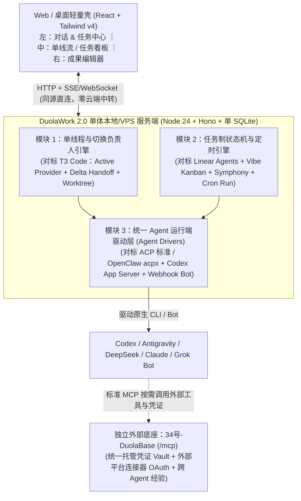

# 02 - DuolaWork 2.0 开发架构、成熟模块选型与连接器重构方案

日期：2026-11-25 · 前置产品定义：[README.md](./README.md)

> **核心工程决策**：**彻底放弃 DuolaWork 1.x 的历史代码包袱**（抛弃「Cloudflare Worker D1 + 本机 Electron 轮询拉取」双后端架构、抛弃 68 个群协作文件与 55 个本地胶水脚本）。  
> **新架构原则**：像搭积木一样，**每一个模块直接采用 2026 年已验证成熟的开源产品架构与标准协议**，从根源上消灭 Token 乱消耗、回执丢失堵队列与连接器意大利面条代码。

---

## 一、为什么这套新架构能从根源终结「Token 乱消耗」

1.x 之所以打了十几个补丁（1.6 → 1.9.6）还在修 Token 翻倍和队列堵死，是因为底层架构逆着大模型的物理规律在跑。重拆之后，**四大吃 Token 黑洞直接归零，不再需要打裁剪补丁**：

| 1.x 吃 Token 与卡死的根源 | 1.x 被迫打的补丁 | 2.0 新架构如何从根源消灭 |
| --- | --- | --- |
| **1. 群聊全量旁观历史灌注**<br>每次唤醒都要塞入群历史、未读要求、群记忆、会议、秘书请求（单轮动辄 3~6 万 Token，切模型曾飙到 286 万） | 12 KiB 预取预算、延后话题导航、分页补读 | **单线程复用原生缓存 + 任务物理新会话**：<br>• 方式一直接跑在原 Agent 原生会话上（100% 命中原平台 Prompt Cache），只有换人那一刻传一次极短的 `delta_since_last_seen`；<br>• 方式二每个 `TaskStep` 开独立纯净会话，只喂几百字的 `本步目标 + 验收标准 + 资料引用`，**0 聊天历史灌注**。 |
| **2. 拉取式多跑一轮模型**<br>短唤醒 → 模型调 `claim_work / read_channel` → 再调 `post_message / stay_silent`（1 件事变 2~3 次模型请求） | 紧凑收件格式、隐藏参数、钩子强停 | **推式直驱（Push-Prompt）与三层独立计量**：<br>宿主直接通过协议（`session/prompt`、`turn/start` 或受控远端桥接单次投递）把本轮输入推给目标成员，**消除纯收件/领活通信回合**。计量上严格区分三层：① `workbenchDispatches`（工作台派发数，普通消息严格=1，其余成员=0，静置=0）；② `nativeTurns`（原生协议回合数，严格=1）；③ `providerUsage`（平台实际模型请求与缓存/未缓存 Token，因单回合内模型自用原生工具可能产生多次内部交互，按实测对账记录，平台未暴露项标为 `observable: false`）。 |
| **3. 旁观误唤醒与礼貌废话**<br>提及名字、改任务状态会连带唤醒其他人，哪怕回个 `stay_silent` 也白烧上万输入 Token | 跳数限制、静默处置回执 | **确定性有限状态机（FSM）唤醒**：<br>彻底删除自由唤醒与 `stay_silent`。Agent 进程平时完全休眠（**0 Token**），只有「当前对话选定它」或「任务状态机流转到它的 Step / Review」才会被精准拉起一次。 |
| **4. 巨型常驻工具表膨胀**<br>每个会话挂载几十个群管、会议、秘书、文档、连接器工具（冷启动凭空多烧 3,000~5,000 未缓存 Token） | 手工删减为 5 个常驻工具 | **零编排噪音 + 懒加载工具路由**：<br>• 普通对话与执行人会话挂载 **0 个群聊工具**；<br>• 仅任务负责人（Lead）按需挂载 3 个极简任务工具；<br>• 外部 SaaS 工具统一走 DuolaBase 的 `discover + call` 懒加载。 |

---

## 二、全局模块选型：直接站在成熟开源产品肩膀上

不再自己发明底层协议，2.0 由 **4 个高度内聚的成熟模块范式** 组合而成：



### 1. 整体底座与「方式一（切换负责人）」—— 直接参考 **T3 Code (`pingdotgg/t3code`)**
- **为什么放弃 1.x 双后端，改用 T3 Code 架构**：
  - 1.x 最痛苦的根源是把状态放在远端 Cloudflare Worker D1，再让本机 Electron 跑轮询器去“领活、补传回执”，断网或超长就失步。
  - **T3 Code 的成熟解法**：**Server 直接跑在你的工作机（或常用 VPS）上**，用单个本地 SQLite（`duolawork-v2.sqlite`）存所有 Thread、Task、Artifact 与原生会话映射；桌面端/浏览器/手机端只是连上这个本地 Server 的纯视图层。**彻底消灭跨云轮询、回执补传和双库不一致！**
- **直接复用的核心机制**：
  1. **Thread 单点绑定**：每个 Thread 维护 `activeProviderId`（当前负责人）及每个参与过该 Thread 的 Agent 的原生 `sessionId` + `lastSeenMessageSeq`。
  2. **确定性 `Delta Context Handoff`**：从 Agent A 切换到 Agent B 时，不调额外总结大模型，直接按序号截取 `(lastSeenSeq .. latestSeq]` 的用户原话、A 的最终结论与右侧最新文稿/代码 diff 指针，拼成标准 `<context_handoff>` 块在 B 的本轮输入里一次性带入。
  3. **Git Worktree 隔离（针对代码项目）**：对 Coding 任务直接复用 `git worktree` 生命周期管理，互不污染工作区。

### 2. 「方式二（负责人统筹任务制 + 定时任务）」—— 融合 **Linear for Agents + Vibe Kanban + OpenAI Symphony + Paperclip Routines**
市面上做“AI 任务制协作”最成熟的不是聊天群，而是 **Issue/Kanban 状态机驱动流**：
- **借鉴 `Linear for Agents` 与 `OpenAI Symphony` 的核心铁律——「概率层与确定层分离」**：
  - **确定层（代码写死的有限状态机 FSM）**：负责状态流转、依赖解锁、最大返工次数熔断（如最多打回 3 次）、超时告警。模型绝对不能靠嘴说“我做完了”改状态，必须调用结构化提交通过校验。
  - **概率层（Agent）**：
    - **Lead（负责人）** 只在两个节点被状态机拉起：① 需求谈妥时拆单建卡（`task_create`）；② 收到 Worker 提交物时做验收裁决（`task_review`：`accept` 或 `changes_requested`）。
    - **Worker（执行人）** 只在 `Step` 进入 `ready` 或 `changes_requested` 时被拉起，跑在**与主对话完全隔离的独立 Session / Worktree** 中（同 **`BloopAI/vibe-kanban`** 的每卡一沙盒模式）。
- **借鉴 `Paperclip Routines`（但坚决丢掉它的 Heartbeat 轮询）实现定时长期任务**：
  - **我们只取其精华**：把定时早晚报建模为 `Routine / Scheduled Task Template`（保存 Cron 表达式、负责人、分工 Step 模板），用轻量级本地定时器（如 `croner`）到点直接插入一条全新的 `TaskRun #N` 进入同一个任务状态机执行。
  - **坚决避开的坑**：Paperclip 最被诟病的是“每隔几分钟发一次 Heartbeat 唤醒所有 Agent 查收件箱”，空跑烧掉大量 Token。我们的状态机是**纯事件触发（Event-Driven）**：没任务、没到 Cron 时间点时，**CPU 与 Token 消耗严格为 0**。

---

## 三、连接器模块深度诊断与重构方案（干净吗？有没有更好的方案？）

你问得非常关键：**现有的连接器方案其实混杂了“两类完全不同的连接器”，一类在 1.x 里非常脏必须重做，另一类在 DuolaBase 里底座很稳但上层适配开始变脏，需要立规矩收口。**

### 诊断 1：「连 Agent 的运行端连接器」（原 `32号-Agent-Hub/local/` 55 个文件）
- **现状评价：不合理、非常重且脆弱，建议直接放弃重写。**
  - 原 `local/` 目录堆了 55 个脚本（含硬编码二进制下载器、1MB 打包胶水、轮询死循环、网页 DOM 抓取），每修一个状态同步 Bug 都要改三四个文件。
- **2.0 更干净的成熟方案：标准化为 4 类轻量 `AgentDriver` + 显式成员能力声明（兼顾本机与远端 `Gemini2VPS`）**
  每个已注册成员在 `v2_members` 中显式声明运行位置与能力（`location`、`supportsIsolatedSessions`、`supportsSessionResume`、`supportsCancel`、`maxConcurrentRuns`），统一实现以下接口：
  ```ts
  export interface AgentDriver {
    readonly kind: 'codex-app-server' | 'acp-stdio' | 'remote-bridge' | 'webhook-bot';
    checkHealth(member: MemberRecord): Promise<HealthStatus>;
    ensureSession(binding: SessionBinding): Promise<{ nativeSessionId: string; resumed: boolean }>;
    runTurn(input: TurnDispatchInput, onEvent?: (ev: TurnStreamEvent) => void): Promise<TurnExecutionResult>;
    reconcileAttempt(attempt: DispatchAttemptRecord): Promise<ReconcileResult>;
    abortTurn(attempt: DispatchAttemptRecord): Promise<boolean>;
  }
  ```
  1. **`CodexDriver`（本机直驱）**：直连本机 `/Users/duola/.local/bin/codex app-server`（`thread/start`、`thread/resume`、`turn/start`、`turn/interrupt`）；断线或重启时通过 `thread/read` 核对最近回合完成对账恢复，不重跑已完成的模型回合。
  2. **`AcpDriver`（本机标准 ACP 直驱）**：基于 ACP JSON-RPC over stdio 驱动本机 `agy`（1.5+）等运行端，按 `initialize` 返回的能力决定 `session/load` 或建立新会话注入快照。
  3. **`RemoteBridgeDriver`（跨机远端节点与 `Gemini2VPS` 零重装接力）**：同时支持 ① **v2 标准远端 Worker 节点**（`Bearer runtimeToken` + `runtimeId` + `attemptId` 幂等领单/心跳/断线重连对账），以及 ② **既有 `Gemini2VPS` 远端接收器无损桥接**（无需 SSH 登录用户 VPS 或触碰 `ClaudeVPS`，直接复用其在线 `runtimeId` 为 2.0 线程/任务步骤分配独立远端工作会话并核对真实原生 `sessionId` 与 Token 回执）。
  4. **`WebhookBotDriver`（固定上下文 Bot 安全串行驱动）**：针对 `Grok Bot` 等不具备多会话物理隔离能力的固定窗口 Bot，在成员能力中标明 `supportsIsolatedSessions: false, maxConcurrentRuns: 1`，由服务端调度器强制串行化执行并附带单次 `attemptToken` 与显式任务边界头，防止并发任务串味。

### 补齐的四项关键工程契约（对应审计闭环）
1. **12 KiB 有界交接与确认推进游标**：`handoff.ts` 严格限制交接块 ≤ `12 KiB`（必保本轮原话、当前关联任务摘要与最新文稿指针，超长旧消息折叠为序号区间并支持 `thread_read_history` 分页补读）；仅当目标驱动返回投递成功回执后才更新 `v2_handoff_cursors.last_seen_seq`。
2. **定时调度去重、重启对账与名额释放**：`v2_task_runs` 强制 `UNIQUE(task_id, planned_slot_at)` + 显式时区（默认 `Asia/Shanghai`）+ `misfire_policy`；所有派发先写 `v2_dispatch_attempts`，崩溃重启后先走 `reconcileAttempt` 对账再决定是否补发；旧期步骤超时后立即置 `slot_held = 0` 释放该成员执行名额，迟到回执标为 `late_ignored` 只归档不二次交付。
3. **受管会话 `scopedTurnToken` 与 DuolaBase 读写分级**：每次唤醒签发绑定 `(principalKind, memberId, threadId/taskId/stepId, toolPolicy)` 的短期令牌。Worker 跨任务读写或越权调 Lead 工具一律 `403`；默认 Worker 的 DuolaBase 策略为 `readonly`（仅放行查询类元工具与只读连接器操作，拦截 `vault_reveal` 及一切发消息/改外部文档写操作），且关闭 DuolaBase 开关时主对话完全不受影响。
4. **切人后的核验会话隔离、文稿 CAS 与代码 Worktree 合并**：任务核验固定唤醒 `task.lead_member_id` 的独立统筹会话；`waiting_user` 卡片回复精准路由回 `task.lead_member_id`；`artifact_write` 强制校验 `expectedBaseVersion`，旧回合晚写自动存为 `conflict_branch` 绝不覆盖新稿；并行代码步骤各自在独立 `git worktree` 完成后自动合入 Run 集成分支跑通校验，且最终结单经 SQLite 事务 CAS 保证每期只产出唯一交付卡。

---

### 诊断 2：「连外部业务工具的连接器」（飞书、微信、GitHub、Gmail、Notion、Vercel 等）
对比目前行业最成熟的开源连接器架构（**Nango** 管 OAuth、**ACI.dev / MetaMCP** 管懒加载工具路由、**官方 Remote MCP** 生态）：

- **DuolaWork 1.x 内置连接器（`connectors.mjs` / `mcp-connectors.mjs`）：彻底废弃！**
  - 1.x 把连接器绑死在 `channelId` 群权限上，还在 Worker 里手写 GitHub API。**2.0 本体做到「0 行外部平台连接器代码」**，彻底解耦。
- **34号-DuolaBase 外部连接器底座（已于 `0.5.8` 完成插件化瘦身并上线就绪）**：
  - **核心优势**：双进程 Broker 密钥隔离 + OAuth 单飞刷新锁（对齐 **Nango + Infisical**，Agent 拿不到明文 Token），配合 `connector_discover` + `connector_call` 两步懒加载（对齐 **ACI.dev / MetaMCP**，极省 Token）。
  - **已完成的分层插件化架构（`packages/gateway/src/providers/`）**：
    1. `connectors.ts` 已精简为纯粹的注册表、ACL、Vault 凭据注入、SSRF 守卫与幂等审计路由壳；
    2. 四类协议已彻底解耦为独立模块：`http-mcp.ts`（GitHub / Notion / Cloudflare / Vercel 等官方远程 MCP 首选通道）、`oauth-rest.ts`（Gmail 等 OAuth REST 插件）、`native-apps.ts`（飞书与微信公众号原生插件，后续扩展优先接入 `@larksuiteoapi/lark-mcp` 等官方 MCP 子服务）、`legacy-bridge.ts`（仅作旧 Vercel 团队过渡兼容，重新直连授权后即可随时拔除）。
  - **DuolaWork 2.0 施工边界**：`34号-DuolaBase` 线上 `0.5.8` 与本机非 Claude 端技能软链（`duolabase-credentials`、`duolabase-memory`）均已部署到位，**开发 DuolaWork 2.0 时只需为受管 Agent 提供挂载 `https://duolabase.manyaitool.com/mcp` 的配置开关，无需再改动 DuolaBase 仓库**。

---

## 四、DuolaWork 2.0 全新目录结构（告别历史包袱，新起干净工程）

建议直接在 `32号-Agent-Hub/duolawork2.0/`（或独立新包/新分支）从零搭建干净的 TypeScript Monorepo，总核心代码量预计不到 1.x 的 **1/5**：

```text
duolawork-2.0/
├── packages/
│   ├── shared/              # 严格类型定义：Thread, Handoff, Task, TaskRun, TaskStep, DriverEvents
│   ├── server/              # 本地/VPS 统一后端 (Node 24 + Hono + node:sqlite)
│   │   ├── db.ts            # 单 SQLite 状态库 (WAL 模式)
│   │   ├── threads.ts       # 方式一：单线程消息流 + Active Owner 切换 + Delta Handoff 生成器
│   │   ├── tasks-fsm.ts     # 方式二：确定性状态机 (Create -> Dispatch -> Submit -> Lead Review -> Done)
│   │   ├── scheduler.ts     # 定时长期任务触发器 (Cron -> 派生独立 TaskRun #N，跨期互不阻塞)
│   │   ├── artifacts.ts     # 右侧可编辑成果/文稿版本库 + Git Worktree 管理器
│   │   └── drivers/         # 干净的三大 Agent 驱动器 (无轮询胶水)
│   │       ├── codex-app-server.ts
│   │       ├── acp-stdio.ts
│   │       └── webhook-bot.ts
│   └── web/                 # 2026 现代三栏工作台 (React 19 + Tailwind v4 + lucide-react)
│       ├── ThreadView       # 单线对话 + 左下角负责人切换器 + 内联任务卡
│       ├── TaskCenterView   # 单次任务看板 + 定时长期任务 (含每期 Run 历史与核验时间线)
│       └── ArtifactEditor   # 右侧 Markdown/代码差异实时预览与人工改稿回传
└── tests/                   # 状态机单测 + 双真机 Agent 切换交接与派单验货集成测试
```

---

## 五、分步开发路线图（稳扎稳打，每步可独立验收）

1. **Step 1：搭好干净骨架 + 3 个标准 `AgentDriver`（预计最先见效）**
   - 建好 `server + shared` 单 SQLite 底座；先把 `CodexDriver`（App Server）和 `AcpDriver`（Antigravity/Gemini）以及 `WebhookBotDriver`（Grok）接通，验证 **1 次发消息 = 1 次原生模型请求、0 额外轮询 Token**，并无损复用本机现有账号登录。
2. **Step 2：跑通「方式一：单线程切换负责人 + 右侧成果空间」**
   - 实现输入框切换负责人、`delta_since_last_seen` 自动增量交接、在途回合归位，以及右侧文稿编辑回传。
3. **Step 3：跑通「方式二：负责人统筹任务制（单次 + 定时长期）」**
   - 实现 `tasks-fsm.ts` 状态机、独立会话/Worktree 派发、执行人提交自动唤醒负责人验收（通过 / 打回返工）、以及 `scheduler.ts` 定时派生独立 `TaskRun #N`。
4. **Step 4：2026 高质感三栏前端 + DuolaBase 可选挂载收口**
   - 完成三栏 UI 联调；支持一键给受管 Agent 注入 DuolaBase MCP（顺手把 Vercel 重新授权到目标团队后，彻底下线 1.x 旧桥接）。
