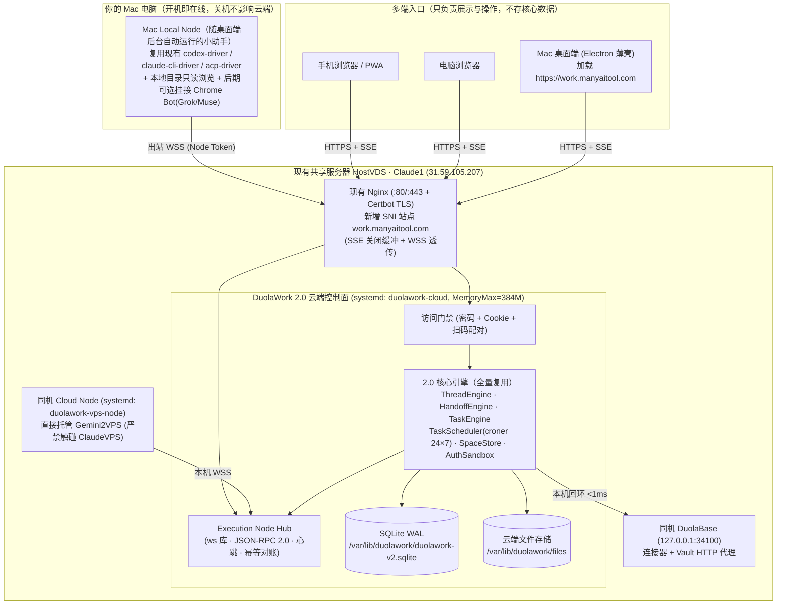

# DuolaWork 2.0 云端控制面与跨设备架构升级方案（V2.0 · 稳健根治版）

> 文档版本：2026-11-26（V2.0，对齐现有 `HostVDS · Claude1 (31.59.105.207)` 生产基线与开源成熟实践）  
> 适用仓库：`/Users/duola/Desktop/Xduola/32号-Agent-Hub/duolawork2.0`  
> 核心原则：**不做临时止血补丁、不推翻重写已有驱动、不手造脆弱轮子**，一次把控制面、执行面、多端同步、安全与运维做稳。

---

## 1. 一句话人话版：这次到底改什么、不改什么

- **改什么（把「大脑」搬到云端）**：把数据库、对话记录、协作空间文件、24×7 定时任务调度器放到你现有的云端服务器 `31.59.105.207` 上。以后电脑关机、合盖、换手机打开网页，都能随时看、随时发、定时任务照常准点跑。
- **不改什么（已有 Agent 接入层全部保留，不重写）**：
  - 已经写好并测通的 `Codex` 驱动（[codex-driver.ts](/Users/duola/Desktop/Xduola/32号-Agent-Hub/duolawork2.0/src/server/drivers/codex-driver.ts)）、`Claude` 驱动（[claude-cli-driver.ts](/Users/duola/Desktop/Xduola/32号-Agent-Hub/duolawork2.0/src/server/drivers/claude-cli-driver.ts)）、`Gemini / ACP` 驱动（[acp-driver.ts](/Users/duola/Desktop/Xduola/32号-Agent-Hub/duolawork2.0/src/server/drivers/acp-driver.ts)）、协作空间、状态机、DuolaBase 沙箱 **100% 复用，不重写**。
- **彻底扔掉什么**：彻底淘汰「通过旧版 1.9.6 `hub.manyaitool.com` 隐藏频道中转 `Gemini2VPS`」这条脆弱的临时桥接链——改由云端控制面直接对接同机/远端原生执行节点，**从根上消灭 `NO_TOOL_CALL` 丢回执和 50万~70万 Token 膨胀**。

---

## 2. 开源架构对照与成熟组件选型（为什么这个方案稳）

这套「**云端单体控制面 + 出站长连接执行节点（Hub-and-Spoke）**」不是拍脑袋发明的，而是目前行业内跨设备 AI Agent 平台公认最稳的主流架构：

### 2.1 对标的成熟开源/行业标杆

| 参考项目 | 核心借鉴点（拿来即用的成熟经验） | 明确避开的坑 |
| :--- | :--- | :--- |
| **OpenClaw**（开源个人 Agent 网关） | **Cloud Gateway + Companion Nodes**：大脑常驻云端，Mac/手机/任意 VPS 作为 Companion Node 通过出站 WebSocket 连上大脑，暴露各自本机工具与能力。 | 不照搬其复杂多频道插件生态，保持我们简洁的单负责人交接与任务状态机。 |
| **T3 Code**（Local-First + Linked Environments） | 借鉴其**把异地机器抽象为可配对执行环境**与便携上下文交接协议（注：T3 Code 本身是本机软件、无官方托管云端，我们的产品定位是**云端中枢型**，比 T3 多出 24×7 云端控制面、跨设备同步与云端定时调度）。 | 不把控制面锁死在单台笔记本上，避免合盖断定时、手机无法访问。 |
| **GitHub Actions Runner / Buildkite Agent** | **出站拉取 + 幂等回执（ACK）**：所有执行机（哪怕在家庭内网/NAT 后）全部主动向外连云端；执行机本地落盘未确认回执，断网重连后自动补传，0 重复执行。 | — |
| **ACP + MCP 开放协议** | 本地/云端编码 Agent 走标准 `ACP / app-server`，外部服务与凭证统一走 `DuolaBase MCP`，不自己维护各家私有胶水脚本。 | 坚决不再做「套壳旧版 1.9.6 隐藏频道」这种二次中转。 |
| **34号-DuolaBase（你自己的线上生产基线）** | 直接复用已经在 `31.59.105.207` 稳定跑通的运维范式：**专用非 root systemd 用户 + `MemoryHigh/MemoryMax` 内存围栏 + 私有 Node 24 + SQLite WAL + Nginx/Certbot + 在线热备脚本**。 | 严格遵守同机红线（零 Docker、零重型数据库），绝不影响同机其他线上业务。 |

### 2.2 成熟开源组件替代手写轮子清单

为了「稳」而不是「炫技」，关键基础设施全部采用久经考验的轻量开源库/组件：

| 模块 | 选型（成熟开源组件） | 替代的脆弱自研代码 |
| :--- | :--- | :--- |
| **节点双向长连接** | `ws`（Node 生态最成熟标准 WebSocket 库）+ 标准 JSON-RPC 2.0 帧 | 不手写自定义 TCP/HTTP 轮询协议 |
| **24×7 Cron 调度引擎** | `croner`（零依赖、完整支持 IANA 时区/夏令时/复杂表达式/misfire 计算） | 替代手写简易 5 段 Cron 解析器 |
| **HTTPS / TLS / 反向代理** | 复用 `31.59.105.207` 现有 **Nginx + Certbot**（新增 `work.manyaitool.com` 虚拟主机） | 不新装 Caddy 避免抢占 `:80/:443` |
| **密码哈希与会话认证** | Node 原生 `crypto.scrypt` + `HttpOnly; Secure; SameSite=Lax` Cookie（与 `34号-DuolaBase` 一致）；可选前端再套一层 **Cloudflare Access** 零信任网关 | 不依赖外部重型认证服务 |
| **SQLite 在线热备** | `sqlite3 .backup` 每日定时热备（复用 `34号-DuolaBase` `site-backup.py` 思路，未来可按需加 **Litestream** 实时流式备份到 R2） | 不直接 `cp` 正在写入的 WAL 文件 |

---

## 3. 现有服务器资源核查（`31.59.105.207` 够不够用？）

核查 `DuolaBase` 资产与 [34号-DuolaBase/README.md](/Users/duola/Desktop/Xduola/34号-DuolaBase/README.md#L20-L27) 的线上实测基线：

- **目标服务器**：`HostVDS · Claude1`（`31.59.105.207`）
- **当前同机已运行业务**：`DuolaBase`（稳态 `< 180 MiB`）、`DuolaWork` 远端 Agent（`Gemini2VPS`）、ATEL Wallet 测试环境、Claude 远程桌面与 VS Code、sing-box VPN。
- **可用余量与红线**：
  - 机器剩余可用内存约 **2.3 GiB，且 0 Swap**；
  - **绝对红线**：禁止装 Docker / PostgreSQL / Qdrant；禁止动系统 Node 18 与既有 Nginx `:5565`；禁止触碰/探测/调用 `ClaudeVPS`（`member_bf4fdac30b4542c8988bb6725f47ec0b`）。
- **产品架构原则（必须先说清）**：**产品设计严格假设「所有 Agent 分散在任意不同的机器、云厂商、家庭 Mac、办公 PC 或第三方平台」**，全部通过标准出站长连接（WSS）或标准协议接入云端控制面，**绝不把“Agent 和控制面刚好装在同一台机器”当作产品依赖或架构优势**。
- **首台落地部署服务器（当前自用环境核查）**：将云端控制面首先部署在你现有的 `HostVDS · Claude1 (31.59.105.207)` 上：
  1. 剩余内存约 **2.3 GiB（0 Swap）**，DuolaWork 2.0 云端控制面单进程 Node 24 + SQLite WAL 稳态仅占 **60 ~ 120 MiB**，通过 systemd 硬设 `MemoryHigh=256M`、`MemoryMax=384M` 内存围栏，资源完全充裕且不会干扰同机其他业务；
  2. 严格遵守同机红线：不装 Docker/PG/Qdrant、不动系统 Node 18 与 Nginx `:5565`、绝不触碰 `ClaudeVPS`；
  3. 复用同机现有 `:80/:443` Nginx + Certbot，通过 SNI 域名新增 `work.manyaitool.com`（指向 `127.0.0.1:8780`），零端口冲突；未来随时可一键迁到任意独立云服务器或扩展为多租户官方云。

---

## 4. 本次一次性根治的 6 个 Bug 总账

| 编号 | 线上症状 | 真实根因 | 彻底根治方案（不做临时补丁） |
| :--- | :--- | :--- | :--- |
| **BUG-01**（截图实锤） | 连续对 `Gemini2VPS` 发消息返回 `原对话已结束，但这条消息尚未回传；请在原环境检查。`（`nativeEndEvent: NO_TOOL_CALL`） | 走 1.9.6 桥接时，`Gemini2VPS` 必须自己调旧 Hub 的回复工具才能把文字传回来；2.0 注入的「非旧版 1.9.6 / 严禁调用旧版工具 / 普通回答直接输出自然语言」让模型停止调用回传工具，把上万 token 正文吐在原窗口里没发回来。 | **直接废除 1.9.6 隐藏频道桥接**。`Gemini2VPS` 改由 `duolawork-node` 原生驱动直连，由 Node 进程确定性捕获输出流并回传 `turn.completed`，彻底不依赖模型自己调「回复工具」。 |
| **BUG-02** | 升级安装或重启应用后，正在回复的对话永久卡在 `running` | 旧版重启只对账 3 秒且未收敛 `stalled / not_found / 孤儿 running`。（本机已先补 `DW2-29` 修复） | 控制面上云后，升级 Mac 桌面壳完全不影响云端运行；Node 端自带本地 `outbox.json`（保留 24h），即使云端滚动重启，Node 重连后自动幂等补交完成结果。 |
| **BUG-03** | `Gemini2VPS` 单轮暴烧 48万~72万 input tokens | 2.0 拼接的 `protocolBrief + spaceMaterials + handoff` 与 1.9.6 桥接层的 `nativeContextMode: full` 叠加重复打包。 | 切到原生 Node 协议后，只有 2.0 这一层管理会话与增量 `<context_handoff>`，彻底消除双层上下文重复灌入。 |
| **BUG-04** | 协作空间上传文件锁在单台 Mac 本地，跨设备看不到/打不开 | 文件落在单机 `~/.config/agent-hub/duolawork-v2-files`，且用 JSON base64 传输大文件低效。 | 协作空间文件 100% 存云端 `/var/lib/duolawork/files`（抽象 `BlobStorage` 接口，后续可切 R2/S3），改用 `multipart/form-data` 流式上传与鉴权下载。 |
| **BUG-05** | `DuolaBase` 凭证依赖读本机 `~/.codex/config.toml` | 单机思维遗留。 | 云端通过 `/etc/duolawork/server.env`（权限 `0600`）统一托管，所有云端/本地 Agent 统一经云端沙箱代理调用 `duolabase:*`，凭证绝不外泄给节点或前端。 |
| **BUG-06** | Mac 休眠/关机后定时任务无法触发 | 调度器寄生在 Mac 桌面进程内。 | `TaskScheduler`（底层换用 `croner`）常驻 24×7 云端；云端 Agent 准点跑，本地 Agent 离线时支持明确排队（上线自动补跑一次）或提示。 |

---

## 5. 整体架构与核心模块设计

### 5.1 架构全景图



### 5.2 用人话讲清楚：3 类 Agent 与「Mac Local Node」到底怎么配合

你手头现在有 3 种截然不同的 Agent，它们不需要重写，只需要**各归各位**：

| Agent 类型 | 代表成员 | 它住在哪儿 | 在新架构里怎么接入（要不要重写？） |
| :--- | :--- | :--- | :--- |
| **1. 云端 Personal Agent** | `Gemini2VPS` | 住在 `31.59.105.207` 云端 VPS | 由同机 `duolawork-vps-node` 直接拉起原生会话并流式回传结果——**扔掉旧版 1.9.6 桥接，彻底根治 `NO_TOOL_CALL`，24×7 在线**。 |
| **2. 本机代码助手** | `Codex`、`Claude`、`Gemini (本机)` | 装在你 Mac 电脑里，能读写你 Mac 上的代码项目 | **现有驱动代码 100% 不重写**！只是把它们放进随 Mac 桌面端一起运行的 **Mac Local Node（本地传话小助手）**里。你在手机上给 `Codex` 发消息 → 云端通过长连接把指令发给 Mac 小助手 → 小助手在 Mac 本机调用原来的 `codex-driver.ts` 干活并把结果实时推回云端和手机。 |
| **3. 浏览器网页型 Bot** | `Grok`、`Muse`、`Dot` | 靠你 Mac 上开专用 Chrome 登录网页版操作 | 因为它们没有官方 CLI/API，必须依赖你 Mac 上的 Chrome 登录态（`~/.config/agent-hub/profiles/*`）。以后按需把旧版 `local/browser.mjs` 封装成一个可插拔模块挂进 Mac Local Node 即可，**不阻塞主力上线，也不破坏旧 Chrome 登录资料**。 |

> **一句话理解 Mac Local Node**：它不是一套新软件，也不是重写驱动——就是云端大脑伸到你 Mac 电脑上的一只「远程机械手」（和 T3 Code 的 Linked Environments、OpenClaw 的 Companion Node 完全同一个原理）。Mac 开着它就自动连上云端干本地活；Mac 关机了它就显示离线，完全不影响云端 `Gemini2VPS` 照常工作。

---

### 5.3 核心子系统完整规格（不遗漏任何细节）

#### A. 访问控制与登录（为什么公网上云必须有「一把锁」）

- **为什么必须有登录**：以前服务只监听 `127.0.0.1`（仅你自己电脑能连），不需要密码。一旦挂到公网域名 `https://work.manyaitool.com` 让手机和电脑跨设备访问，公网扫描器和任何知道网址的人都能直接打开——没有登录门禁，别人就能看你全部聊天、白嫖你的 Agent Token、甚至调用你接入的 DuolaBase 连接器！
- **尽量无感、不烦人的登录体验**：
  1. **日常几乎不用输密码**：Mac 桌面端、常用浏览器、手机登录一次后，发一张 **30 天有效（用一次自动续期）的 `HttpOnly; Secure` 加密通行证 Cookie**，以后打开直接进工作台；
  2. **手机免输密码扫码/配对码登录**：在电脑端点一下「添加新设备」生成 6 位一次性配对码（或二维码），手机扫一下直接登录；
  3. **设备安全管理**：设置页可查看当前所有已登录设备，随时一键踢掉旧设备；
  4. **可选加厚防护**：如果域名走 Cloudflare DNS，后续可以一行配置叠加 **Cloudflare Access**，多加一层免费企业级网关保护。

#### B. 统一 Execution Node 协议（`ws` + JSON-RPC 2.0）

- 接入地址：`wss://work.manyaitool.com/api/v2/nodes/ws`（`Authorization: Bearer <nodeToken>`，服务端仅存 SHA-256 哈希）。
- 节点配对：在云端「成员与节点」页生成 5 分钟有效的 6 位配对码 → 节点执行配对命令换取独立 `nodeToken`（随时可吊销）。
- 标准帧类型：
  - **生命周期**：`node.hello`（上报机器名、OS、支持驱动、托管成员健康态）、`node.ping/pong`（15s 心跳，3 次超时自动标离线）。
  - **会话与执行**：`session.ensure`、`turn.dispatch`（带 `attemptId` + `idempotencyKey`）、`turn.started`、`turn.delta`（实时流式）、`turn.tool_trace`（已脱敏）、`turn.completed` / `turn.failed`、`turn.ack`、`turn.abort`、`turn.reconcile`。
  - **安全工具反调（核心）**：`turn.tool_call` / `turn.tool_result` —— 节点上的 Agent 需要读协作空间资料、建任务、或调 DuolaBase 连接器/Vault 代理时，统一反向 RPC 调云端 `executeScopedAgentTool`，由云端 [auth-sandbox.ts](/Users/duola/Desktop/Xduola/32号-Agent-Hub/duolawork2.0/src/server/auth-sandbox.ts) 统一裁决权限并执行，**节点本身不持有任何高权限 DuolaBase 凭证**！
  - **本地工作目录只读代理**：`fs.list_dir` / `fs.stat`（仅在节点显式授权目录下允许，防路径穿越）。
  - **断线续传（防卡死防重跑）**：Node 侧将每个已完成但未收到 `turn.ack` 的结果写入本地 `outbox.json`（保留 24h），WSS 重连瞬间自动补发，云端按 `attemptId` 幂等落库。

#### C. 多设备实时同步（SSE 增量补齐）

- `GET /api/v2/events?lastEventId=<seq>`（兼容标准 `Last-Event-ID` 头），服务端维护单调递增 `eventSeq` 与最近 500 条事件环形缓冲；
- 每 20 秒发 `: ping\n\n` 心跳防 Nginx/运营商断流；
- 手机切后台再切回来时，若遗漏事件在 500 条内自动补播，超出则触发 `sync.full_refresh` 静默对齐最新状态；
- 多设备并发编辑同一文稿仍由现有 `expectedBaseVersion` + `conflict_branch` 兜底，永不静默覆盖。

#### D. 协作空间云端化 & 本地工作目录解耦

- **协作空间（文档、上传文件、链接）全量上云**：
  - 文件存 `/var/lib/duolawork/files`（`BlobStorage` 抽象接口，未来可零改业务切 R2/S3）；
  - 新增 `POST /api/v2/threads/:id/space/files/upload` 支持 `multipart/form-data` 流式上传（单文件上限 50 MiB，SHA-256 去重）；
  - 全设备、全云端/本地 Agent 统一通过 `space_read_material` 或鉴权下载读取。
- **本地代码目录按节点绑定**：
  - `v2_threads` 新增 `workspace_node_id`（例如明确记录「属于 Duola MacBook Pro 的 `/Users/duola/Desktop/Xduola`」）；
  - 节点在线时所有设备可浏览目录、可让该节点上的 `Codex/Claude` 配合独立 `git worktree` 改代码；节点离线时前端明确标灰提示「所属电脑离线」，绝不误读云端 VPS 目录。

#### E. 24×7 云端定时调度（`croner` + 离线策略）

- 底层定时解析替换为开源库 `croner`，精准支持 `Asia/Shanghai` 与所有标准 Cron 表达式；
- 单主进程锁 `/var/lib/duolawork/server.lock` 杜绝误启双进程导致定时双发；
- 触发时按执行人节点状态分级处理：
  - **云端成员（`Gemini2VPS`）**：24×7 准时触发，0 依赖本机；
  - **本地成员（本机 `Codex`）**：若触发时 Mac 离线，`catch_up_once` 策略进入 `waiting_node_online`，Mac 一上线自动补跑一次；`skip_stale` 策略跳过并发卡片告知。
- 完成后支持多端触达：桌面系统通知 + 浏览器通知 + 可选经 DuolaBase 连接器推送摘要到飞书/邮件/Telegram。

#### F. 多端客户端体验（Mac 薄壳 + Web + 手机 PWA）

- **Mac Electron 桌面壳（[desktop/main.cjs](/Users/duola/Desktop/Xduola/32号-Agent-Hub/duolawork2.0/desktop/main.cjs)）**：
  - 默认 **云端工作区模式**：直接加载 `https://work.manyaitool.com`，同时在后台托管轻量 `Mac Local Node` 进程，通过最小 `preload.cjs` 仅向受信任域名暴露 4 个原生桥（选择本地目录、查看/重启 Local Node、同步窗口深浅色、外链打开）；
  - 保留 **本机独立模式** 开关（供离线开发调试）。
- **手机端 PWA**：
  - `< 768px` 自动切换为「全屏对话流 + 左滑/左上对话抽屉 + 右上协作空间抽屉」；
  - 用 `100dvh` + `visualViewport` 适配 iOS Safari 软键盘，避免底部输入框被遮挡；
  - 补全 `manifest.webmanifest` 与图标，支持「添加到主屏幕」像原生 App 一样打开。

---

## 6. 数据库迁移与生产运维方案（对齐 `31.59.105.207`）

### 6.1 SQLite 增量表变更（100% 向下兼容）

- 新增表：`v2_auth_sessions`（多设备登录会话）、`v2_auth_magic_codes`（扫码登录/节点配对短码）、`v2_nodes`（执行节点注册表与心跳状态）。
- 新增列：`v2_members.node_id`、`v2_threads.workspace_node_id`、`v2_space_files.storage_driver / storage_key`。
- 扩展状态：`v2_task_runs.status` 新增 `waiting_node_online`。

### 6.2 `31.59.105.207` 生产目录与资源围栏（严格不干扰同机其他服务）

```text
/opt/duolawork/
  ├── runtime/node/              # 独立私有 Node 24（不碰系统 Node 18，不耦合 DuolaBase runtime）
  ├── current -> releases/xxxx   # 原子软链切换，15秒自动回滚
  └── releases/

/etc/duolawork/                  # 权限 0750
  └── server.env                 # 权限 0600（ADMIN_PASSWORD_HASH / MASTER_KEY / DUOLABASE_MCP_TOKEN）

/var/lib/duolawork/              # 属主 duolawork:duolawork
  ├── duolawork-v2.sqlite        # WAL 主库
  ├── files/                     # 协作空间上传文件
  ├── backups/                   # 每日 03:30 sqlite3 .backup 热备（保留 14 天）
  └── server.lock                # 单主进程锁
```

- **两个独立 systemd 服务（均配置严格内存围栏）**：
  1. `duolawork-cloud.service`（用户 `duolawork`，监听 `127.0.0.1:8780`，`MemoryHigh=256M`，`MemoryMax=384M`，`ProtectSystem=strict`）；
  2. `duolawork-vps-node.service`（以运行 `Gemini2VPS` 的账号启动，只负责托管白名单内的云端 Agent 并反连 `ws://127.0.0.1:8780/api/v2/nodes/ws`，代码层硬编码排除 `ClaudeVPS`）。
- **Nginx 虚拟主机（复用现有 `:80/:443` + Certbot）**：
  - 新增 `work.manyaitool.com` 配置块，开启 `proxy_buffering off`（保障 SSE 实时推流）与 `Upgrade / Connection` 头（保障 `/api/v2/nodes/ws` 长连接），上传限制 `client_max_body_size 55m`。
- **一键无损迁移本机数据（`scripts/migrate-local-to-cloud.mjs`）**：
  - 对 `~/.config/agent-hub/duolawork-v2.sqlite` 只读热拷贝（绝不修改本机原库、绝不触碰 1.9.6 任何遗留文件）；
  - 完整带走现有对话（含 `你在吗` 与第 36 期午报）、3 个 Xhunter 定时任务（`08:00 / 14:00 / 20:00`）和协作空间文档，并自动校验 `ClaudeVPS` 零存在。

---

## 7. 完整分阶段实施计划（直接根治，不做临时补丁）

| 阶段 | 核心交付内容 | 预计耗时 | 硬验收门槛 |
| :--- | :--- | :--- | :--- |
| **Phase 1：云端控制面核心 + 安全门禁 + `croner` 调度 + 存储云端化** | ① 接入 `ws` + `croner`；② 完成密码/Cookie/扫码配对认证与设备管理；③ 协作空间流式上传与 `BlobStorage`；④ `DuolaBaseClient` 云端托管与沙箱代理；⑤ SSE 增量补齐 + 20s 心跳；⑥ 全量单测覆盖。 | 2 天 | 全套安全单测通过（未登录 401、暴破限流、CSRF、403 `vault_reveal` 拦截）；`croner` 时区与 misfire 单测全绿。 |
| **Phase 2：统一 Execution Node 协议 + 云端 `Gemini2VPS` 原生接入（根治 `BUG-01`）** | ① 服务端 `NodeHub` + `RemoteNodeDriver`；② 独立打包 `duolawork-node`（内置复用现有驱动 + `outbox.json` 断线重放 + `turn.tool_call` 反调云端沙箱 + 目录只读代理）；③ VPS 上原生接入 `Gemini2VPS`（零 1.9.6 桥接，硬排除 `ClaudeVPS`）；④ 「节点管理」前端页。 | 3 天 | `Gemini2VPS` 通过原生 VPS Node 连续 5 轮对话 + 1 次完整定时任务推送，**0 次 `NO_TOOL_CALL`**，单轮 token 恢复正常；中途杀重启云端进程后 10 秒内自动补交回执。 |
| **Phase 3：部署上 `31.59.105.207` + 本机数据迁移 + Mac 薄壳与本地节点** | ① 在 `31.59.105.207` 配置 systemd（带 `MemoryMax=384M`）、Nginx `work.manyaitool.com` + Certbot TLS、每日 SQLite 热备 timer、一键部署/回滚脚本；② 迁移现有本机数据与 3 个 Xhunter 定时任务上云；③ 升级 Mac Electron 桌面壳为 Cloud Mode + 内嵌 Mac Local Node（复用本地 `Codex / Claude / Gemini` 驱动）。 | 2~3 天 | Mac 彻底退出并断网时，云端 24×7 准点触发 `Gemini2VPS`；手机浏览器下发任务给 Mac `Codex` 改本地代码并流式回传；`31.59.105.207` 内存稳态增长 `< 150 MiB`。 |
| **Phase 4：移动端 PWA 体验打磨 + 跨设备全链路验收** | ① 移动端抽屉布局 + `100dvh` 输入法适配 + `manifest.webmanifest`；② 节点离线排队与通知推送；③ 执行 7 项端到端验收矩阵（跨设备同步、Mac 离线定时、重启无卡死、安全红队、遗留文件哈希零变动）。 | 1.5 天 | 桌面 + 移动双视口 Playwright E2E + 真实跨机联调全绿；输出完整验收报告。 |
| **Phase 5（按需扩展）：浏览器型 Bot 挂接** | 如后续仍需使用依赖专用 Chrome 的 `Grok / Muse / Dot`，将既有只读浏览器执行器封装为 Mac Local Node 插件，不破坏 `~/.config/agent-hub/profiles/*`。 | 1~2 天（按需） | 与主力节点隔离运行、登录资料哈希零破坏。 |

---

## 8. 开工前最后确认的 2 个小细节

结合你刚才的回复（直接彻底根治、挂到现有服务器），只剩这 2 个事实确认就能按 Phase 1 直接开工：

1. **云端访问域名**：是否使用 **`work.manyaitool.com`**（挂在现有 `31.59.105.207` 上，与 `duolabase.manyaitool.com` 同域并列）？如果域名 DNS 在 Cloudflare，我部署时一并配好 HTTPS 证书。
2. **关于旧版浏览器型 Bot（`Grok / Muse / Dot`）**：目前是先按 **Phase 1~4** 集中精力把「云端控制面 + 云端 `Gemini2VPS` + 本地 `Codex / Claude / Gemini` + 手机/电脑跨设备」做到极致稳定，浏览器型 Bot 放到 **Phase 5** 按需再接，还是现在就要同步把它们一起接进来？
