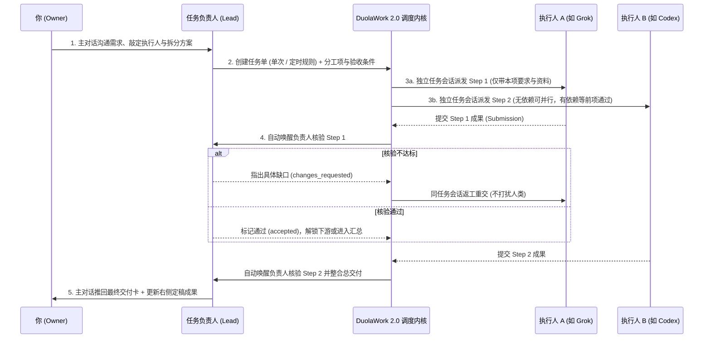

# DuolaWork 2.0 正式产品与架构方案

日期：2026-11-25 · 状态：**正式定稿（可直接交付开发）**

> **一句话定位**：DuolaWork 2.0 是支持 **Coding Agent + Personal/商业 Agent 混编** 的多 Agent 协作工作台。  
> **唯一入口与两种协作方式**：全产品只有唯一一个沟通入口 **`+ 新对话`**（不拆分“线性对话 / 任务对话”两个聊天入口）。在同一个对话里自然涵盖两种工作方式：  
> 1. **同一对话换人接力**（T3 Code 式：左下角随时切换当前对接成员，底层静默同步增量上下文与右侧最新文稿）；  
> 2. **负责人统筹的任务制协作**（支持**单次任务**与**定时任务**：你在对话里只跟负责人谈妥要求和分工，由负责人在对话内立项建卡、指派 1 人或拆给多人后台执行、自动跟进验货并把定稿交回对话）。

### 成套方案文档索引
| 文档 | 作用 |
| --- | --- |
| **[01 - README.md（本文档）](./README.md)** | 产品定义、唯一对话入口与任务看板关系、角色分工、核心数据表与 4 类唤醒边界 |
| **[02 - 开发架构与连接器选型方案.md](./02-开发架构与连接器选型方案.md)** | Token 零空耗根治原理、成熟开源模块选型（T3 Code + Linear Agents + Symphony + ACP）、连接器双仓边界（DuolaBase `0.5.8` 已就绪） |
| **[03 - Phase1-4工程实施与反作弊验收清单.md](./03-Phase1-4工程实施与反作弊验收清单.md)** | 7 条一票否决红线（含纯净产品文案铁律）、Phase 1~4 施工拆解表与 `DW2-01 ~ DW2-12` 硬验收标准 |
| **[prototype-v2.html](./prototype-v2.html)** | 三栏工作台与自然产品文案交互基线参考（唯一 `+ 新对话`、对话内嵌任务卡、任务详情与定时记录切换、右侧文稿编辑） |

---

## 1. 架构减法与三条物理隔离红线

吸取 1.x 群自由协作中“多成员乱唤醒烧 Token、长群历史超限、前序缺回执堵死后续队列”的教训，2.0 先做彻底减法：

1. **砍掉群自由协作与对话内分叉**
   - 移除群聊入口、群内 `@` 提及唤醒、会议室（`meetings.mjs`）、全局秘书路由（`secretary.mjs`）。
   - 砍掉原草案中的「对话内并行按钮 / 多分支聊天」——主对话永远保持**一根干净的线性时间轴**；凡需多人分工或后台执行，统一走「任务制协作」。
2. **与 1.x 历史群聊物理隔离**
   - 1.x 已有群聊与历史消息仅归入底部「历史归档（只读）」，2.0 新对话与新任务完全使用独立的数据表/对象类型与调度入口，不经过 `channel_turn` 旧群广播链路。
3. **剥离并解耦 1.x 内置重资产模块**
   - 1.x 内置的旧版凭证库（`vault.mjs`）、内置连接器网关（`connectors.mjs`）、群记忆（`group-memory.mjs`）、内置技能库（`skills.mjs`）与 2.0 核心协作内核**明确解耦隔离**，不再塞进每次模型唤醒的上下文包。
   - **2.0 内核只专注做好四件事**：① 原生 Agent 连接与保活唤醒；② 单线程负责人切换与增量交接；③ 任务制拆单派发、跟进与验收状态机；④ 右侧可编辑成果空间。外部能力后期是否以及如何挂载，保持插件化独立开关，不污染核心链路。

---

## 2. 两种核心工作方式（完整闭环）

### 方式一：T3 Code 式「单线程切换负责人」（串联接力）

适用于：**日常对话探讨、单人直接能干完的活、或者你手动换不同 Agent 前后接力（如 A 出方案 → 切 B 实现 → 切回 A 验收）**。

| 环节 | 产品行为与确定性规则 |
| --- | --- |
| **唯一当前负责人** | 每个对话（`Thread`）底部输入框固定显示当前选中的唯一成员（如 `[Codex ▾]`）。你发出的每条消息只派发给当前选中成员；正文里出现其他成员名字一律只当普通文字。 |
| **有界增量交接（Bounded Delta Handoff）** | 切换成员后首次发言时，系统按目标成员上次已确认送达的 `lastSeenSeq` 生成 **`12 KiB` 有界增量交接包**（必带本轮用户原话、关联任务摘要、右侧最新文稿版本指针及预算内最近对话，超长旧历史折叠为可按需读取的序号区间 `thread_read_history`）；**仅在本次投递确认收到后才推进 `lastSeenSeq`**，离线或失败重连绝不丢增量。 |
| **切人后的消息、核验与文稿防覆盖** | 若 `A` 仍在运行中你就切到了 `B` 并改了右侧文稿：① 后续输入只发给 `B`；② `A` 迟到完成的聊天回复归回 `A` 原消息回合卡；③ **文稿写入强制校验 `expectedBaseVersion`（乐观锁）**——若当前主稿已被人类或 `B` 更新，`A` 基于旧版本的晚到写稿自动存为独立冲突草稿分支（`conflict_branch`），**绝不覆盖最新主稿**。 |
| **原生会话延续与跨机协同** | 同一对话再次切回某成员时优先恢复其已绑定的原生会话（本机 CLI 或远端 VPS 运行端如 `Gemini2VPS`）；若运行端未声明会话恢复能力或超上下文阈值，则建立同工作范围子会话并注入最新基线。 |

---

### 方式二：「负责人统筹的任务制协作」（单次任务 + 定时长期任务）

适用于：**需要明确立项跟进、负责人自己不干具体活而是指派别人做、把一件事拆给几个人配合做、或者需要每天/每周定时自动跑的长期工作**。

#### 2.1 核心角色解耦：你只管对接「负责人（Lead）」
- **你（Owner）**：只在主对话里和**负责人（Lead）**把需求、分工、验收标准聊清楚，拍板立项，最后收定稿。不需要自己当监工去催每个执行人。
- **任务负责人（Lead）**：扮演 **PM / 架构师 / 验收官**。**负责人不一定亲自干具体执行**——它可以把整张单指派给某位擅长干活的 Agent（如把写代码指派给 `Codex`、把抓推文指派给 `Grok`），也可以拆成若干子项（`Step / Subtask`）分派给多位 Agent 协同，自己专职负责**建单派发、盯进度、核验成果、打回返工、汇总交付**。
- **执行人（Assignee / Worker）**：在各自物理隔离的任务会话里只领自己的明确分工包干活、交成果。**执行人严禁私自向外再拆单或唤醒其他成员**。

#### 2.2 从需求到交付的四步标准闭环

1. **阶段一：需求阶段定好分工（主对话内完成）**
   - 你与当前对话负责人聊清楚四件事：① **交付目标与验收标准**；② **谁当任务负责人**（默认当前对话负责人，也可指定别人）；③ **具体谁干活**（指派给 1 人，或拆为 2~N 个分工项分别指派给具体成员，可标明先后依赖，例如“先让 Grok 出素材，再让 Gemini2VPS 撰稿”）；④ **执行频率**（单次立即执行 / 待办暂存 / 定时长期执行）。
   - 谈妥后由负责人生成清晰的任务确认卡（或你直接说“按这个建任务开干”），正式立项。

2. **阶段二：物理隔离派发（1 个执行项 = 1 个独立工作会话）**
   - 系统为每期任务的每个执行项分配**完全独立的原生工作会话**（Coding Agent 支持绑定独立 git worktree，互不踩代码）。
   - 执行人收到的输入包**极其干净**：只有 `本项任务说明 + 完成标准 + 明确关联的参考资料/上游已通过产物引用`，彻底告别“扫全群 500 条聊天记录”。

3. **阶段三：负责人自动跟进与结果验证（系统驱动闭环）**
   - 执行人提交产物（文稿、结构化数据、代码改动与测试结果）后，系统**自动唤醒任务负责人**执行验收（`review_task_step`）：
     - **未达标**：负责人给出具体修改意见打回（`changes_requested`），系统唤醒原执行人在该任务原工作会话里继续改，改好再审（设置合理最大打回轮次如 3 轮，超限自动上报人类，防死循环烧额度）。
     - **已达标**：负责人标记通过（`accepted`）。若有下游依赖步骤，系统自动带着上游通过的成果唤醒下一个执行人；全部步骤完成后，负责人做最终整体验收与汇总。
     - **遇阻需人类决策**：若遇到需求歧义、缺账号授权或超范围变更，负责人整理好简明问题推回主对话请你拍板。

4. **阶段四：干净交付回主对话**
   - 整单验收通过后，主对话里只更新/插入一张清爽的**任务完成交付卡**（附最终结论与右侧成果空间定稿链接）；中间所有派发、提交、打回返工明细全部留在任务详情抽屉里按需查阅。

---

## 3. 单次任务与定时长期任务：同一模型天然统一

**单次任务**与**定时长期任务（如每日早报/晚报、竞品监控、定时巡检）**完全共用同一套「负责人 + 分工执行 + 验证交付」机制，仅在**触发层**区分，彻底不冲突：

| 维度 | 单次任务（`One-off Task`） | 定时长期任务（`Scheduled Task`） |
| --- | --- | --- |
| **定义方式** | 需求阶段与负责人谈妥后创建，立即跑或标为「待办」手动启动 | 需求阶段与负责人谈妥分工、交付格式及触发周期（如每天 `08:00`、`20:00`），保存为「长期任务计划」 |
| **运行实例（`TaskRun`）** | 只有 1 次运行实例（`Run #1`），负责人验收通过即整单完结 | 每次到点由调度器自动派生**当期独立实例**（`Run #25`、`Run #26`…），每期各自拥有全新的独立工作会话链 |
| **故障隔离（根治卡队列）** | 单内异常由负责人处理或提示用户 | **跨期绝对隔离**：哪怕 `Run #25` 因某平台超时卡住或失败，仅将 `Run #25` 标为异常并提醒负责人/你；第二天 `Run #26` 到点在全新工作会话里照常运行，**绝不再出现前一期缺回执把后 6 期全堵死的故障** |
| **规则变更与启停** | 在对话或任务卡随时补充要求、暂停或取消 | 随时可暂停/恢复计划，或在原对话对负责人说“从下期开始增加 XX 板块”更新任务模板，下一期 `Run` 自动按新版说明执行 |

---

## 4. 界面信息架构与入口关系（唯一对话入口，零工程黑话）

> **核心交互澄清：没有“线性对话”和“任务对话”两个聊天入口！**  
> 整个产品的沟通入口永远只有唯一一个 **`+ 新对话`**。两种工作方式在**同一个对话里按事情轻重自然过渡**：日常小事直接在对话里聊或左下角换人接手；需要派给别人做、拆给多人配合或每天定时跑的事，直接在当前对话里跟负责人谈妥生成**任务卡**立项。左侧的「任务」只是后台执行进度与定时计划的集中看板，不是第二种聊天室。

保留顺手的 **「左导航 + 中对话/任务详情 + 右文稿与成果」** 三栏工作台，且**所有界面文案必须使用自然产品语言（严禁出现“线性单主线”“仅唤醒1人”“零空耗”“防堵死”等内部工程纠偏词）**：

1. **左侧栏（统一对话入口 + 任务进度看板）**
   - 顶部唯一新建主按钮：**`+ 新对话`**
   - **对话**：按最近活跃排序的对话列表（显示标题与当前接手人，如 `Gemini`、`Codex`）。
   - **任务**（从各对话立项生成的后台看板）：集中查看 **进行中 / 已完成单次任务** 与 **定时任务**（显示进度或最近一期状态，点击可在中间栏展开步骤详情）。
   - 底部低频区：**「成员与连接」**（各运行端在线状态与 MCP 开关）及折叠的 **「归档」**。

2. **中间栏（对话流 ↔ 任务详情抽屉无缝切换）**
   - **对话视图（默认）**：
     - 自然清爽的对话流；换人接手时仅插入一行极简提示（如 `已切换至 Codex`）；立项与交付以**内联任务卡**嵌入对话流对应位置（点击 `[查看详情]` 可展开步骤进度）。
     - 底部输入框：左下角为简洁的接手人选择器 **`[Codex ▾]`**，右下角为 **`发送`**。
   - **任务详情视图**（点击对话内任务卡或左栏「任务」项进入，左上角带 **`← 返回原对话`**）：
     - 顶部展示：任务名称、**负责人**、执行计划（单次任务 / 定时规则如 `每天 08:00, 20:00` 及启停开关）。
     - 中部展示：分工步骤与核验记录（每步执行人、当前状态 `待开始 / 进行中 / 待验收 / 修改中 / 已通过`、提交产物与负责人意见）。
     - 定时任务额外展示各期记录切换（如 `第 26 期 · 已完成`、`第 25 期 · 超时未完成`）。

3. **右侧栏（文稿与成果）**
   - 实时展示当前对话或当前任务的交付文稿、代码变更摘要与参考资料。
   - 支持直接改稿保存、导出 Markdown，或点「发给当前负责人修改」。

---

## 5. 核心数据对象与唤醒安全边界（工程实施契约）

为防止开发时又滑回 1.x 的隐式群广播，2.0 后端强制执行以下对象模型与**唯一唤醒白名单**：

### 5.1 核心对象表（与 1.x `channel_*` 表物理隔离）
- `v2_members`：`id, name, platform_id, driver_kind, location ('local'|'remote-bridge'|'webhook'), capabilities_json (supportsIsolatedSessions/supportsSessionResume/supportsCancel/maxConcurrentRuns), config_json, status`
- `v2_threads`：`id, project_id, title, active_owner_member_id, bound_artifact_id, status, created_at, updated_at`
- `v2_thread_messages`：`id, thread_id, seq, author_kind ('user'|'agent'|'system_task_card'|'switch_notice'), author_id, target_member_id, attempt_id, body, artifact_refs_json, turn_status`
- `v2_handoff_cursors`：`(thread_id, member_id) -> native_session_id, last_seen_seq, context_epoch, updated_at`（仅在投递确认收到后推进 `last_seen_seq`）
- `v2_tasks`：`id, project_id, source_thread_id, title, kind ('once'|'scheduled'), cron_expr, timezone, misfire_policy, schedule_enabled, template_version, lead_member_id, lead_session_key, tool_policy, spec_json, status`
- `v2_task_runs`：`id, task_id, run_number, planned_slot_at, template_version, trigger_type, status ('running'|'waiting_user'|'completed'|'timed_out'|'failed'|'canceled'), delivery_stage ('steps_running'|'lead_final_review'|'delivered'), waiting_question, integration_worktree_path, final_artifact_id, summary`（`UNIQUE(task_id, planned_slot_at)`）
- `v2_task_steps`：`id, run_id, step_order, title, assignee_member_id, depends_on_step_ids_json, brief, acceptance_criteria, tool_policy, status ('pending'|'running'|'submitted'|'changes_requested'|'accepted'|'blocked'|'timed_out'), review_round, isolated_session_key, worktree_path`
- `v2_dispatch_attempts`：`id, target_kind, target_id, member_id, idempotency_key, native_session_id, native_turn_id, status ('prepared'|'dispatched'|'running'|'reconciling'|'succeeded'|'timed_out'|'failed'|'late_ignored'), slot_held, base_artifact_version, usage_json, response_text`
- `v2_artifacts` & `v2_artifact_versions`：绑定 `source_thread_id / run_id`，每次写稿校验 `expected_base_version`；旧回合晚写自动存为 `conflict_branch` 分支版本，不覆盖主稿 `head_version`。

### 5.2 铁律：全系统只允许 5 种显式确定性事件唤醒 Agent
除以下 5 种确定性状态机事件外，**严禁任何文本提及、空闲轮询、旁路监听唤醒任何 Agent**：
1. **用户在 `Thread` 发普通消息** → **仅派发给** `thread.active_owner_member_id`（绑定本次 `attemptId` 与 `baseArtifactVersion`）。
2. **`TaskRun` 启动或前置依赖全部 `accepted`** → **仅派发给**当前就绪 `TaskStep` 的唯一 `assignee_member_id`（独立工作会话；对无独立会话能力的固定 Bot 自动按 `maxConcurrentRuns=1` 串行排队隔离）。
3. **执行人提交 `StepSubmission`（或执行超时/阻塞）** → **仅派发给**该任务固定的 `task.lead_member_id`（在其独立的任务统筹会话 `lead_session_key` 中按 `(runId, stepId, submissionVersion)` 核验，与原对话当前已切成谁无关）。
4. **负责人给出 `changes_requested` 打回意见（且未超最大轮次）** → **仅派发给**该 `TaskStep` 原 `assignee_member_id` 在原任务会话返工；若最后多个并行步骤同时通过，通过 SQLite 事务 CAS（`delivery_stage: steps_running -> lead_final_review`）保证**只触发一次终审与唯一一张主对话交付卡**（代码多 Worktree 先自动合入 Run 集成分支跑通校验后再终审）。
5. **用户在处于 `waiting_user` 的任务卡上提交补充答复** → **精准路由回**该任务的 `task.lead_member_id` 恢复该期 `TaskRun`，不干扰主对话当前的聊天对接人。

### 5.3 给 Agent 暴露的受控工具面与最小权限沙盒
每次派发签发绑定 `(principalKind, memberId, threadId/taskId/stepId, toolPolicy)` 的短期 `scopedTurnToken`，由服务端强制校验权限：
- **对当前对话负责人 / 任务负责人（Lead）暴露**：
  - `task_create_or_update`、`task_review_step`、`task_complete_run`、`thread_read_history`、`artifact_read`、`artifact_write(expectedBaseVersion)`。
- **对任务执行人（Worker / Assignee）仅暴露**：
  - `step_read_context`、`step_submit_result`、本任务授权范围内的 `artifact_read` / `artifact_write(expectedBaseVersion)`，以及按步骤 `toolPolicy` 受控代理的 `external_tool_discover` / `external_tool_call`（默认 `duolabase_readonly` 仅放行只读查询，拦截 `vault_reveal` 与一切外部写入；越权调用负责人接口或跨任务读资料一律返回 `403`）。

### 5.4 必须继承的既有工程红线与无损共存策略
- **登录与资料零破坏**：完整保留 [`AGENTS.md`](../AGENTS.md) 中的所有账号资料保护红线——2.0 使用独立端口（默认 `8780`）与独立数据库（`duolawork-v2.sqlite`），**只读导入**既有已验证成员身份（本机 `Codex`、远端 `Gemini2VPS`、`grok1` 等）与 1.x 历史归档，严禁删除或覆盖 `~/.config/agent-hub/` 原配置与 Chrome `profiles/<account_id>`，随时可无损回退；**云端 VPS 订阅 Claude Code（`ClaudeVPS`）继续严格排除在一切连接、探测与测试之外**。

---

## 6. 统一四阶段里程碑与真机验收标准（与架构及施工单完全对齐）

| 阶段 | 交付范围 | 必过真机验收用例（Pass Criteria） |
| --- | --- | --- |
| **Phase 1：独立底座 + 本机/跨机驱动与断线对账** | 单 SQLite 状态库（含 `v2_dispatch_attempts` 幂等账本）、本机 `Codex` + 本机 `Antigravity ACP` + 远端 `Gemini2VPS` 桥接/远端节点 + `Grok` 串行驱动、断线重连对账 | **首里程碑必过**：本机 `Codex` 与远端 `Gemini2VPS` 在同一对话接力并派出一项独立任务，中途模拟一次连接中断/服务重连，验证对账恢复无重复执行，核对成员身份、原生会话、回合与三层用量记录完整。 |
| **Phase 2：唯一对话换人接力 + 文稿乐观锁 + Worktree 合并** | 12 KiB 有界增量交接（ACK 后推进游标）、切人后迟到写稿 CAS 冲突分支防覆盖、多步骤 Git Worktree 集成合并校验 | ① 超长历史切人控制在 12 KiB 预算内且离线失败不丢游标； ② `A` 派单后切 `B`、人工改稿、`A` 旧回合晚归，验证人类新稿零覆盖； ③ 两个代码步骤各自 Worktree 改动合入集成分支并通过测试。 |
| **Phase 3：负责人统筹任务状态机 + 最小权限沙盒 + 定时防重** | 单次/定时统一 FSM、`scopedTurnToken` 服务端鉴权与 DuolaBase 读写分级代理、`waiting_user` 卡片续跑、`(task_id, planned_slot_at)` 去重与旧期超时释放名额 | ① Worker 越权调负责人接口、跨任务读资料或未授权调外部写工具均返回 `403`，关闭 DuolaBase 时主对话正常可用； ② 模拟上一期超时未回执，验证立即释放执行名额，同一成员准点跑通下一期且每期严格只交付一次。 |
| **Phase 4：2026 三栏纯净前端 + 1.x 只读共存回退** | 唯一 `+ 新对话` 三栏工作台、任务详情与期次切换、文稿多版本与冲突审阅、1.x 账号与历史归档只读接入（独立端口/独立库，随时可无损回退） | 0 原生 `<select>/
`，界面 0 工程纠偏黑话；`~/.config/agent-hub/` 原文件与 Chrome 登录态 100% 未破坏，VPS Claude 0 触碰；全套自动化 + 浏览器 UI + 真机端到端证据归档。 |
